# Bank/Cash Statement

Bank/Cash Statement adalah fitur yang digunakan untuk mencatat mutasi rekening bank atau kas berdasarkan rekening koran (_bank statement_) maupun laporan transaksi kas. Fitur ini berfungsi sebagai media rekonsiliasi antara transaksi yang terjadi di bank dengan transaksi yang telah dicatat di sistem, seperti Payment, Receipt, maupun transaksi lainnya.

Transaksi Payment hanya mencatat bahwa perusahaan telah melakukan atau menerima pembayaran, namun belum membuktikan bahwa dana benar-benar telah masuk atau keluar dari rekening bank. Proses **Bank/Cash Statement** digunakan untuk mengonfirmasi bahwa transaksi Payment tersebut benar-benar telah terjadi di rekening bank melalui proses **rekonsiliasi (_matching_)**. Dengan demikian, Bank/Cash Statement menjadi kontrol untuk memastikan setiap transaksi pembayaran dan penerimaan sesuai dengan mutasi rekening yang diterbitkan bank.

## Konfigurasi Bank Masuk dan Bank Keluar

Bank/Cash Statement dapat digunakan untuk mencatat transaksi **Bank Masuk** maupun **Bank Keluar**. Jenis transaksi tersebut menentukan nilai pada **Statement Amount**:

- **Bank Masuk** → Statement Amount bernilai **positif**.
- **Bank Keluar** → Statement Amount bernilai **negatif**.

Sebelum membuat transaksi Bank/Cash Statement, user perlu mengatur **Document Type** untuk menentukan apakah transaksi tersebut merupakan Bank Masuk atau Bank Keluar. Konfigurasi ini akan menentukan tanda nilai pada **Statement Amount** secara otomatis.
### Langkah Konfigurasi Document Type

1. Buka menu **Document Type**.
2. Klik **New** untuk membuat Document Type baru.
3. Pada field **GL Category**, pilih **Manual**.
4. Pada field **Document Base Type**, pilih **Bank Statement**.
5. Konfigurasi field **Bank Masuk**:

- **Dicentang** → Document Type digunakan untuk transaksi **Bank Masuk**, sehingga Statement Amount bernilai positif.
- **Tidak dicentang** → Document Type digunakan untuk transaksi **Bank Keluar**, sehingga Statement Amount bernilai negatif.

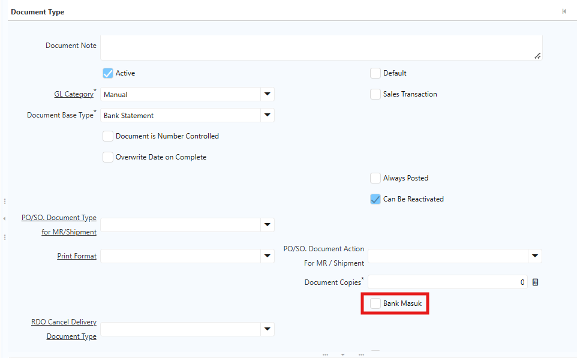 {#Figure317}

6. Klik **Save** untuk menyimpan konfigurasi.

Setelah konfigurasi selesai, sistem akan membedakan nilai **Statement Amount** berdasarkan Document Type yang digunakan:

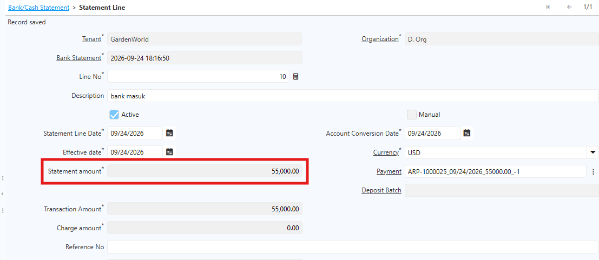 {#Figure318}

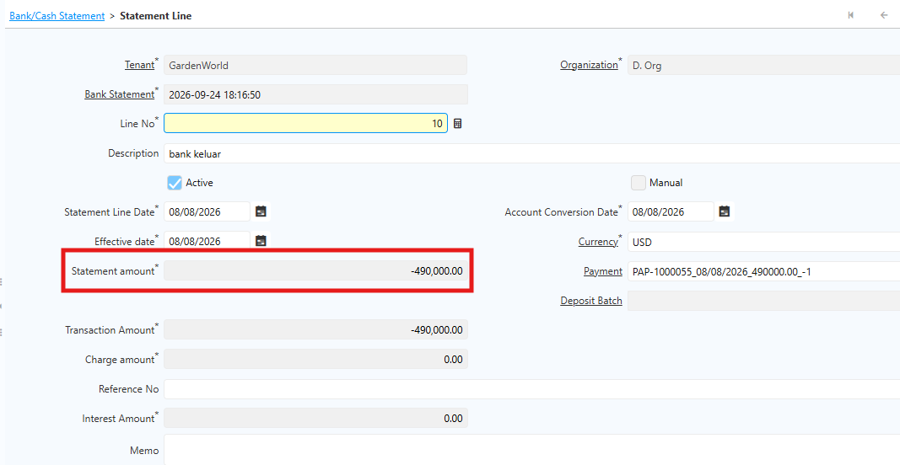 {#Figure319}

## Validasi Currency

Salah satu validasi penting dalam proses rekonsiliasi adalah **currency antara Payment dan Bank/Cash Statement harus sama**. Mekanisme validasinya adalah sebagai berikut:

- Jika Payment menggunakan mata uang **IDR**, maka Bank/Cash Statement juga harus menggunakan **IDR**.
- Jika Payment menggunakan mata uang **USD**, maka Bank/Cash Statement juga harus menggunakan **USD**.
- Sistem hanya menampilkan dan mengizinkan proses _matching_ terhadap Payment yang memiliki currency yang sama dengan Bank/Cash Statement.

## Rate pada Bank/Cash Statament

Untuk Bank/Cash Statement yang telah direkonsiliasi ke Payment tertentu, jurnal yang ter-generate menggunakan **rate yang digunakan di Payment**. Rate pada Payment dapat diambil dari nilai rate atas currency type pada tanggal tersebut, atau dari hasil **overwrite rate**.

Berikut contoh Payment dengan currency USD menggunakan overwrite rate, beserta Bank Statement atas payment tersebut:

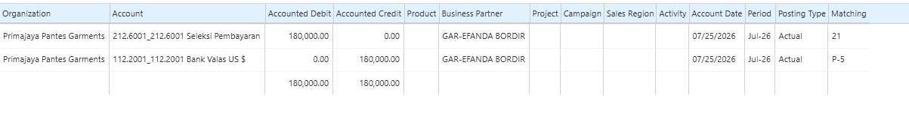 {#Figure171}

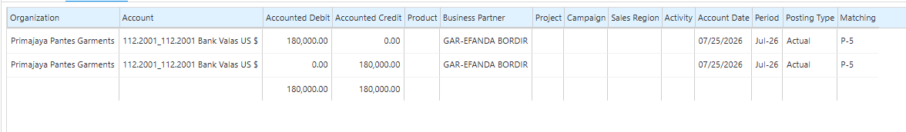 {#Figure172}

## Bank/Cash Statement Manual

Bank Statement Manual adalah transaksi pencatatan mutasi bank yang diinput secara manual oleh user. User mengisi **Statement Amount** sesuai nilai transaksi bank, kemudian menentukan **Charge** yang dikenakan atas transaksi tersebut.

Di iDempiere, Charge digunakan untuk mencatat biaya atau pendapatan tambahan yang berkaitan dengan transaksi bank — misalnya biaya administrasi bank. Charge yang dipilih memengaruhi pencatatan akuntansi sesuai konfigurasi akun pada Charge. Ikuti langkah berikut untuk membuat Bank Statement Manual:

1. Buka menu **Bank/Cash Statement**.
2. Tentukan **Bank Account**.
3. Tentukan **Document Type**.
4. Masuk ke **Statement Line**.
5. Tentukan **Statement Line Date**.
6. Input **Statement Amount**.
7. Tentukan **Charge**.

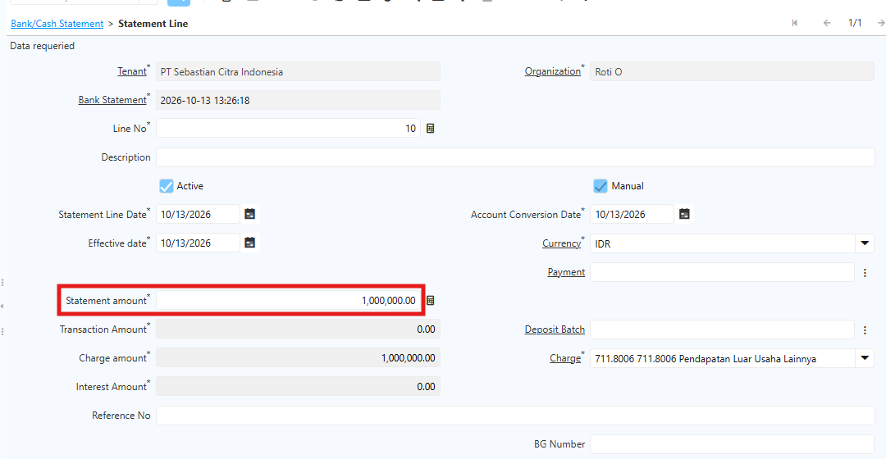 {#Figure349}

8. Klik **Save**.
9. Klik **Complete** pada dokumen.

Saat membuat Statement Line, user cukup menginput **Statement Amount**. Field lain seperti **Transaction Amount**, **Charge Amount**, dan **Interest Amount** tidak perlu diinput secara manual — saat Charge ditentukan, sistem otomatis mengisi **Charge Amount** sesuai Statement Amount yang diinput.
## Revaluasi Bank/Cash Statement Valas

Pada transaksi Bank/Cash Statement yang menggunakan mata uang asing, nilai transaksi dalam mata uang dasar (misalnya IDR) dapat berubah akibat perbedaan kurs antara tanggal transaksi pembayaran dan tanggal penutupan periode. Oleh karena itu, lakukan proses **Revaluasi** di akhir periode akuntansi untuk menyesuaikan nilai saldo rekening bank sesuai kurs penutupan. Revaluasi ini hanya memengaruhi nilai dalam mata uang dasar — nilai dalam mata uang asal (misalnya USD) tetap tidak berubah.
### Konfigurasi Revaluasi Bank/Cash Statement Valas

Sebelum melakukan revaluasi, lakukan konfigurasi akun atas bank valas yang digunakan pada Bank/Cash Statement. Berikut ketentuan konfigurasi yang perlu diperhatikan:

- Pada akun bank valas, pastikan field **Bank Account** sudah **dicentang**. Jika field ini tidak dicentang, proses revaluasi Bank/Cash Valas tidak dapat dijalankan.
- Penamaan akun disesuaikan dengan kebijakan perusahaan.

Berikut contoh konfigurasi akun bank valas:

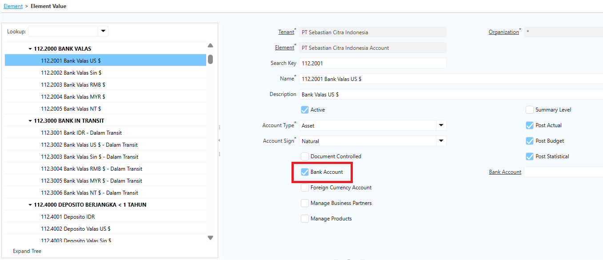 {#Figure197}
### Mekanisme Revaluasi

Contoh: perusahaan melakukan Payment sebesar **USD 5** dengan kurs transaksi **Rp10.000/USD**, sehingga nilai yang tercatat adalah **Rp50.000**. Pada akhir periode, kurs penutupan berubah menjadi **Rp10.100/USD**. Sistem menjalankan **Currency Revaluation** sehingga nilai saldo bank disesuaikan menjadi **Rp50.500**. Selisih sebesar **Rp500** diakui sebagai keuntungan atau kerugian selisih kurs sesuai konfigurasi akun akuntansi.

Ikuti langkah berikut untuk melakukan revaluasi Bank/Cash:

1. Buka menu **SIS Revaluasi Valas Bank/Cash**.
2. Input parameter berikut:
- **Organization**
- **Document Type**
- **Period Revaluation**

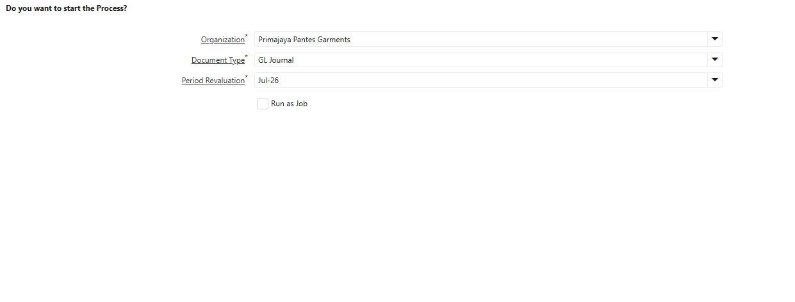 {#Figure175}

3. Klik **Start**.

Proses revaluasi menghasilkan dua jurnal:

- **Jurnal Revaluasi Akhir Bulan** — Menyesuaikan nilai saldo bank berdasarkan kurs penutupan periode sehingga laporan keuangan mencerminkan nilai aset atau kewajiban yang sebenarnya pada tanggal pelaporan.

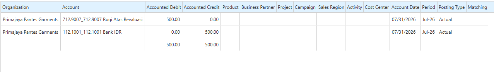 {#Figure176}

- **Jurnal Pembalik Awal Periode Berikutnya (_Reversing Journal_)** — Sistem otomatis membalik jurnal revaluasi pada hari pertama periode berikutnya agar transaksi kembali menggunakan nilai historis dan proses rekonsiliasi Payment dengan Bank/Cash Statement tetap sesuai.

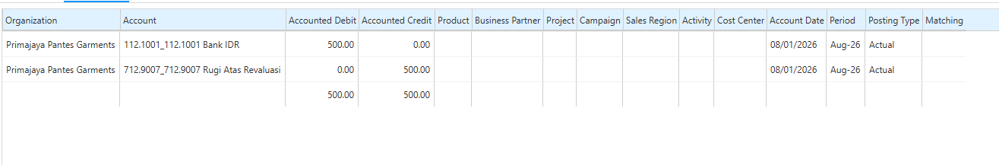 {#Figure177}

Saat dilakukan revaluasi Bank/Cash Statement, field **Description** pada GL Journal Line memuat informasi perhitungan dan **Bank Account** dari revaluasi tersebut, sehingga user dapat mengetahui nilai jurnal berasal dari Bank Account mana. Selain itu, GL Journal Line juga menampilkan informasi **Bank Account** pada field tersendiri sebagai referensi tambahan.

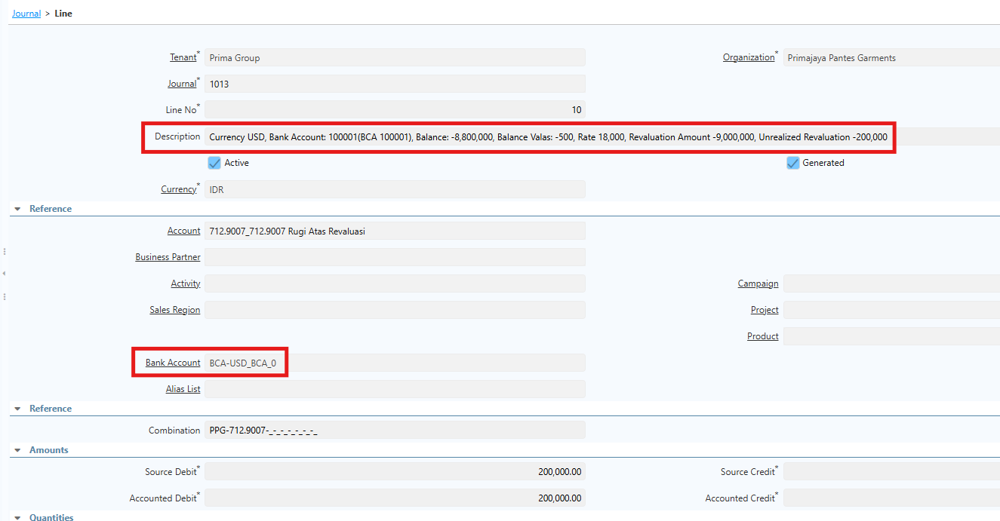 {#Figure352}

Berikut informasi yang tersedia pada field **Description**:

- **Balance** — Saldo dalam mata uang dasar.
- **Balance Valas** — Saldo dalam mata uang asing.
- **Revaluasi Amount** — Nilai penyesuaian hasil revaluasi.
- **Rate** — Kurs yang digunakan pada revaluasi.
- **Unrealized Revaluation** — Nilai keuntungan atau kerugian revaluasi yang belum direalisasi.

## Penentuan Batas Rekonsiliasi

Sistem menyediakan field **Last Reconciliation Date** pada masing-masing akun bank untuk menentukan batas tanggal rekonsiliasi. Konfigurasi ini digunakan untuk membatasi proses void pada Bank Statement berdasarkan tanggal transaksi.

### Konfigurasi Last Reconciliation Date

Berikut langkah untuk menentukan tanggal akhir rekonsiliasi:

1. Buka menu **Bank/Cash**.
2. Pilih akun bank yang akan dikonfigurasi.
3. Masuk ke tab **Account**.
4. Isi field **Last Reconciliation Date** dengan tanggal akhir rekonsiliasi.

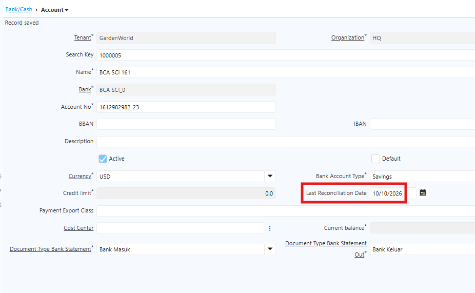 {#Figure357}

5. Klik **Save**.

### Validasi Void Bank Statement

Setelah user mengatur **Last Reconciliation Date**, sistem akan memvalidasi tanggal transaksi saat user melakukan void pada Bank Statement.

Sistem membandingkan **Statement Date** dengan **Last Reconciliation Date**. Jika Statement Date lebih awal daripada Last Reconciliation Date, sistem akan menampilkan pesan error dan menolak proses void.

Dengan demikian, user tidak dapat melakukan void pada Bank Statement yang tanggal transaksinya masih termasuk dalam periode rekonsiliasi yang telah ditentukan.