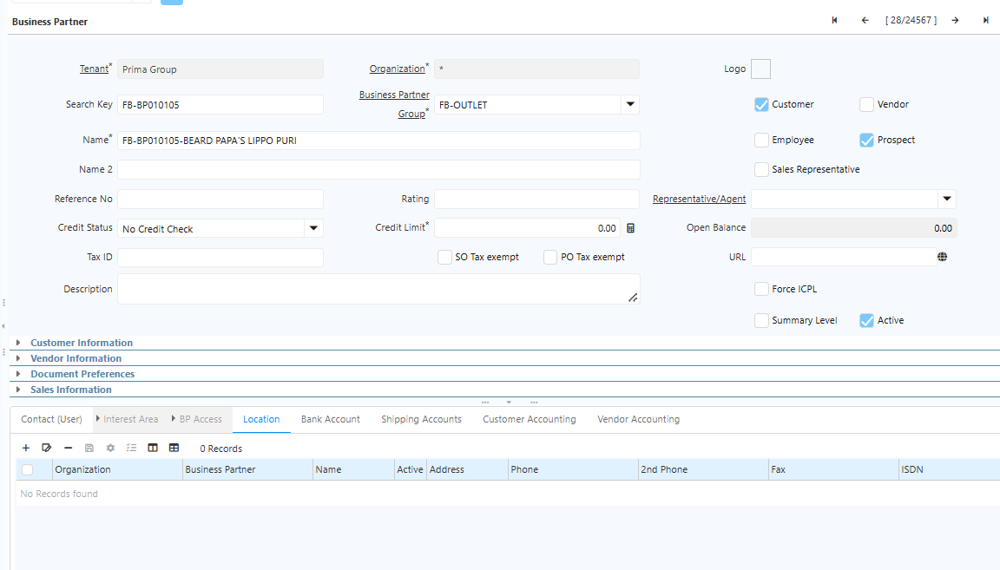
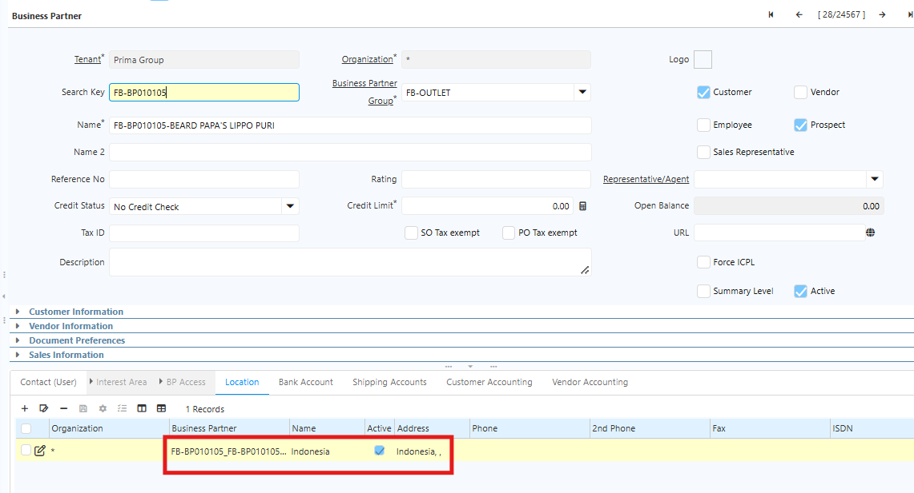

# Business Partner

Sebelum melakukan transaksi, user perlu memastikan data pendukung sudah tersedia, salah satunya **Business Partner**. Business Partner merupakan field mandatory pada transaksi seperti Purchase Order dan Sales Order, sehingga harus ditentukan terlebih dahulu.

## Langkah Membuat Business Partner

1. Buka menu **Business Partner**.
2. Tentukan **Search Key** dan **Name** Business Partner.
3. Tentukan **Organisasi**.
4. Tentukan **Business Partner Group**.
5. Centang field **Vendor** jika Business Partner berperan sebagai vendor.
6. Centang field **Customer** jika Business Partner berperan sebagai customer.
7. Input NPWP pada field **Tax ID** _(jika ada)_.
8. Klik **Save**.

Saat Business Partner disimpan, sistem otomatis membuat data **Contact (User)** dan **Location**. Jika diperlukan perubahan, user dapat mengeditnya pada masing-masing tab.

Selain dibuat secara manual, master data Business Partner juga dapat diproses melalui **import**, mengingat jumlah Business Partner di perusahaan umumnya cukup banyak.

## Location dan Contact pada Business Partner

**Location** dan **Contact (User)** merupakan field mandatory saat transaksi. Jika salah satu belum dikonfigurasi, transaksi tidak dapat diproses. Pada master Business Partner _existing_, Location bisa saja belum dikonfigurasi sehingga transaksi tidak dapat diproses.

### Update Location Business Partner Existing

Untuk Business Partner existing yang belum memiliki Location, user dapat melakukan **update massal** dengan mengatur Location ke standar yaitu **Indonesia**. Ikuti langkah berikut:

1. Buka menu **SIS Generate BP Location**.
2. Klik **OK**.

Sistem otomatis memperbarui Location pada masing-masing Business Partner ke standar Location.

Berikut contoh Location sebelum (_before_) dan sesudah (_after_) update:

 {#Figure416}

 {#Figure417}