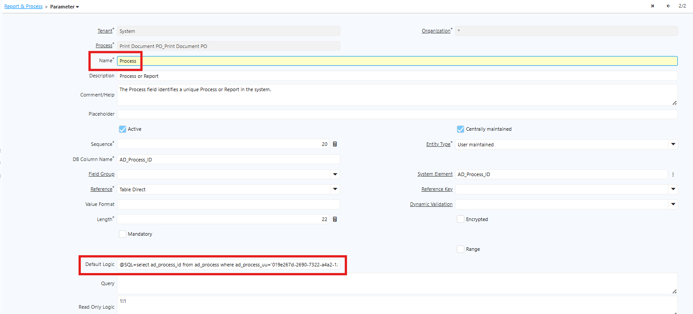
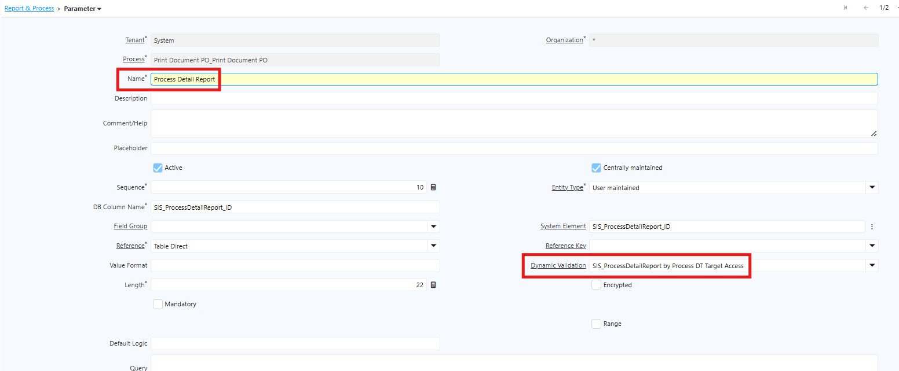
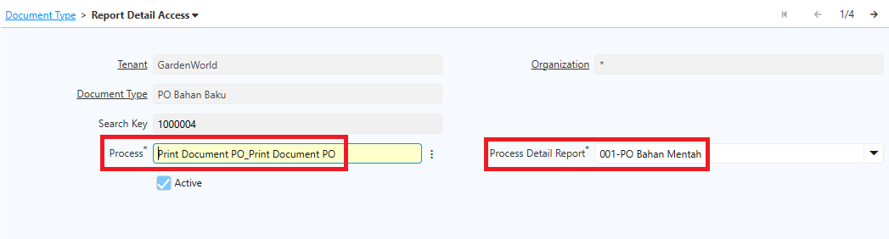
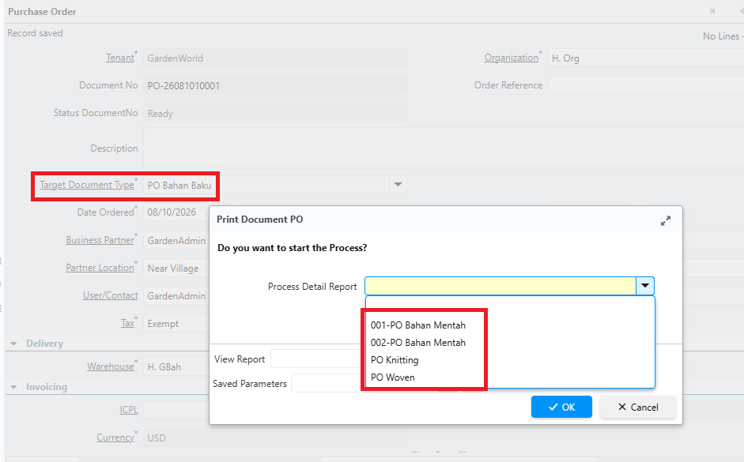

# Format Report

Satu document type dapat memiliki beberapa pilihan sub document type pada dropdown. Contoh: document type Purchase Order dapat memiliki pilihan PO General, PO Bahan Baku, PO Inventaris, PO Barang Kemas, PO Perlengkapan, dan sebagainya. Konfigurasi serupa juga dapat diterapkan pada document type lain, seperti Invoice dengan pilihan _Credit Note_, _Invoice Vendor Lain-lain, dan sebagainya.

Untuk mengatur dropdown tersebut, lakukan konfigurasi pada setiap document type yang membutuhkan.

Konfigurasi ini bertujuan untuk:

- Memisahkan penomoran dokumen.
- Menerapkan Print Format berbeda — setiap document type dapat menggunakan Print Format PDF dengan kolom, layout, atau logo yang berbeda.
- Menerapkan workflow approval berbeda — misalnya, PO Inventaris memerlukan approval lebih tinggi dibanding PO Bahan Baku.
- Memudahkan filter dan pelaporan per kategori pembelian.
## Konfigurasi Document Type

Setiap document type dapat menghasilkan report dengan pilihan yang berbeda. Oleh karena itu, tim IT harus menyiapkan file **Jasper** untuk masing-masing report. Contoh: document type **Purchase Order** dapat memiliki report **PO General** dan **PO Bahan Baku Woven**.

Untuk referensi print Jasper pada dokumen PO, gunakan dua parameter berikut:

- **Process** — Menggunakan default logic berdasarkan **AD_Process_UU**. Contoh logic yang digunakan:  `@SQL=select ad_process_id from ad_process where ad_process_uu='019e267d-2690-7322-a4a2-122489db370d'`

 {#Figure99}

- **Process Detail Report** — Menggunakan Dynamic Validation **SIS_ProcessDetailReport by Process DT Target Access** untuk Target Document Type dan **SIS_ProcessDetailReport by Process DT Access** untuk Document Type.

 {#Figure100}

Pastikan field **Report** masing-masing process pada menu **Report & Process** sudah dicentang agar report tersebut muncul di tenant dan sistem.
## Akses Report Berdasarkan Document Type

Ikuti langkah berikut untuk melakukan konfigurasi report print pada masing-masing document type:

1. Buka menu **Document Type** yang akan dikonfigurasi, contoh: **Purchase Order**.
2. Masuk ke tab **Report Detail Access**.
3. Klik **New**.
4. Pada field **Process**, pilih proses sesuai kebutuhan perusahaan.
5. Pada field **Process Detail Report**, input report sesuai kebutuhan perusahaan.

 {#Figure101}

6. Klik **save**.

 {#Figure102}

Ulangi langkah di atas untuk document type lain yang memerlukan konfigurasi serupa. Setelah konfigurasi selesai, sistem menampilkan pilihan format report saat user melakukan print pada dokumen terkait.

Hanya user yang memiliki akses ke menu dan document type terkait yang dapat mencetak dokumen PO. Contoh: jika Target Document Type yang dipilih adalah **PO Bahan Baku**, maka report yang muncul hanya report yang telah dikonfigurasi pada document type tersebut — misalnya PO Bahan Mentah, PO Woven, dan PO Knitting.

Pembatasan akses report berdasarkan document type ini bertujuan untuk:

- Memastikan setiap user hanya dapat mengakses report sesuai haknya.
- Menghindari kesalahan pemilihan report — misalnya, memproses PO Bahan Baku namun mencetak printout PO ATK yang tidak sesuai.

### Listing Proses Report Setiap Menu

Setiap window atau menu memiliki Process Report yang berbeda sesuai dengan jenis transaksi dan kebutuhan dokumennya. Sebagai contoh, Purchase Order dan Material Receipt memiliki format print out yang berbeda.

Berikut adalah daftar nama Process Detail Report yang digunakan pada masing-masing window atau menu:

| Nama Process Report                 | Nama Window                            |
| ----------------------------------- | -------------------------------------- |
| Print Document PO                   | Purchase Order                         |
| Print Material Receipt BPB          | Material Receipt                       |
| Print Invoice                       | Purchase Invoice and Credit/Debit Note |
| Print Document Payment              | Payment and Receipt                    |
| SIS Print Bank Statement            | Bank/Cash Statement                    |
| SIS Print Kontra Bon                | SIS Kontra Bon                         |
| SIS Printout Invoice Mirror         | SIS Invoice Mirror                     |
| SIS Printout Invoice Mirror Thermal | SIS Invoice Mirror                     |
| Print Document Movement             | Inventory Move                         |
| Print Nota Retur Transfer           | Inventory Move                         |
| SIS Print Document SO               | Sales Order                            |
| Print Document Internal Use         | Inventory Decrease/Increase            |
| SIS Print Document Phyisical Inv    | Physical Inventory                     |
| SIS Print Document POP              | Production Order Planning              |
| Generate Listing Document POP       | Production Order Planning              |
| Export View Routing di POP Line     | Production Order Planning              |
| SIS Print Document Requisition      | Requisition                            |
| SIS Printout PO Project             | Project                                |
| SIS Print Document Expedition       | SIS Expedition                         |
| SIS Print Document RDO              | SIS RDO                                |
| SIS Print Document RMA              | Vendor RMA                             |
| SIS Print Document Return Vendor    | Return to Vendor                       |

