# Import Data

Import Data adalah proses memasukkan data dari sumber eksternal seperti file CSV atau Excel ke dalam sistem iDempiere. Tujuan utama import data meliputi:
- Migrasi data — memindahkan data dari sistem lama ke iDempiere
- Input massal — memasukkan ratusan/ribuan record sekaligus tanpa input manual satu per satu
- Efisiensi — menghemat waktu dibandingkan proses entry manual

## FileZilla

FileZilla adalah aplikasi transfer file open source yang digunakan untuk memindahkan file antara komputer lokal dan server melalui jaringan internet atau jaringan lokal. Dalam konteks iDempiere, FileZilla digunakan untuk mengupload file Excel atau CSV dari PC ke folder di server iDempiere.

### Langkah Instalasi & Koneksi FileZilla:

**Langkah 1: Install FileZilla**

1. Download dari [https://filezilla-project.org/](https://filezilla-project.org/)
2. Install Filezilla dan buka aplikasi

**Langkah 2: Menghubungkan ke server FTP**

1. Klik menu Manajemen Situs
2. Klik New Site dan beri nama contoh “Prima-Dev”
3. Input konfigurasi koneksi sebagai berikut:
  - Protocol : SFTP – SSH File Transfer Protocol
  - Host : 76.13.18.16
  - Port : (sesuai kebijakan)
  - Logon : Normal
  - User : (sesuai kebijakan)
  - Password : (sesuai kebijakan)

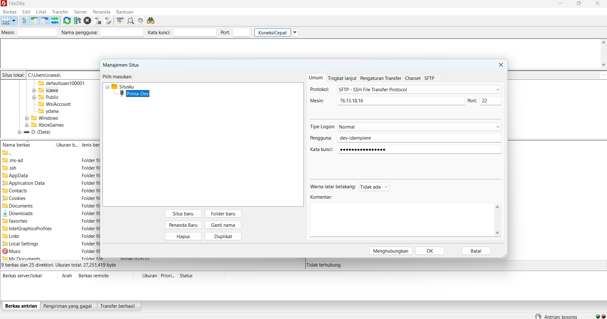 {#Figure81}

4. Klik Connect untuk menghubungkan ke server.

## Mekanisme Import Data MT940

MT940 adalah format standar SWIFT (Society for Worldwide Interbank Financial Telecommunication) untuk rekening koran elektronik (_electronic bank statement_). File MT940 memuat informasi transaksi perbankan — mencakup saldo awal, daftar debit/kredit, dan saldo akhir — yang dikirimkan bank kepada nasabah korporat. Di iDempiere, MT940 digunakan dalam modul **Bank Statement**.

Format MT940 umumnya menggunakan encoding **UTF-8**. Namun, sistem iDempiere saat ini juga mendukung format MT940 dengan encoding **ISO-8859-1**. Berikut contoh format file yang digunakan untuk import data Bank Statement.

    
   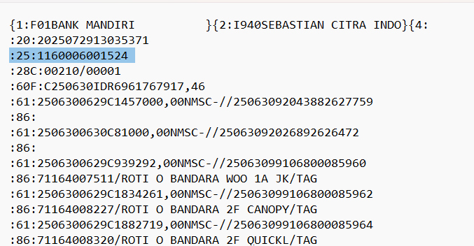 {#Figure91}

Fitur Import MT940 digunakan untuk memasukkan data rekening koran elektronik dari bank ke iDempiere, kemudian mencocokkannya dengan dokumen Payment yang sudah dibuat sebelumnya. Hasil pencocokan akan membentuk Bank Statement dan merekonsiliasi Payment secara otomatis, sehingga user tidak perlu melakukan rekonsiliasi satu per satu.

> **Penting:** MT940 hanya berlaku untuk **bank keluar** yang berasal dari Payment. Fitur ini tidak digunakan untuk bank masuk.

### Konfigurasi Sebelum Import MT940

Sebelum melakukan import MT940, pastikan kondisi berikut sudah terpenuhi:

1. **Dokumen Payment sudah tersedia.** MT940 merepresentasikan transaksi bank keluar yang berasal dari Payment. Informasi Payment atas setiap transaksi pada file MT940 harus sudah ada di sistem sebelum file diimport. Jika Payment belum dibuat, sistem tidak dapat melakukan pencocokan.
2. **BG Number terisi pada Payment.** Proses pencocokan dilakukan berdasarkan **BG Number**, sehingga nomor BG pada Payment harus sesuai dengan nomor BG yang tercantum di file MT940.
3. **Document Type Payment dikonfigurasi tanpa Auto Bank Statement.** Pada Document Type Payment yang digunakan untuk transaksi MT940, field **Auto Bank Statement** tidak boleh dicentang. Hal ini bertujuan agar Bank Statement tidak terbentuk ganda — Bank Statement akan dibuat oleh proses **Generate Bank Statement from MT940**, bukan saat Payment di-complete.

## Langkah Import MT940

Langkah Import File MT940:
1. Siapkan file MT940 dari bank. File MT940 menggunakan format **TXT**.
2. Konfigurasi Bank Account di iDempiere:
  - Masuk ke Bank/Cash → Account → Account No

  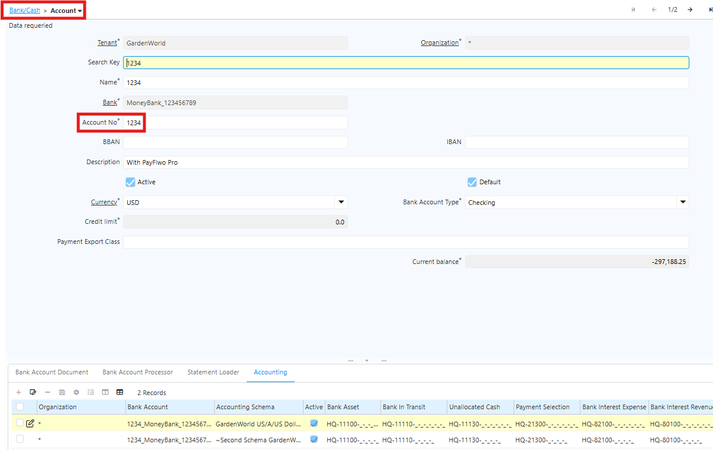 {#Figure82}

  - Pastikan nomor rekening **cocok** dengan field :**25**: di file MT940
  - Set Currency sesuai (IDR untuk rupiah)

3. Import melalui FileZilla
  - Navigasi ke /home/dev-idempiere/MT940 → Import Bank Statement
  - Pilih file MT940 yang akan diimport

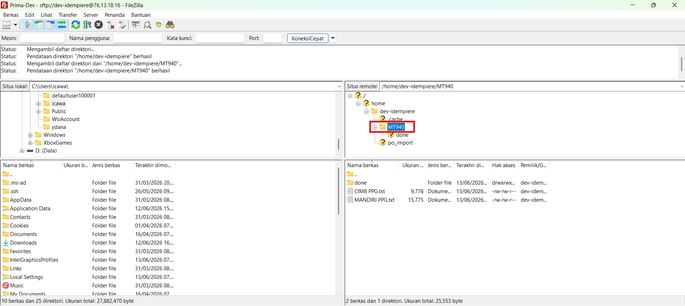 {#Figure83}

4. Jika import berhasil, file otomatis berpindah ke folder **done**

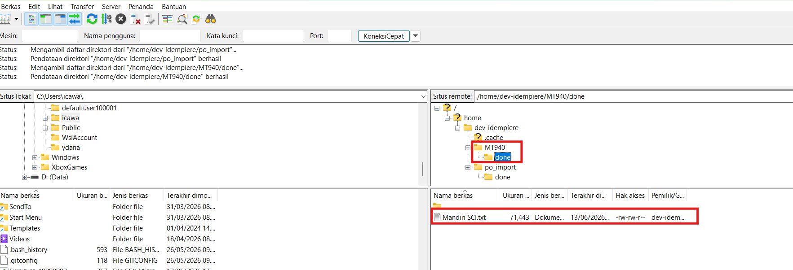 {#Figure87}

5. Jika import berhasil, data hasil import otomatis ter-generate dan dapat dilihat pada menu **SIS MT940**.

Pada tahap ini data MT940 sudah masuk ke sistem, namun belum dicocokkan dengan Payment dan belum membentuk Bank Statement.

### Proses Generate Bank Statement from MT940

Setelah data MT940 tampil di menu **SIS MT940**, jalankan proses pencocokan dengan langkah berikut:

1. Buka menu **SIS MT940**.
2. Pilih data MT940 yang akan diproses.
3. Jalankan proses **Generate Bank Statement from MT940**.
4. Klik **OK**.

Saat proses dijalankan, sistem melakukan hal berikut:

1. **Matching Payment dengan BG Number.** Sistem membandingkan BG Number pada data MT940 dengan BG Number pada dokumen Payment.
2. **Pembentukan Bank Statement.** Untuk data yang matched, sistem membuat Bank Statement berdasarkan Payment tersebut.
3. **Update data MT940.** Data pada SIS MT940 diperbarui dengan informasi Payment yang matched.
4. **Rekonsiliasi otomatis.** Payment dan data MT940 yang matched otomatis ter-rekonsiliasi. Field **Reconciled** pada Payment tercentang secara otomatis.

### Clean Up Data MT940

File MT940 memuat seluruh transaksi bank, dan satu file bisa berisi ratusan hingga ribuan transaksi. Tidak semua transaksi tersebut diproses di sistem. Agar data tidak menumpuk, user dapat menghapus data MT940 yang tidak diperlukan melalui proses **Clean Up Data MT940**.

Ketentuan penghapusan:

- Data yang dapat dihapus hanya data yang **belum ter-rekonsiliasi**.
- Data yang **sudah ter-rekonsiliasi** tidak dapat dihapus.
- Penghapusan didasarkan pada selisih hari antara **Document Date** MT940 dan batas hari yang dikonfigurasi di sistem.

### Konfigurasi System Configurator

Sebelum melakukan penghapusan, tentukan batas usia data yang akan dihapus:

1. Buka menu **System Configurator**.
2. Klik **New**.
3. Isi field **Name** dengan **SIS_CLEAN_UP_MT940_DAYS**.
4. Isi field **Configured Value** dengan jumlah hari sesuai kebijakan perusahaan.
5. Pilih **Configuration Level** = **Client**.

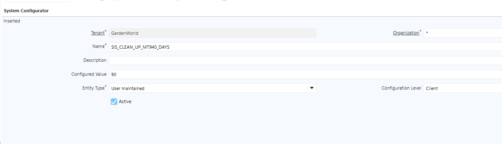 {#Figure410}

6. Klik **Save**.

Nilai default di sistem adalah **90 hari**. Jika dikonfigurasi dengan nilai yang lebih kecil, misalnya **60 hari**, maka proses clean up dilakukan untuk data dengan Document Date yang berumur 60 hari atau lebih.

### Konfigurasi Proses di Level System

Selain System Configurator, proses clean up perlu dikonfigurasi di level system:

1. Login sebagai **System Administrator**.
2. Buka menu **Report & Process**.
3. Klik **New**.
4. Input **Search Key** dan **Name** dengan **SIS Clean MT940**.
5. Pada field **Data Access Level**, pilih **Client+Organization**.
6. Pada field **Allow Concurrent Execution**, pilih **Not from same user and parameters**.
7. Pada field **Classname**, input nama class dengan **id.sistematika.base.process.SIS_CleanMT940**.

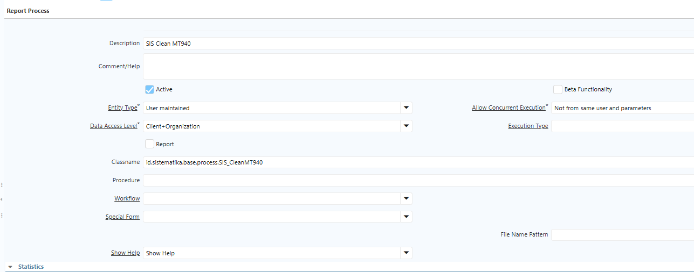 {#Figure411}

8. Klik **Save**.

### Menjalankan Proses Clean Up Data MT940

1. Buka menu **SIS Clean MT940**.
2. Klik **OK**.

Sistem menghapus data MT940 yang memenuhi dua kriteria: **Document Date** sesuai batas hari yang dikonfigurasi, dan data tersebut **belum ter-rekonsiliasi**.
## Import Data PO Kecil

Sebelum melakukan import, pastikan nama file sesuai format yang ditentukan, yaitu: organisasi, tahun bulan transaksi, username. Berikut contoh format file yang digunakan untuk import data PO Kecil.

   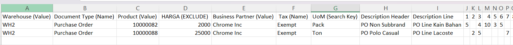 {#Figure90}

**Ketentuan data yang diinput di file:**

- **Warehouse** — Warehouse tujuan, diisi dengan _Value (Search Key)_ warehouse.
- **Document Type** — Diisi dengan _Name_ document type.
- **Product** — Diisi dengan _Value (Search Key)_ product.
- **Harga** — Diisi dengan _Price Actual_. Jika menggunakan UoM Conversion, Price Actual dinyatakan dalam satuan konversi.
- **Business Partner** — Diisi dengan _Value (Search Key)_ Business Partner.
- **Tax** — Diisi dengan _Name_ tax.
- **UoM** — Diisi dengan _UoM Code_.
- **Description Header** — Diisi dengan description yang akan masuk ke field Description pada header PO.
- **Description Line** — Diisi dengan description yang akan masuk ke field Description pada PO Line.

Perlakuan Description berbeda untuk setiap jenis import PO Kecil:

- **PO Kecil Reguler (per tanggal transaksi)** — Description mengikuti isi yang dikonfigurasi di file template yang diimport.
- **PO Kecil Special Mechanism (generate per minggu)** — Description diinformasikan pada PO Line dan memuat rincian tanggal serta quantity transaksi per tanggal dalam satu minggu tersebut.

UoM yang digunakan adalah **UoM Conversion** di level product yang memiliki flag **Purchasing**. Oleh karena itu, sebelum melakukan import, pastikan UoM Conversion sudah dicentang flag **Purchasing**. Jika UoM yang digunakan tidak memiliki flag tersebut, proses import tidak dapat dijalankan.

Selain itu, lakukan konfigurasi **Price List** dan **Payment Term** yang akan digunakan sebagai acuan. Konfigurasi ini dilakukan di level **server**. Berikut contoh setup Price List dan Payment Term di server.

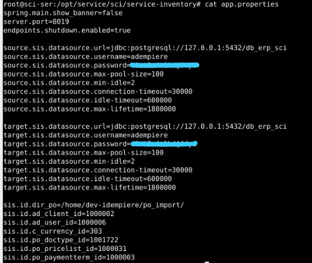 {#Figure346}

Sistem menentukan Price List dan Payment Term dengan ketentuan berikut:

- Jika **Business Partner belum memiliki** konfigurasi Price List dan Payment Term, sistem menggunakan Price List dan Payment Term yang dikonfigurasi di server.
- Jika **Business Partner sudah memiliki** konfigurasi Price List dan Payment Term, sistem mengambil data dari master Business Partner tersebut.

### Langkah Import File PO Kecil di FileZilla

1. Siapkan file PO Kecil dalam format csv
2. Import melalui FileZilla
  - Navigasi ke /home/dev-idempiere/po_import → Import PO Kecil
  - Pilih file PO Kecil yang akan diimport

4. Jika import berhasil, file otomatis berpindah ke folder **done**

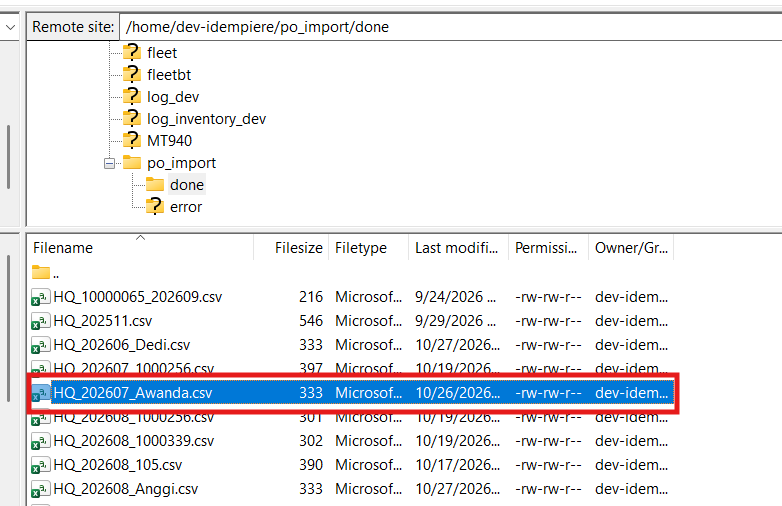 {#Figure89}

5. Sistem iDempiere akan membuat dokumen PO dengan status Draft atau In Progress, yang selanjutnya dapat di-confirm sesuai kebutuhan operasional.

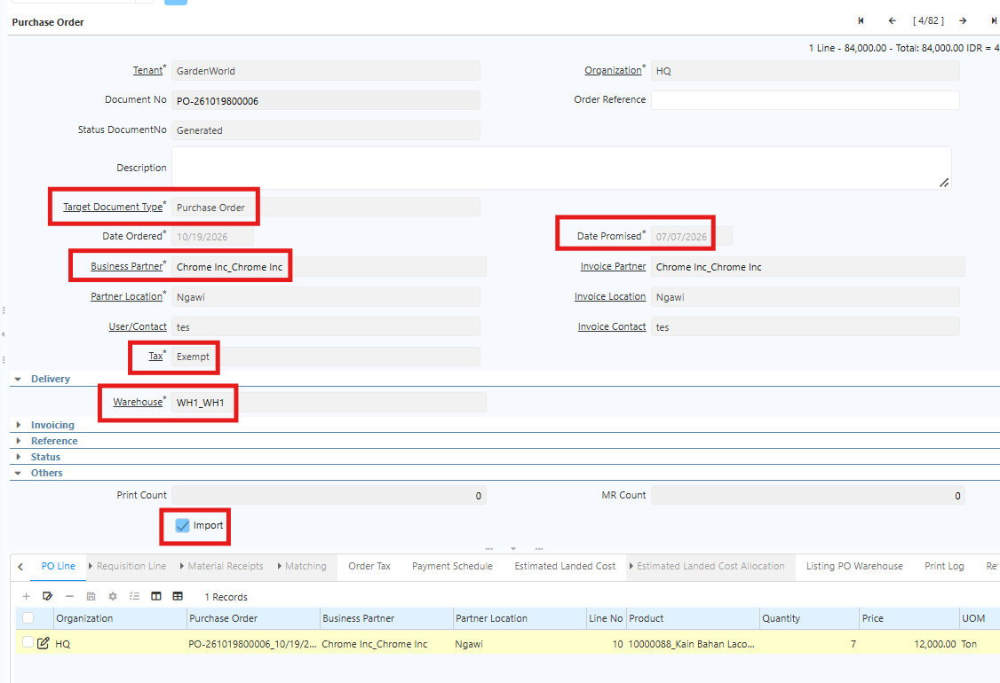 {#Figure90}

Data pada PO hasil import mengikuti data yang ada di file — mulai dari Document Type hingga Price List.

**Flag Import**

Purchase Order hasil import memiliki perbedaan pada field **Import**:

- **PO yang dibuat langsung di iDempiere** — Flag Import tidak tercentang.
- **PO hasil import** — Flag Import tercentang otomatis. User tidak dapat mencentang flag ini secara manual.

**Date Ordered dan Date Promised**

- **Date Promised** — Diambil dari tanggal yang tercantum di file template.
- **Date Ordered** — Diset sesuai tanggal user melakukan import.

Karena kedua tanggal bersumber berbeda, **Date Ordered** dan **Date Promised** dapat memiliki nilai yang berbeda.

**Identitas User Import**

Nama file import memuat **Username** sebagai identitas user yang melakukan import. Dengan demikian, setiap PO yang ter-create dapat ditelusuri siapa yang mengimportnya.

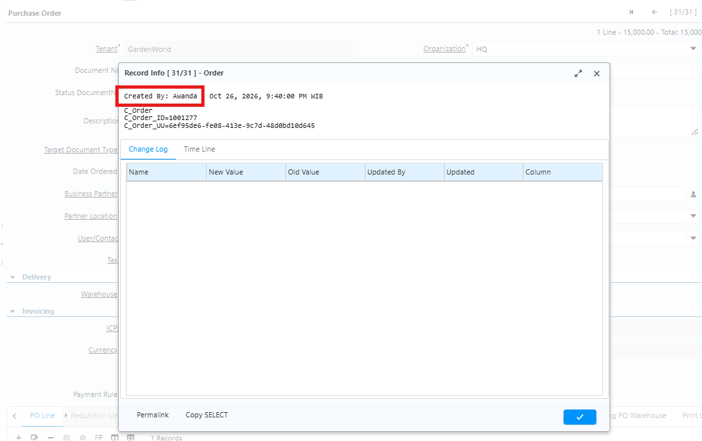 {#Figure376}
### Gagal Import PO Kecil karena Template Tidak Sesuai

Jika file PO Kecil yang diimport tidak sesuai format, sistem tidak akan memproses file tersebut ke iDempiere. Contoh ketidaksesuaian format yang umum terjadi antara lain penggunaan delimiter **;** atau penggunaan **Product ID** pada nama file yang seharusnya menggunakan **Product Value**.

Saat import gagal, file tidak berpindah ke folder **done**. Sistem otomatis membuat folder **error** pada direktori PO Import, yang berisi file txt dengan informasi detail penyebab kegagalan import.

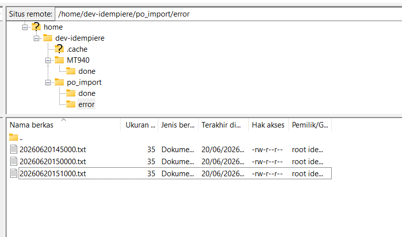 {#Figure91}

Jika file pertama belum diperbaiki dan file kedua yang diimport juga tidak sesuai format, sistem menampilkan pesan error yang sama. File akan tetap berada di folder PO Import dan tidak akan berpindah hingga kesalahan pada file diperbaiki.

## Report PO Kecil

Report PO Kecil digunakan untuk menampilkan informasi Purchase Order dengan format PO Kecil sesuai kebutuhan operasional. Report ini mengambil data dari transaksi Purchase Order beserta informasi pendukung yang telah dikonfigurasi. Report PO Kecil memuat informasi **Regional** dan **Area** yang digunakan untuk mengelompokkan PO berdasarkan lokasi atau wilayah outlet/warehouse tujuan.

### Mekanisme Konfigurasi Regional dan Area

Informasi Regional dan Area pada Report PO Kecil mengikuti konfigurasi **SIS Regional** dan **Sales Region**. SIS Regional menentukan struktur wilayah yang digunakan perusahaan, sedangkan Sales Region berfungsi sebagai pengelompokan wilayah yang ditampilkan pada report.

#### Konfigurasi Regional

1. Buka menu **SIS Regional**.
2. Tentukan Regional yang digunakan, misalnya:
- Jakarta
- Jawa Barat

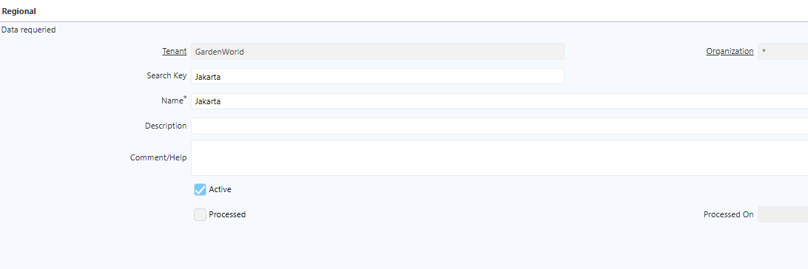 {#Figure255}

3. Masuk ke tab **Sales Region**.
4. Tentukan **Search Key** dan **Name** dari region, contoh: Jakarta Pusat, Jakarta Utara, dan sebagainya.

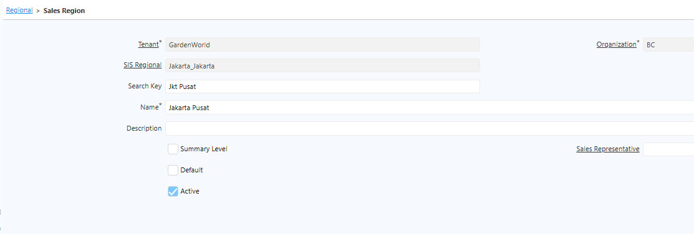 {#Figure256}

5. Klik **Save**.

#### Konfigurasi Sales Region pada Warehouse

1. Buka menu **Warehouse and Locators**.
2. Tentukan warehouse yang akan dikonfigurasi.
3. Pada field **Sales Region**, tentukan Sales Region untuk masing-masing Warehouse/Outlet.

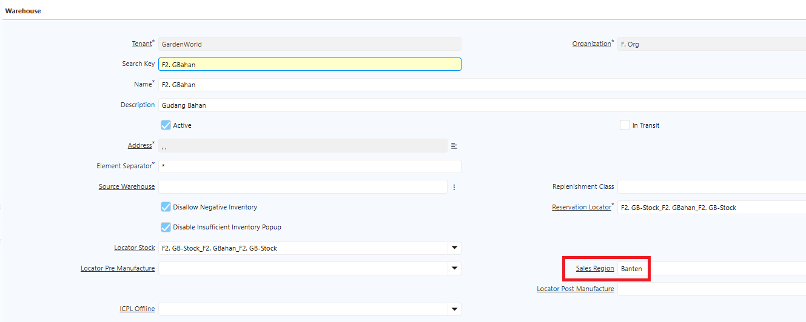 {#Figure257}

4. Klik **Save**.

Setiap Warehouse/Outlet akan terhubung dengan Regional melalui Sales Region yang telah dikonfigurasi. Saat PO Kecil dibuat dengan Warehouse/Outlet tujuan tertentu, sistem mengambil Sales Region dari master Warehouse tersebut untuk menentukan **Regional** dan **Area** yang ditampilkan pada Report PO Kecil.
### Langkah Proses Report PO Kecil

1. Buka menu **Print Report PO Kecil**.
2. Tentukan **periode** yang akan diproses.
3. Klik **OK**.

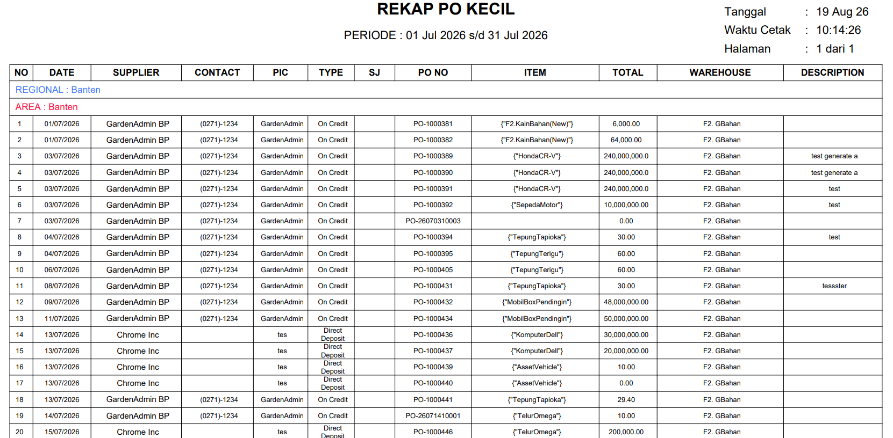 {#Figure258}

## Import PO Kecil Ice Cube (Special Mechanism)

PO Kecil memiliki dua jenis mekanisme:

- **PO per tanggal transaksi** — PO hasil import dibuat per tanggal transaksi.
- **PO per minggu (Special Mechanism)** — PO hasil import dibuat per minggu, sehingga dalam satu bulan hanya terbentuk **5 PO**. **Date Promised** masing-masing PO adalah tanggal awal minggu tersebut, dan quantity dikalkulasi secara akumulatif selama satu minggu. Rincian tanggal dan quantity per hari ditampilkan pada **Description** PO Line, sehingga user tetap dapat mengetahui quantity transaksi per tanggal.
### Konfigurasi Product

Sebelum melakukan transaksi, konfigurasi product untuk Special Mechanism:

1. Buka menu **Product**.
2. Tentukan **product** yang akan dikonfigurasi.
3. Centang field **PO Kecil Special Mechanism**.

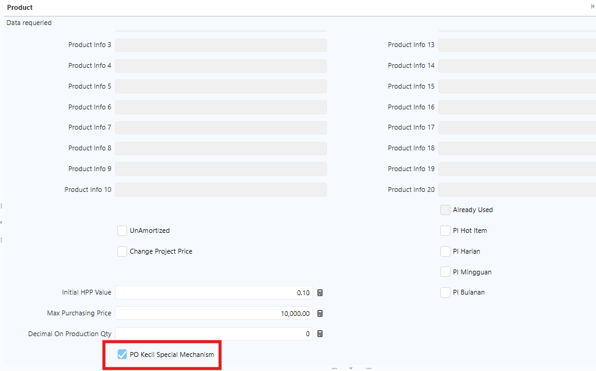 {#Figure377}

4. Klik **Save**.

### Proses Import

Setelah product dikonfigurasi, tentukan quantity dan tanggal transaksi pada file template seperti mekanisme sebelumnya, kemudian lakukan import melalui FileZilla. Setelah import berhasil, sistem otomatis men-generate 5 PO per bulan.

Berikut contoh hasil import PO per minggu:

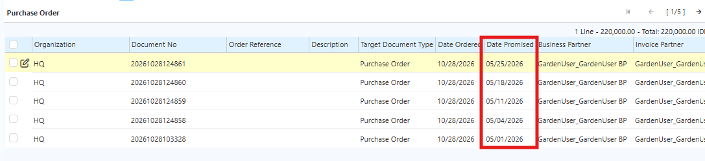 {#Figure378}

Berikut contoh PO Line pada PO minggu pertama. **Quantity PO** merupakan akumulasi quantity selama satu minggu, sedangkan **Description** memuat rincian tanggal dan quantity transaksi per tanggal:

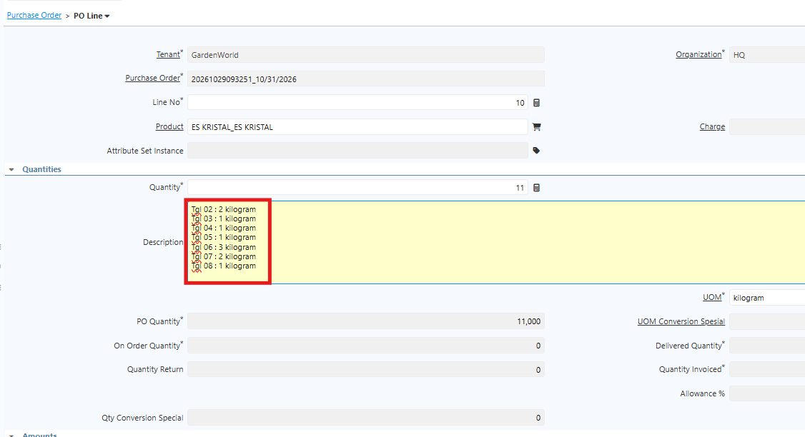 {#Figure379}

## Import Data dan Transaksi

Mekanisme import digunakan untuk memasukkan data dari file eksternal (CSV) ke dalam sistem tanpa input manual satu per satu melalui masing-masing menu. Proses import menggunakan fitur **Import Loader**, yaitu penampungan data sementara sebelum data diproses ke tabel transaksi atau master data yang sebenarnya.

Mekanisme ini digunakan untuk dua kebutuhan utama:

1. **Import Master Data** — Memasukkan data master seperti Product, Business Partner, Warehouse, Price List, dan sebagainya.
2. **Import Transaction** — Memasukkan data transaksi seperti Purchase Order (PO), Sales Order (SO), Inventory Move, dan sebagainya.

### Mengakses File Template

1. Klik ikon **titik tiga** di sisi paling kanan pada menu terkait, lalu pilih **Export**.
2. Centang **Export Current Row Only** dan **PO Line** (contoh).
3. Klik **OK**.

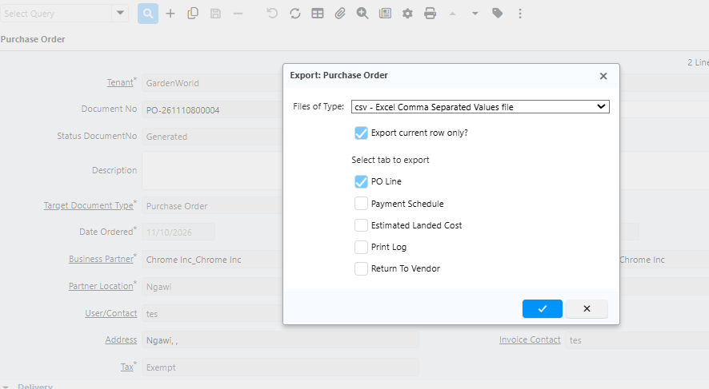 {#Figure403}

4. Kemudian unduh template.
5. Setelah template terunduh, pastikan format tanggal pada file CSV adalah **YYYY-MM-DD**.

### Pengaturan Kolom Template

1. Ubah transaksi atau master data ke mode **Grid Toggle**.
2. Klik ikon **titik tiga** di sisi paling kanan pada menu, lalu pilih **Customize**.

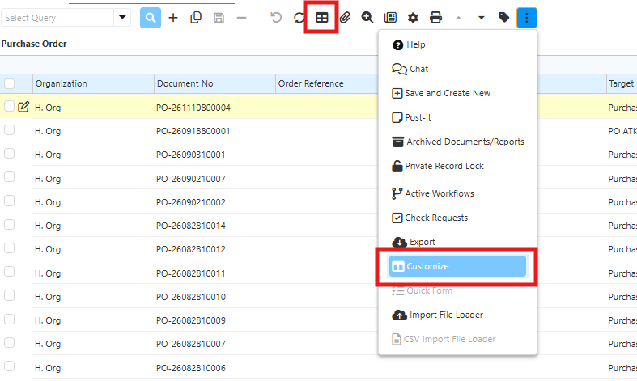 {#Figure404}

3. Atur kolom yang akan ditampilkan pada template di sisi kanan.

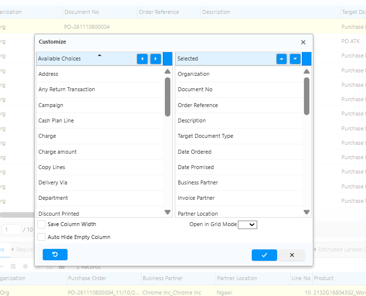 {#Figure405}

4. Klik **OK**.

### Mode Import

- **Merge** — Jika data sudah ada, data diperbarui (_update_); jika belum ada, data ditambahkan (_insert_).
- **Insert** — Digunakan untuk menambahkan data baru.
- **Update** — Digunakan untuk memperbarui data yang sudah ada.

### Langkah Import Data

1. Klik ikon **titik tiga**, lalu pilih **Import File Loader**.
2. Pilih **Import Mode** yang sesuai.
3. Tentukan **file template** yang akan diupload.
4. Klik **OK**.

Data atau transaksi akan masuk ke sistem setelah proses selesai. Saat melakukan **Update** atau **Merge** data pada beberapa field, tambahkan penanda **Primary Key (/K)** pada kolom yang menjadi acuan di file template. Penanda ini menentukan data mana yang akan diperbarui, baik pada level **header** maupun **line**.

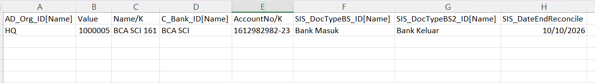 {#Figure406}

> **Catatan:** Pada import transaksi Purchase Order, jika satu PO memiliki beberapa line dan salah satu line mengalami error, seluruh PO tersebut tidak akan masuk ke sistem.