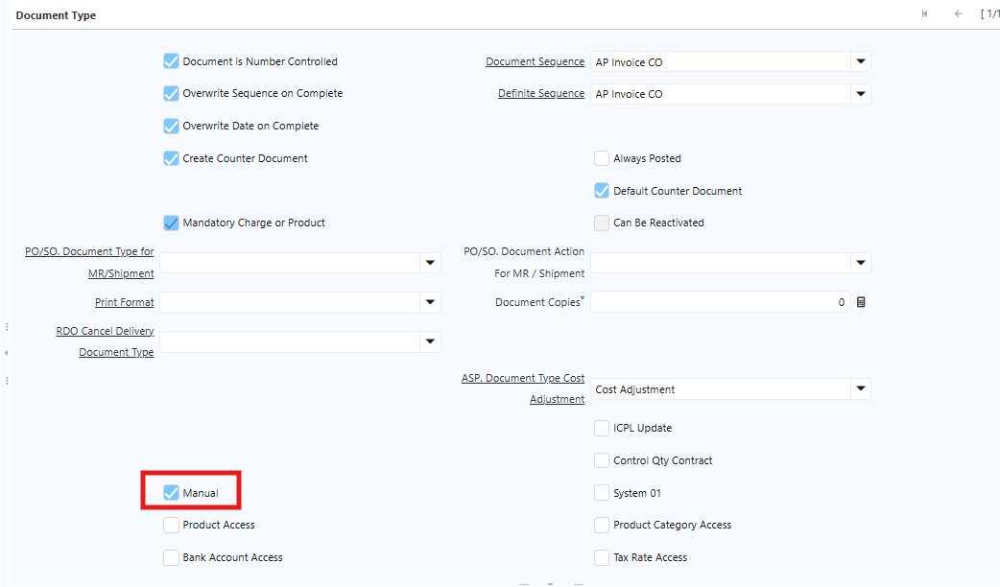
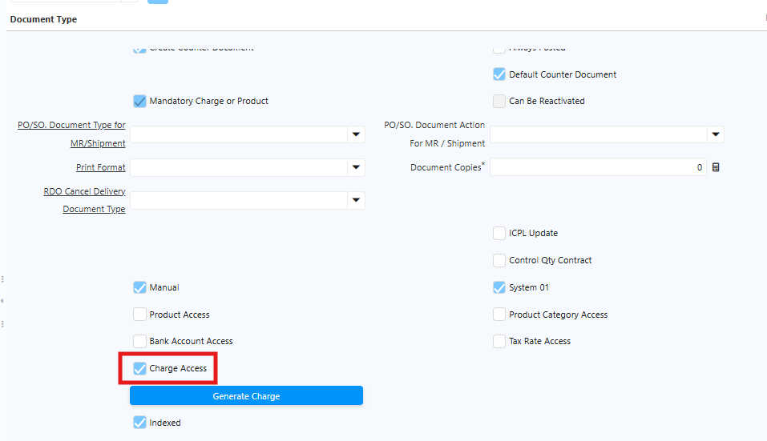
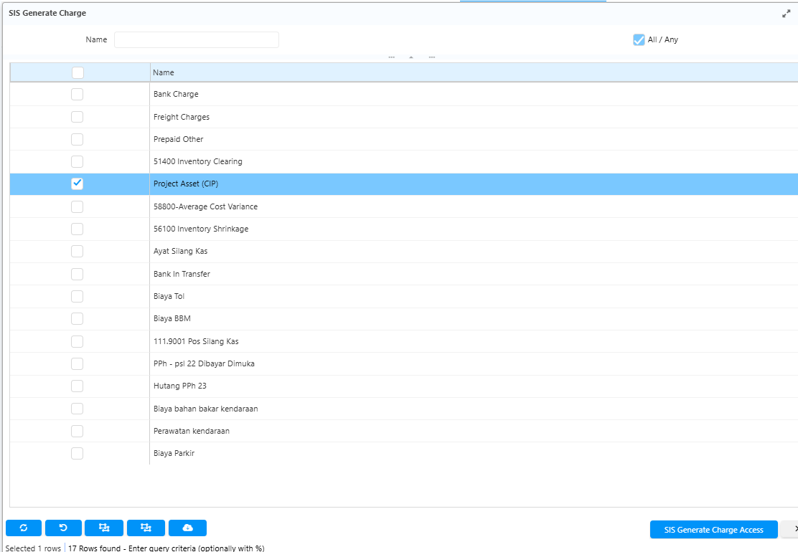
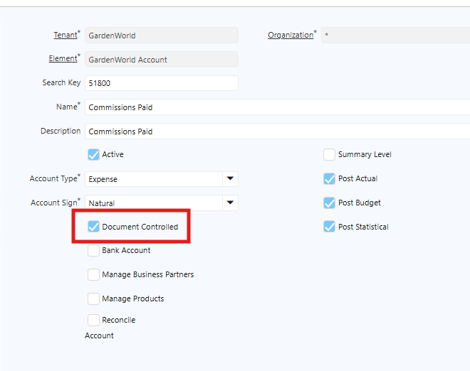
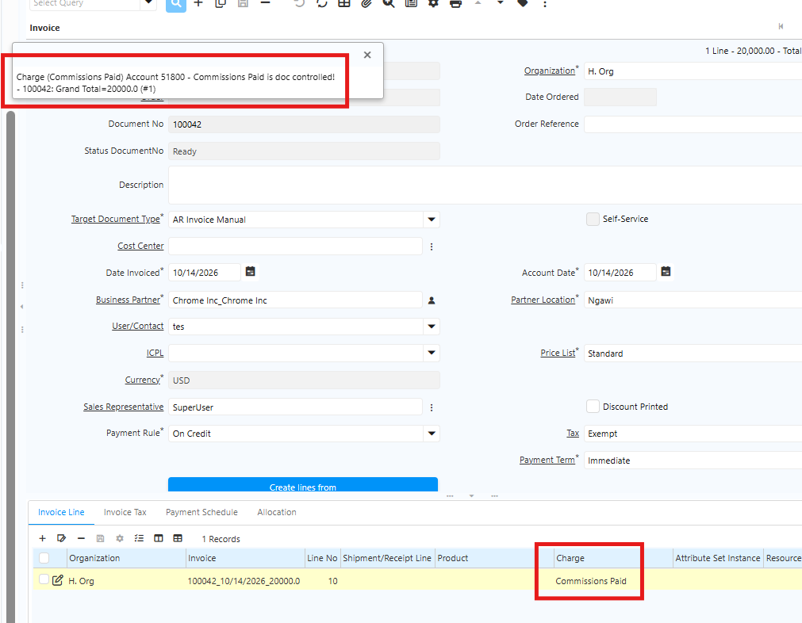

# Konfigurasi Charge

## Konfigurasi Document Type AP & AR Invoice Manual

Saat membuat AP dan AR Manual, user harus menggunakan **Document Type** khusus untuk transaksi manual. Pada Document Type AP dan AR Invoice, terdapat field **Manual** dengan ketentuan berikut:

- **Dicentang** — Transaksi dengan document type tersebut dapat dilakukan secara manual.
- **Tidak dicentang** — Transaksi dengan document type tersebut tidak diperbolehkan dilakukan secara manual.

Untuk mencegah human error akibat user lupa menginput Charge — yang dapat menyebabkan jurnal AP dan AR tidak sesuai — saat field **Manual** dicentang, field **Mandatory Charge or Product** otomatis tercentang. Dengan demikian, Invoice Line tidak dapat disimpan jika Charge belum diinput.

Ikuti langkah berikut untuk mengkonfigurasi Document Type AP dan AR Invoice Manual:

1. Buka menu **Document Type**.
2. Klik **New**.
3. Tentukan **Name** document type.
4. Pada field **Document Base Type**, pilih:
- **AP Invoice** untuk transaksi AP Invoice.
- **AR Invoice** untuk transaksi AR Invoice.
5. Centang field **Manual**.

 {#Figure352}

6. Field **Mandatory Charge or Product** otomatis tercentang.
7. Klik **Save**.

## Konfigurasi Charge Access

Charge yang tersedia di sistem bisa mencapai puluhan, namun tidak semua digunakan dalam satu transaksi. Contoh: untuk AP Invoice digunakan charge **biaya**, sedangkan untuk AR Invoice digunakan charge **pendapatan**. Untuk mengelompokkan charge per transaksi, lakukan konfigurasi **Charge Access** di Document Type.

Ikuti langkah berikut untuk mengkonfigurasi Charge Access di Document Type AP Invoice, AR Invoice, Bank Statement, dan GL Journal:

1. Buka menu **Document Type**.
2. Klik **New**.
3. Tentukan **Name** document type.
4. Pada field **Document Base Type**, pilih:
- **AP Invoice** untuk transaksi AP Invoice.
- **AR Invoice** untuk transaksi AR Invoice.
- **Bank Statement** untuk transaksi Bank Statement.
- **GL Journal** untuk transaksi GL Journal Manual.
5. Centang field **Charge Access**.

 {#Figure353}

6. Klik **Generate Charge**.

 {#Figure354}

7. Tentukan charge yang akan dikonfigurasi.
8. Klik **SIS Generate Charge Access**.
9. Klik **Save**.

Setelah Charge Access dikonfigurasi, sistem hanya menampilkan charge yang telah dikonfigurasi pada Document Type tersebut saat transaksi dilakukan.

## Ketentuan Akun pada Charge

Saat membuat master Charge, user juga menentukan akun atas charge tersebut. Akun dengan flag **Document Controlled** yang dicentang tidak dapat digunakan untuk transaksi. Jika charge yang diproses menggunakan akun dengan **Document Controlled** tercentang, sistem menampilkan pesan error dan transaksi tidak dapat diproses.

 {#Figure355}

 {#Figure356}

Pastikan charge yang digunakan memiliki akun dengan **Document Controlled tidak dicentang** agar transaksi dapat berjalan lancar.