# Material Management
## Stock Opname

Stock Opname — atau dikenal sebagai **Physical Inventory** di iDempiere — adalah fitur untuk merekonsiliasi stok fisik di gudang dengan stok yang tercatat di sistem. Jika terdapat selisih antara quantity fisik dan quantity di sistem (_book_), selisih tersebut diproses sebagai penyesuaian.
### Langkah Proses Stock Opname

1. Buka menu **Physical Inventory**.
2. Klik **New**.
3. Input field pada header:
- **Warehouse** — Lokasi inventory yang akan diproses.
- **Movement Date** — Tanggal dilakukan perhitungan stok. 
- **Cost Center** — Dimensi tambahan untuk financial report.
- **Sub Brand** — Opsional. Jika ditentukan, produk yang diproses difilter berdasarkan Sub Brand.
- **MClass** — Opsional. Jika ditentukan, produk yang diproses difilter berdasarkan MClass.

4. Klik **Create Inventory Count List** — Sistem otomatis men-generate line dari daftar inventory di warehouse yang dipilih, dengan filter berikut:
- Locator — Lokasi dari warehouse yang diproses.
- Product — Product yang akan diproses.
- Product Category — Kategori produk yang akan diproses.
- Inventory Qty — **Not 0** = hanya produk yang memiliki stok di locator
- Set Inventory Count to — Pilih **On Hand Qty** untuk mengisi quantity berdasarkan stok yang tersedia pada locator, atau **Zero** untuk mengisi quantity dengan nilai nol tanpa memperhitungkan stok yang tersedia.

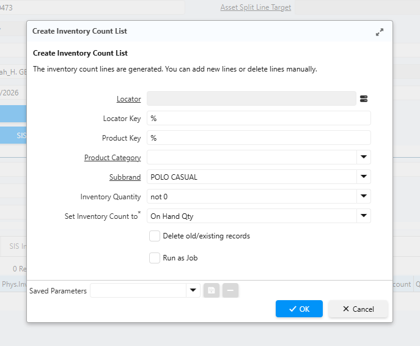 {#Figure349}

5. Klik **ok** untuk membuat Inventory Count Line sesuai filter yang ditentukan.
6. Klik **SIS Generate Inventory Charge Amount** — Menghitung biaya charging jika terdapat selisih minus.
7. Masuk ke **Inventory Count Line**, kemudian input field berikut:
- **Qty Count** — Jumlah quantity fisik hasil perhitungan aktual.
- **Inventory Type** — Tipe charging untuk biaya yang dicatat.
- **Attribute** — ASI pada produk _(jika ada)_.
- **Charge** — Menentukan biaya yang akan dicatat atas selisih (plus atau minus).
8. Klik **Complete** pada dokumen Physical Inventory.

> **Catatan:** 
> - Jika ASI tidak diinput saat memproses Physical Inventory, sistem mengkalkulasi quantity berdasarkan artikel tanpa spesifikasi ke ASI atau batch/lot.
> - Saat **Sub Brand** ditentukan pada header dokumen Stock Opname, sistem hanya memproses produk yang termasuk dalam Sub Brand tersebut.

### Konfigurasi Sistem

SIS_INVENTORY_EXT_URL dan SIS_INVENTORY_CHARGE5_URL merupakan konfigurasi URL yang digunakan untuk menghubungkan iDempiere dengan tools atau informasi yang tersedia pada server klien. Konfigurasi ini digunakan untuk mendukung proses Stock Opname, khususnya dalam mengakses informasi atau fungsi tambahan yang diperlukan selama transaksi Stock Opname.

- SIS_INVENTORY_EXT_URL adalah URL untuk mengakses tools atau informasi eksternal yang digunakan dalam proses Stock Opname.
- SIS_INVENTORY_CHARGE5_URL adalah URL untuk mengakses tools atau informasi yang digunakan pada proses Stock Opname dengan Charge Type 5.

### Final Stock Opname

Stock opname dapat dilakukan dengan beberapa frekuensi: **harian**, **mingguan**, atau **bulanan**. Frekuensi disesuaikan dengan kebutuhan operasional, tingkat perputaran barang, dan kebijakan pengendalian persediaan perusahaan. Periode pelaksanaan dikonfigurasi di level **Product** dan **Document Type Physical Inventory**.
#### Konfigurasi di Product

1. Buka menu **Product**.
2. Tentukan **product** yang akan dikonfigurasi.
3. Tentukan periode stock opname: **PI Harian**, **PI Mingguan**, **PI Bulanan**, atau **PI Hot Item**.

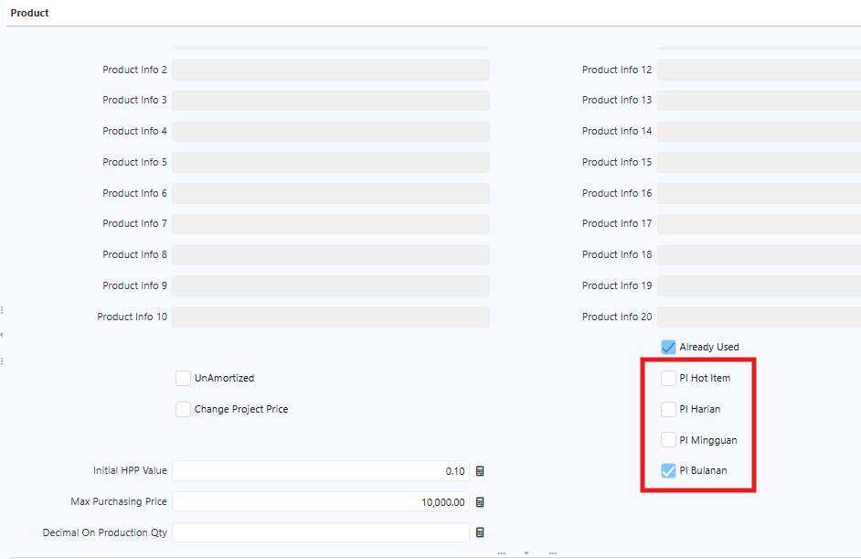 {#Figure370}

4. Klik **Save**.
#### Konfigurasi di Document Type Physical Inventory

1. Buka menu **Document Type**.
2. Pilih **Document Base Type** **Material Physical Inventory**.
3. Pada field **Inv Sub Type**, pilih **Physical Inventory**.
4. Pada field **PI Opname Period**, pilih periode opname sesuai kebutuhan: **Harian**, **Mingguan**, **Bulanan**, atau **Hot Item**.

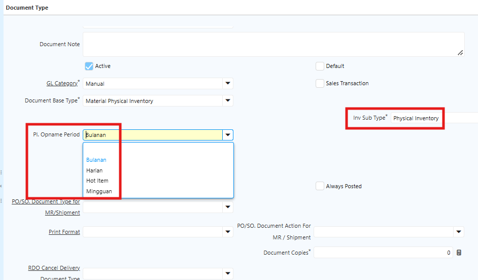 {#Figure369}

5. Klik **Save**.

#### Periode Stock Opname

- **Stock Opname Harian** — Dilakukan setiap hari, umumnya untuk barang dengan perputaran tinggi, bernilai tinggi, atau yang perlu diawasi ketat. Dapat dilakukan hanya untuk beberapa produk.
- **Stock Opname Mingguan** — Dilakukan satu kali dalam seminggu untuk memeriksa persediaan secara berkala tanpa menghitung seluruh barang setiap hari.
- **Stock Opname Bulanan** — Dilakukan pada akhir periode atau jadwal yang ditetapkan perusahaan untuk mengevaluasi persediaan secara menyeluruh. Cakupannya dapat meliputi seluruh persediaan di gudang.

#### Final Stock Opname Bulanan

User melakukan final stock opname setiap bulan. Data quantity stok fisik diimport dari aplikasi **POS Skye**. Jika saat final stock opname terdapat produk yang seharusnya diperiksa di akhir bulan tetapi tidak muncul di **Inventory Count Line**, user perlu men-generate produk yang memiliki _stock on hand_ dan flag **SIS_PIIsBulanan = Y** pada master product. Ikuti langkah berikut untuk men-generate produk pada Physical Inventory yang ter-create dari POS Skye:

1. Buka menu **Physical Inventory**.
2. Tentukan dokumen stock opname yang akan diproses.
3. Pastikan **Document Type** yang digunakan memiliki periode stock opname **Bulanan**.
4. Klik **Document Action**, lalu pilih **Prepare**.

Setelah **Prepare** dijalankan, sistem otomatis men-generate produk yang sebelumnya tidak ada di Inventory Count Line. Sistem memuat produk yang memiliki **Summary M_Transaction tidak sama dengan 0** dan flag **SIS_PIIsBulanan = Y**.
## Adjustment Plus dan Minus

Untuk mencatat penggunaan persediaan atau melakukan adjustment plus/minus tanpa melalui proses penjualan, gunakan fitur **Inventory Decrease/Increase**.
### Konfigurasi Document Type

Penentuan adjustment plus atau minus dikonfigurasi di level **Document Type**, sehingga adjustment plus dan minus menggunakan document type yang berbeda.

1. Buka menu **Document Type**.
2. Cari dokumen **Inventory Decrease/Increase**.
3. Pada field **Adjustment Type**, tentukan jenis adjustment yang digunakan untuk dokumen tersebut:
- - **Adjustment Negatif** — Dokumen khusus untuk adjustment negatif. Saat diproses, Internal Use Qty bernilai positif dan sistem **menambah** stok.
- **Adjustment Positif** — Dokumen khusus untuk adjustment positif. Saat diproses, Internal Use Qty bernilai negatif dan sistem **mengurangi** stok.

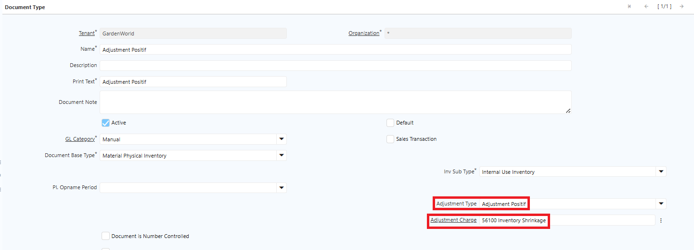 {#Figure161}

4. Pada field **Charge**, input charge atas transaksi jika charge sudah ditentukan. Jika tidak, user dapat memilih charge secara manual saat transaksi.
5. Klik **Save**.
### Langkah Proses Inventory Decrease/Increase

1. Buka menu **Inventory Decrease/Increase**.
2. Input field pada header:
- **Warehouse** — Tentukan warehouse inventory yang akan diproses.
- **Movement Date** — Tanggal adjustment dilakukan.
- **Document Type** — Tipe dokumen yang digunakan.
- **Cost Center** — Dimensi tambahan untuk financial report.
3. Masuk ke **Internal Use Line**, kemudian input field berikut:
- **Locator** — Lokasi inventory yang akan diproses.
- **Product** — Artikel yang akan diproses.
- **Qty** — Quantity produk yang akan di-adjust.
- **Attribute Set Instance** — Nomor ASI yang akan diproses _(jika ada)_.
4. Klik **Save**.
5. Klik **Complete** pada dokumen Inventory Decrease/Increase.

### Ketentuan Adjustment

- **Adjustment Positif** — Menunjukkan adanya kelebihan stok yang harus dikurangi dari sistem. Sistem otomatis **mengurangi** stok produk.
- **Adjustment Negatif** — Menunjukkan adanya kekurangan stok yang harus ditambahkan ke sistem. Sistem otomatis **menambah** stok produk.

Setelah dokumen di-complete, sistem otomatis mengkalkulasi ulang quantity produk sesuai konfigurasi dan membentuk jurnal atas penyesuaian tersebut. Nilai jurnal mengikuti cost pada artikel.
## Report Internal Use

Ikuti langkah berikut untuk mengakses report Internal Use (_Inventory Decrease/Increase_):

1. Buka menu **Inventory Decrease/Increase**.
2. Klik tombol **Setting (⚙)**.
3. Klik **Print Document Internal Use**.
4. Klik **OK**.

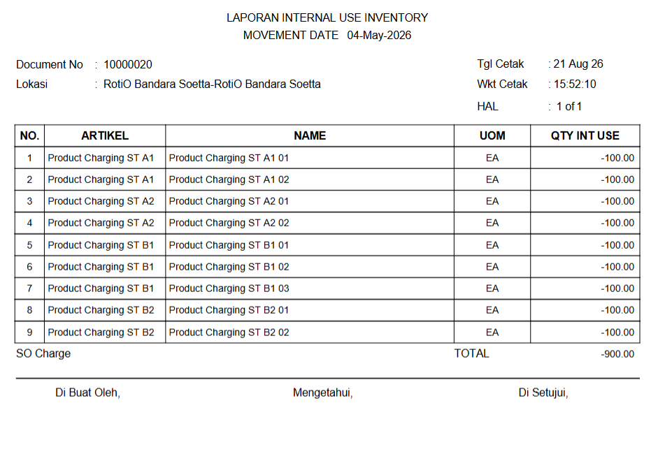{#Figure268}

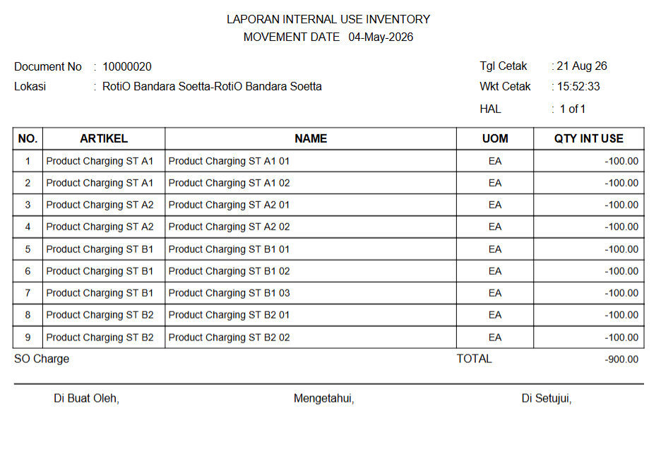 {#Figure269}

## Product Auto Internal Use

Beberapa product yang dipindahkan ke warehouse atau gudang tertentu akan otomatis membentuk **Internal Use**. Karena jumlah product yang memerlukan konfigurasi ini bisa sangat banyak, konfigurasi Auto Internal Use dapat dilakukan di level **Product Category** untuk efisiensi.

Jika Auto Internal Use sudah dikonfigurasi di Product Category, seluruh product baru maupun product _existing_ yang menggunakan Product Category tersebut otomatis ter-update menjadi Auto Internal Use. Setelah konfigurasi tersalin ke product, user perlu melakukan konfigurasi **Charge Internal Use** untuk setiap product secara individual.

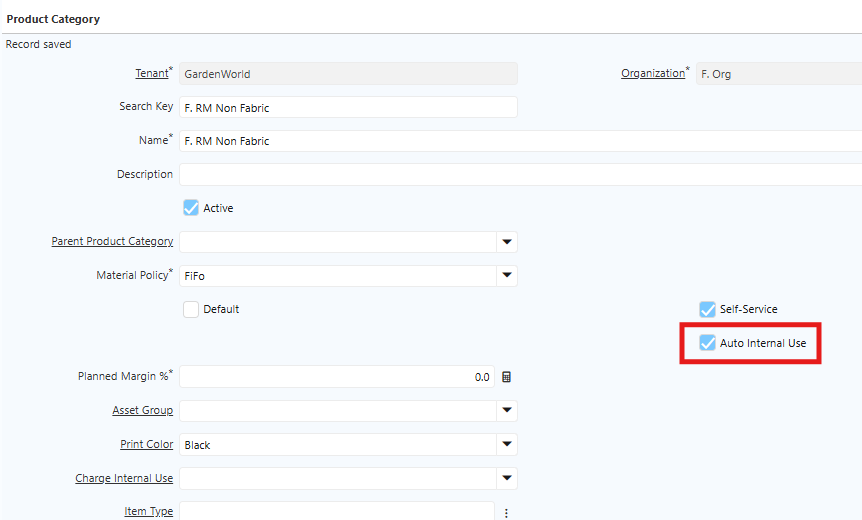 {#Figure278}

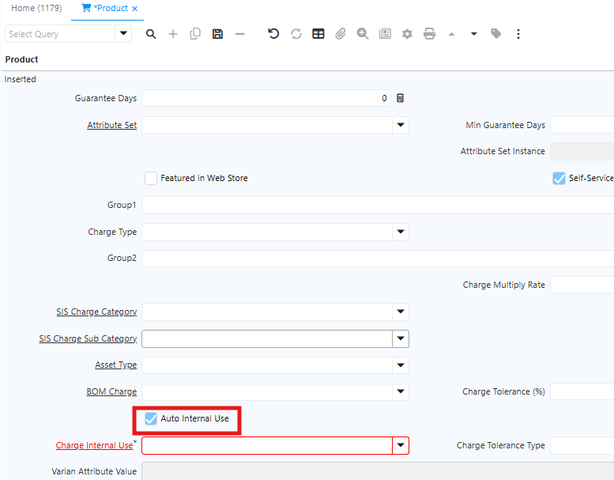 {#Figure279}

Dengan mekanisme ini, user tidak perlu mengkonfigurasi Auto Internal Use satu per satu pada setiap product.

## Internal Use Product dengan BoM

Produk Semi Finished Goods yang dipindahkan ke outlet dicatat penggunaannya melalui **Internal Use (Inventory Decrease/Increase)**. Produk tersebut diproduksi oleh outlet, dan setelah selesai diproduksi user melakukan Internal Use untuk produk tersebut.
### Konfigurasi Document Type Internal Use

Sebelum melakukan Internal Use, lakukan konfigurasi pada **Document Type Internal Use**. Ikuti langkah berikut:

1. Buka menu **Document Type**.
2. Klik **New**.
3. Tentukan **nama** Document Type.
4. Pada field **Document Base Type**, pilih **Material Physical Inventory**.
5. Pada field **Inv Sub Type**, pilih **Internal Use Inventory**.
6. Centang field **Inventory FG BOM**.
7. Tentukan **Charge** pada field **Adjustment Charge**.

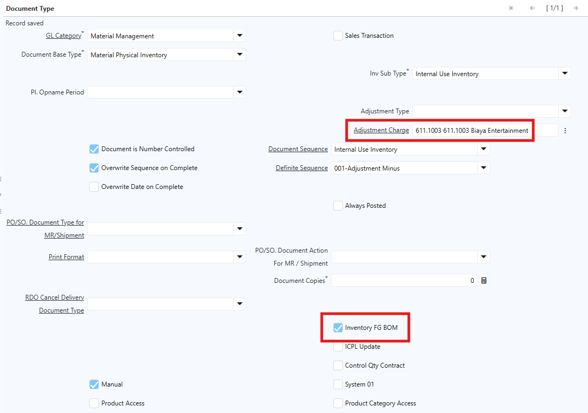 {#Figure363}

8. Klik **Save**.

### Konfigurasi BoM

1. Buka menu **Product**.
2. Centang field **Bill of Material**.
3. Masuk ke tab **BoM**.
4. Centang field **Auto Production**.
5. Pada field **BoM Type**, pilih **Manufacture This Product**.

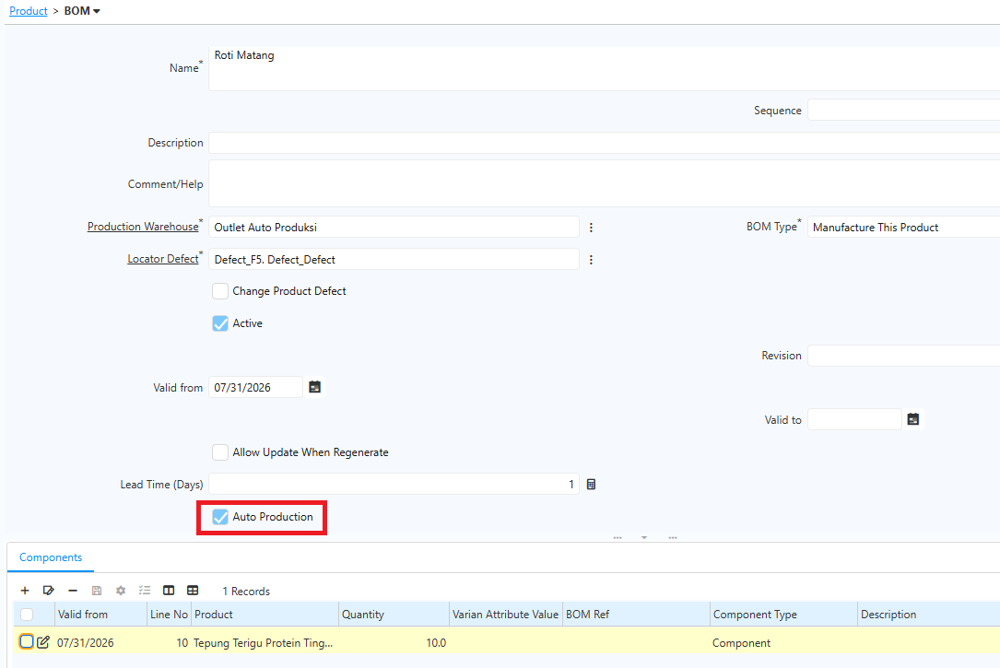 {#Figure203}

8. Klik **Save**.
### Langkah Internal Use Product Finished Good dengan BoM

Setelah Document Type dikonfigurasi, lakukan Internal Use dengan langkah berikut:

1. Buka menu **Inventory Decrease/Increase**.
2. Tentukan **Warehouse**.
3. Tentukan **Locator**.
4. Tentukan **Document Type**.
5. Masuk ke tab **Internal Use Special**.
6. Input **produk** yang akan diproses.
7. **BoM** akan ter-set otomatis.
8. Tentukan **quantity** produk.
9. Klik **Save**.
10. Kembali ke **header**.
11. Klik **Action Prepare**.

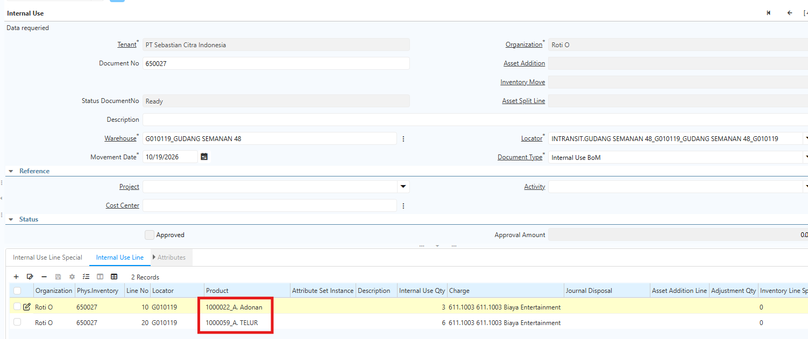 {#Figure364}

Setelah Prepare dijalankan, sistem otomatis membuat **Internal Use Line** berdasarkan komponen pada BoM yang dipilih. Quantity Internal Use terisi otomatis sesuai quantity yang diinput di Internal Use Special dikalkulasi dengan quantity di BoM. Charge juga terisi otomatis sesuai konfigurasi Charge pada document type Internal Use.

> **Catatan:** Tab **Internal Use Special** hanya muncul jika field **Inventory FG BOM** pada Document Type diset **Yes**. Jika **Inventory FG BOM = False**, tab tersebut tidak muncul — yang berarti Internal Use dilakukan langsung pada product itu sendiri, bukan pada komponen-komponennya.