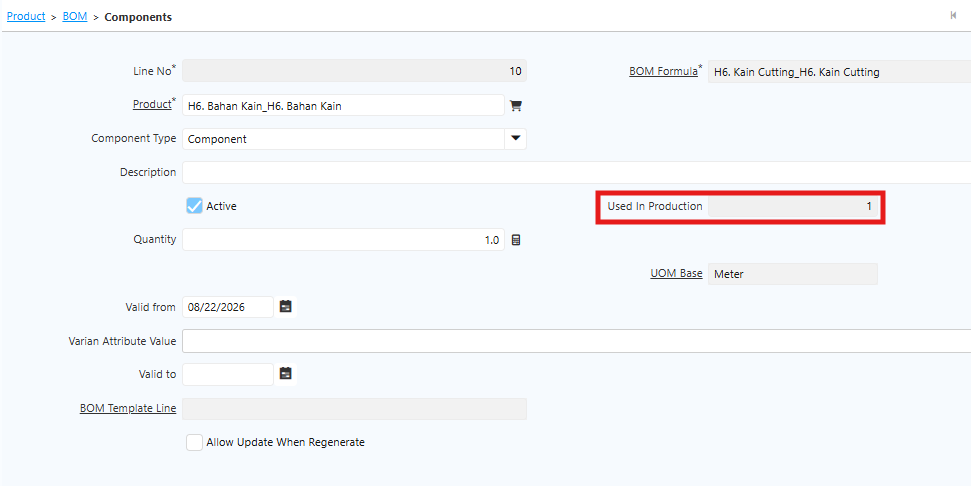
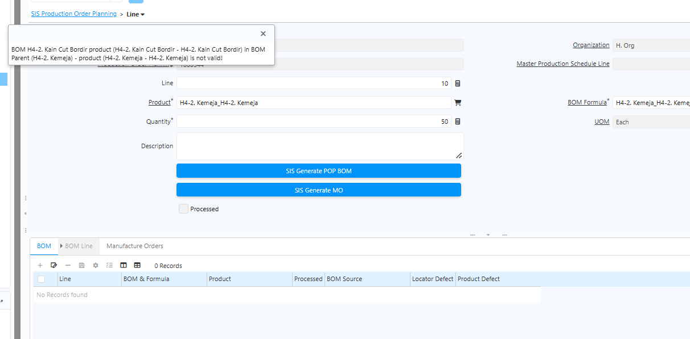

# Bill of Material

Bill of Material (BoM) adalah struktur daftar komponen atau bahan yang digunakan untuk memproduksi suatu produk. BoM digunakan pada  Manufacturing dan Production untuk mendukung proses produksi.

Bill of Material berfungsi untuk:
1. Menentukan komponen penyusun produk
2. Menghitung kebutuhan bahan baku
3. Mendukung proses produksi
4. Menghitung biaya produksi

Satu produk dapat memiliki lebih dari satu BoM sesuai kebutuhan produksi.
## Konfigurasi Bill of Material

### Type BoM

- **Manufacturing Product** — Produksi dilakukan secara _in-house_ oleh perusahaan.
- **Subcontracting** — Produksi dilakukan di luar perusahaan melalui vendor.
### UoM Base

UoM Base bersifat _read-only_ dan terisi otomatis sesuai UoM Base yang dikonfigurasi di level product.
### Component

Komponen atau material yang digunakan dalam proses produksi. Jika komponen pada BoM sudah digunakan dalam transaksi Production, field **Used In Production** otomatis bertambah sesuai quantity yang digunakan. Komponen yang sudah digunakan untuk transaksi produksi tidak dapat dihapus dari BoM.

  {#Figure275}

Berikut field yang tersedia pada Component:

- **Product** — Produk yang menjadi komponen Semi Finished Goods maupun Finished Goods.
- **Qty** — Quantity yang diperlukan untuk memproduksi Semi Finished Goods maupun Finished Goods.
- **UoM Base** — Terisi otomatis sesuai UoM Base pada product dan bersifat _read-only_.
- **Valid From** — Periode mulai berlakunya komponen BoM untuk produk tersebut.
- **Valid To** — Periode berakhirnya komponen BoM untuk produk tersebut.
### BoM Reference

BoM referensi yang digunakan untuk artikel Semi Finished Goods yang memiliki struktur BoM dan komponen tersendiri.
### Valid From dan Valid To

Satu produk dapat memiliki lebih dari satu Bill of Material (BoM), dengan komponen yang berbeda maupun sama. Namun, pada saat menjalankan Production Order Planning (POP), user hanya dapat menentukan satu BoM yang akan digunakan untuk proses produksi.

Untuk mengatur periode berlakunya BoM, setiap BoM perlu dikonfigurasi dengan **Valid From** dan **Valid To**. Periode tersebut digunakan oleh sistem untuk menentukan apakah BoM masih berlaku pada tanggal produksi yang diproses.

#### Setting Periode BoM

Setiap BoM perlu memiliki tanggal **Valid From** yang sesuai dengan periode mulai berlakunya. Jika terdapat beberapa BoM untuk produk yang sama, pastikan periode validitas masing-masing BoM diatur dengan tepat.

Apabila BoM yang sedang digunakan sudah tidak berlaku dan akan digantikan oleh BoM baru, lakukan langkah berikut:

1. Tentukan **Valid To** pada BoM lama sesuai tanggal berakhirnya masa berlaku.
2. Tentukan **Valid From** pada BoM baru sesuai tanggal mulai berlakunya.
3. Pada master Product, perbarui **BoM Reference** untuk produk yang menggunakan BoM baru, termasuk produk semi-finished good jika terkait.
4. Pastikan BoM Reference mengarah ke BoM yang masih berlaku sebelum menjalankan Production Order Planning.

Jika POP diproses menggunakan BoM yang sudah tidak berlaku, sistem akan menampilkan pesan error bahwa BoM untuk produk tersebut sudah tidak valid. 

  {#Figure294}

User perlu memperbarui BoM Reference ke BoM yang masih berlaku agar proses dapat dilanjutkan.

### Validitas Component pada BoM

Pengaturan Valid From dan Valid To juga berlaku untuk component yang terdapat pada BoM. Jika component memiliki tanggal **Valid To** dan proses produksi dilakukan setelah tanggal tersebut, component tidak akan digenerate pada BoM untuk proses produksi tersebut.

Oleh karena itu, user perlu memastikan periode validitas BoM maupun setiap component telah sesuai dengan tanggal produksi yang akan diproses.

**Contoh Bill of Material**

Untuk memproduksi **1 pcs Kemeja** dibutuhkan komponen berikut:

| Finished Goods | Komponen     | Qty |
| -------------- | ------------ | --- |
| Kemeja         | Kain Cutting | 2   |
| Kemeja         | Label        | 1   |
| Kemeja         | Kancing      | 4   |
"Bill of Material"{#Tabel3}

## Copy Informasi Product

Pada iDempiere, tersedia field **Copy From Product** yang digunakan untuk menyalin informasi dari product lain ke product yang sedang dibuat. Fitur ini membantu user mempercepat proses konfigurasi product, terutama ketika beberapa product memiliki informasi atau konfigurasi yang sama.

Dengan menggunakan **Copy From Product**, user tidak perlu melakukan konfigurasi informasi product satu per satu. User cukup menentukan product sumber yang memiliki konfigurasi sesuai kebutuhan, kemudian sistem akan menyalin informasi tersebut ke product yang sedang dibuat.

Informasi yang dapat disalin dari product sumber meliputi:

- Bill of Material (BOM)
- Price
- Substitutes
- Related
- Replenish
- Business Partner
- UOM Conversion

Fitur ini dapat digunakan apabila terdapat beberapa product yang memiliki konfigurasi yang sama, misalnya BOM, Price, dan UOM Conversion. User dapat menggunakan salah satu product yang telah dikonfigurasi sebagai product sumber dan menyalin informasinya ke product baru.

### Langkah Copy Informasi Product

Untuk menyalin informasi dari product lain, lakukan langkah berikut:

1. Buka menu **Product**.
2. Buat atau pilih product yang akan dikonfigurasi.
3. Isi **Search Key** sesuai dengan kode product.
4. Isi **Name** sesuai dengan nama product.
5. Tentukan **Product Category**.
6. Tentukan **UoM** sebagai satuan dasar (**Base UoM**) product.
7. Tentukan **Product Type** sesuai dengan jenis product.
8. Jika product menggunakan BOM, centang field **Bill of Material**.
9. Klik tombol setting (⚙).
10. Pilih **Copy From Product**.
11. Pada field **Product**, pilih product sumber yang informasinya akan disalin.
12. Klik **OK** untuk menjalankan proses copy.

Setelah proses berhasil dijalankan, sistem akan menyalin informasi dari product sumber ke product yang sedang dibuat.

Informasi yang disalin meliputi **BOM, Price, Substitute, Related, Replenish, Business Partner. dan UOM Conversion** sesuai dengan konfigurasi yang tersedia pada product sumber.