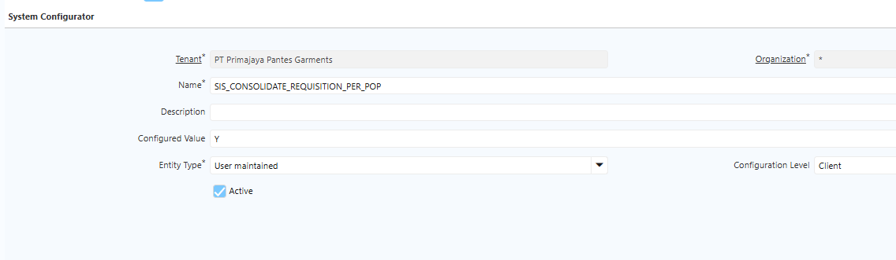
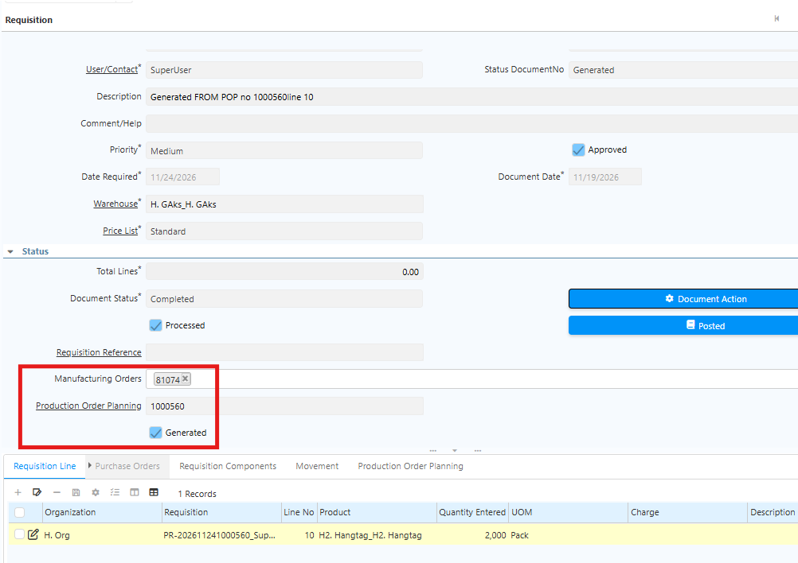
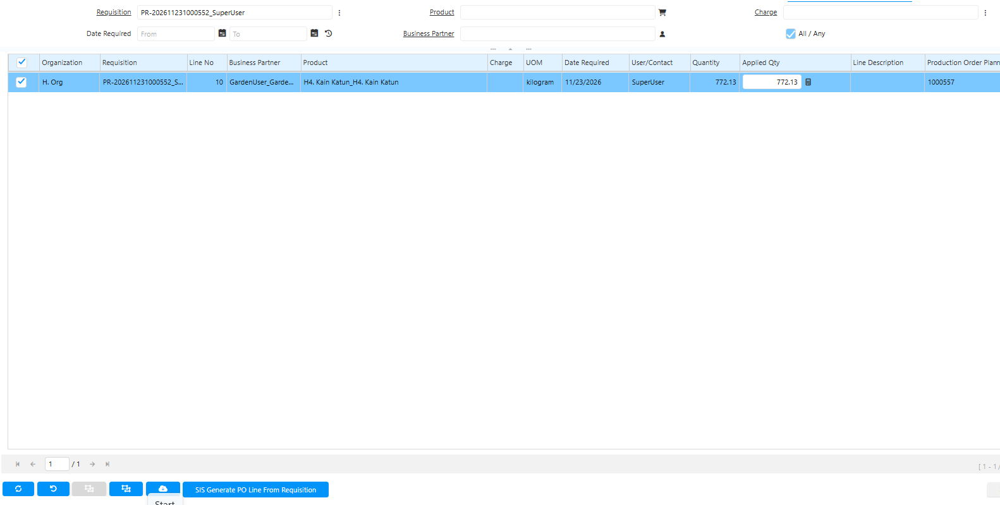
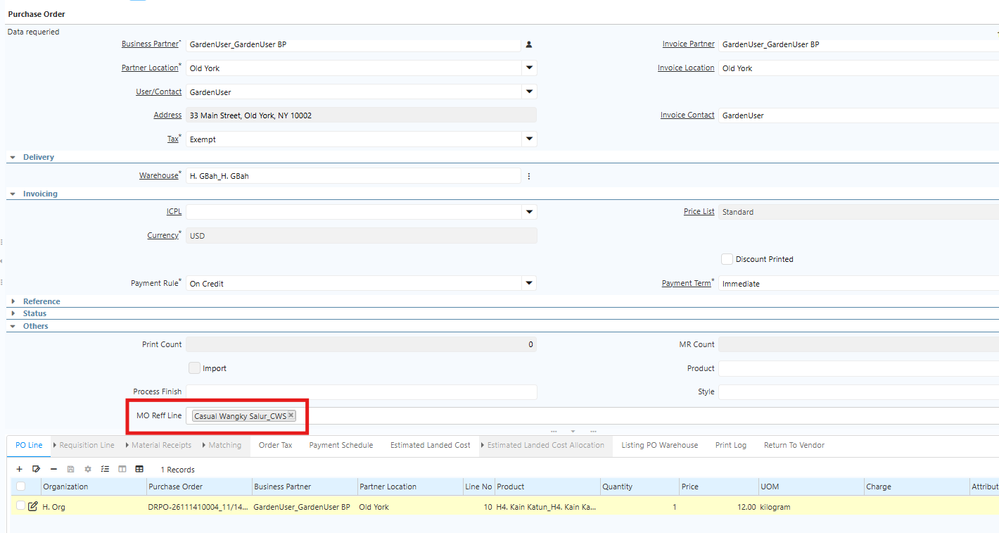
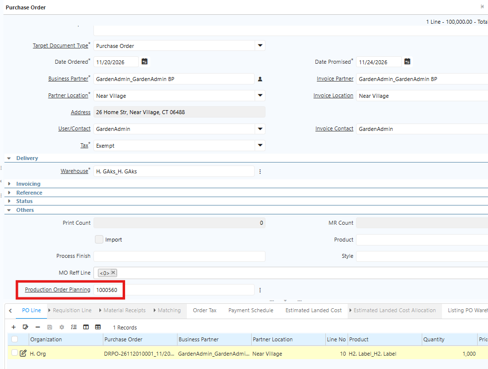

# Requisition

Requisition pada proses **Production Order Planning (POP)** akan terbentuk apabila bahan baku atau komponen lain yang dibutuhkan untuk produksi tidak mencukupi.

Secara default, sistem dapat mengonsolidasikan Requisition dari beberapa POP apabila memiliki **Business Partner, Product, dan Warehouse** yang sama. Namun, khusus untuk Requisition CMT (Cut, Make, Trim) yang akan diproses oleh pihak eksternal, Requisition tidak dikonsolidasikan. Requisition CMT akan dibuat secara terpisah berdasarkan masing-masing POP.

Untuk mengatur mekanisme tersebut, user perlu melakukan konfigurasi pada **System Configurator** dengan langkah-langkah berikut:

1. Login ke tenant masing-masing perusahaan.
2. Buka menu **System Configurator**.
3. Klik **New** untuk membuat konfigurasi baru.
4. Pada field **Name**, masukkan **SIS_CONSOLIDATE_REQUISITION_PER_POP**.
5. Pada field **Configured Value**, tentukan nilai `Y` atau `N` dengan ketentuan berikut:

- **Y**: Requisition dibuat secara terpisah untuk setiap POP dan tidak dikonsolidasikan dengan POP lainnya.
- **N**: Requisition mengikuti mekanisme yang berlaku saat ini, yaitu dikonsolidasikan apabila memiliki Business Partner, Product, dan Warehouse yang sama.

 {#Figure400}

6. Pada field **Configuration Level**, pilih **Client**.
7. Pastikan konfigurasi dibuat pada tenant perusahaan yang bersangkutan, bukan pada tenant **System**.
8. Klik **Save**.

Berikut merupakan contoh Requisition yang terbentuk secara terpisah berdasarkan masing-masing POP. Meskipun memiliki Business Partner, Product, dan Warehouse yang sama, Requisition dari satu POP tidak dikonsolidasikan dengan Requisition dari POP lainnya.

 {#Figure401}

Requisition yang dihasilkan melalui proses Generate MO akan memiliki penanda berupa flag **Generated** pada Requisition Header. Sistem secara otomatis mencentang flag tersebut untuk Requisition yang dibuat melalui proses Generate MO dari POP. Sementara itu, Requisition yang dibuat secara manual tidak akan memiliki tanda centang pada flag **Generated**.
## Generate PO From Requisition

1. Buka menu **SIS Generate PO From Requisition**.
2. Input nomor dokumen Requisition yang akan diproses.
3. Tentukan **Qty Applied** sesuai quantity yang akan diproses, baik secara keseluruhan maupun sebagian.

 {#Figure413}

4. Klik tombol **SIS Generate PO Line From Requisition** untuk menjalankan proses generate PO.

Sistem akan membuat Purchase Order (PO) berdasarkan data Requisition yang dipilih. Jika POP memiliki informasi **MO Reff Line**, sistem akan menyalin informasi tersebut ke kolom **MO Reff Line** pada PO Header. Apabila PO merupakan hasil konsolidasi dari beberapa POP, kolom MO Reff Line akan menampilkan seluruh informasi Manufacturing Order yang terkait dengan POP tersebut.

 {#Figure414}

Purchase Order (PO) yang dibuat berdasarkan Requisition hasil proses Generate MO akan secara otomatis menampilkan informasi POP pada kolom **POP** di Purchase Order Header. Sistem mengambil informasi tersebut dari POP yang tertera pada Requisition terkait, sehingga user dapat mengetahui hubungan antara PO dan POP yang menjadi sumbernya.

 {#Figure415}

Selain terisi secara otomatis, kolom **POP** juga dapat diinput secara manual. Dengan demikian, user dapat menghubungkan Purchase Order dengan POP tertentu melalui pengisian nomor POP pada kolom tersebut.