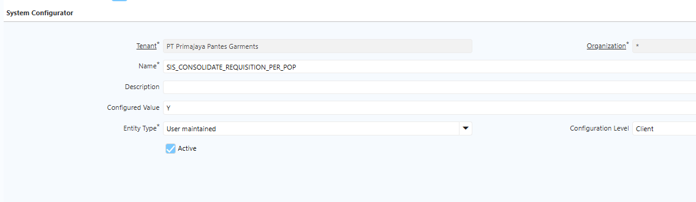
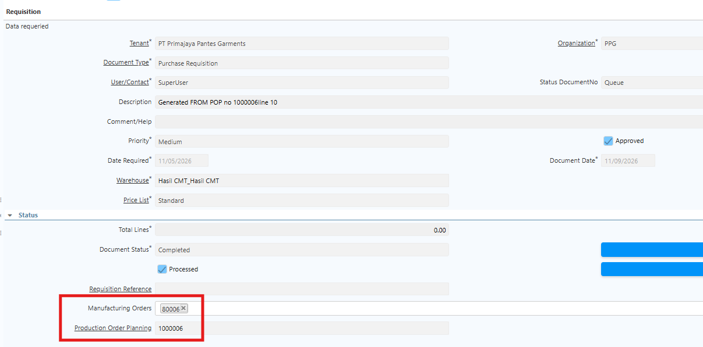

# Requisition

Requisition pada proses **Production Order Planning (POP)** akan terbentuk apabila bahan baku atau komponen lain yang dibutuhkan untuk produksi tidak mencukupi.

Secara default, sistem dapat mengonsolidasikan Requisition dari beberapa POP apabila memiliki **Business Partner, Product, dan Warehouse** yang sama. Namun, khusus untuk Requisition CMT (Cut, Make, Trim) yang akan diproses oleh pihak eksternal, Requisition tidak dikonsolidasikan. Requisition CMT akan dibuat secara terpisah berdasarkan masing-masing POP.

Untuk mengatur mekanisme tersebut, user perlu melakukan konfigurasi pada **System Configurator** dengan langkah-langkah berikut:

1. Login ke tenant masing-masing perusahaan.
2. Buka menu **System Configurator**.
3. Klik **New** untuk membuat konfigurasi baru.
4. Pada field **Name**, masukkan **SIS_CONSOLIDATE_REQUISITION_PER_POP**.
5. Pada field **Configured Value**, tentukan nilai `Y` atau `N` dengan ketentuan berikut:

- **Y**: Requisition dibuat secara terpisah untuk setiap POP dan tidak dikonsolidasikan dengan POP lainnya.
- **N**: Requisition mengikuti mekanisme yang berlaku saat ini, yaitu dikonsolidasikan apabila memiliki Business Partner, Product, dan Warehouse yang sama.

 {#Figure400}

6. Pada field **Configuration Level**, pilih **Client**.
7. Pastikan konfigurasi dibuat pada tenant perusahaan yang bersangkutan, bukan pada tenant **System**.
8. Klik **Save**.

Berikut merupakan contoh Requisition yang terbentuk secara terpisah berdasarkan masing-masing POP. Meskipun memiliki Business Partner, Product, dan Warehouse yang sama, Requisition dari satu POP tidak dikonsolidasikan dengan Requisition dari POP lainnya.

 {#Figure401}