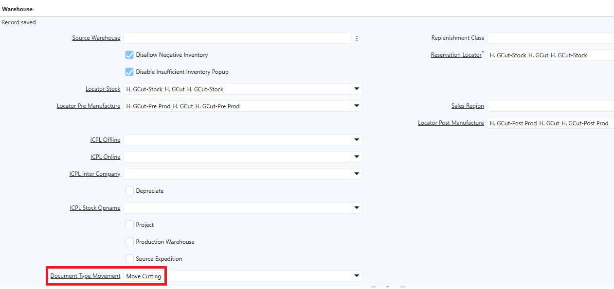
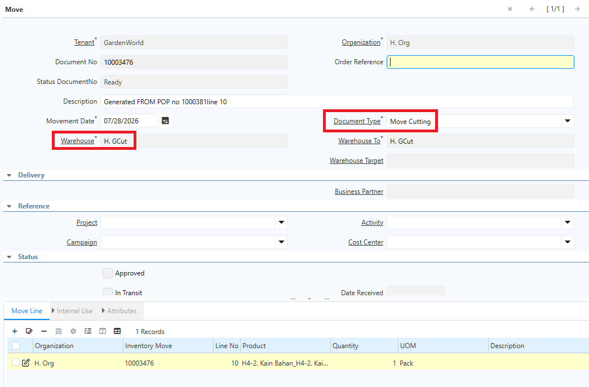
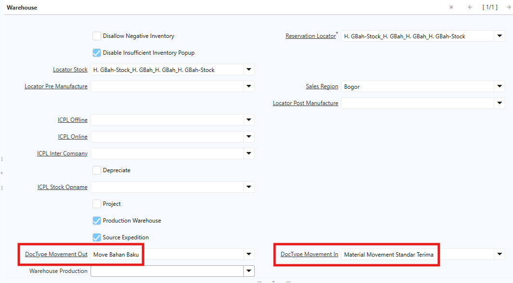
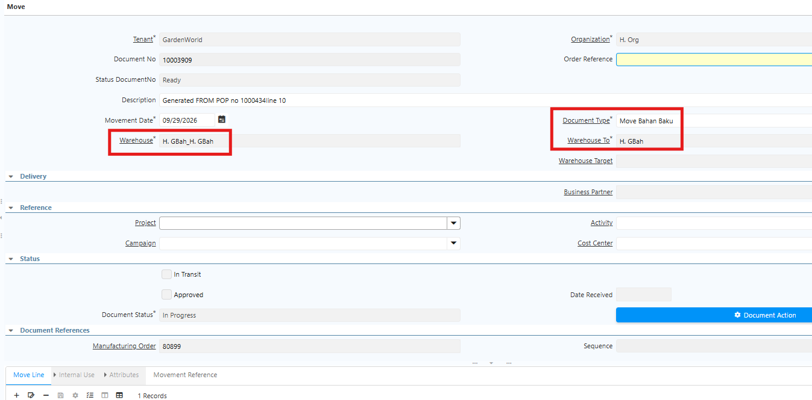
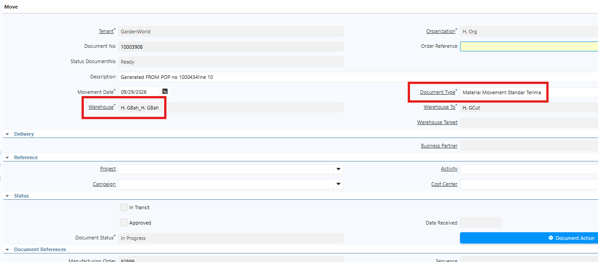
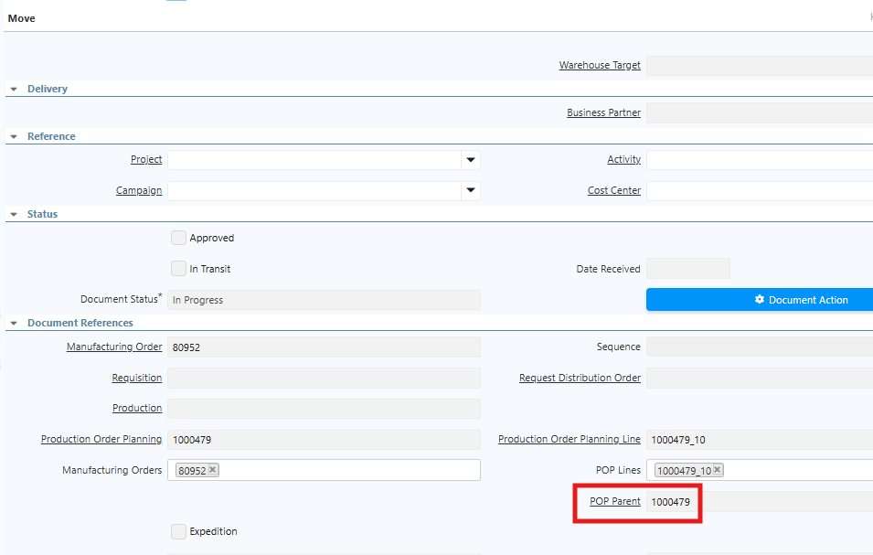
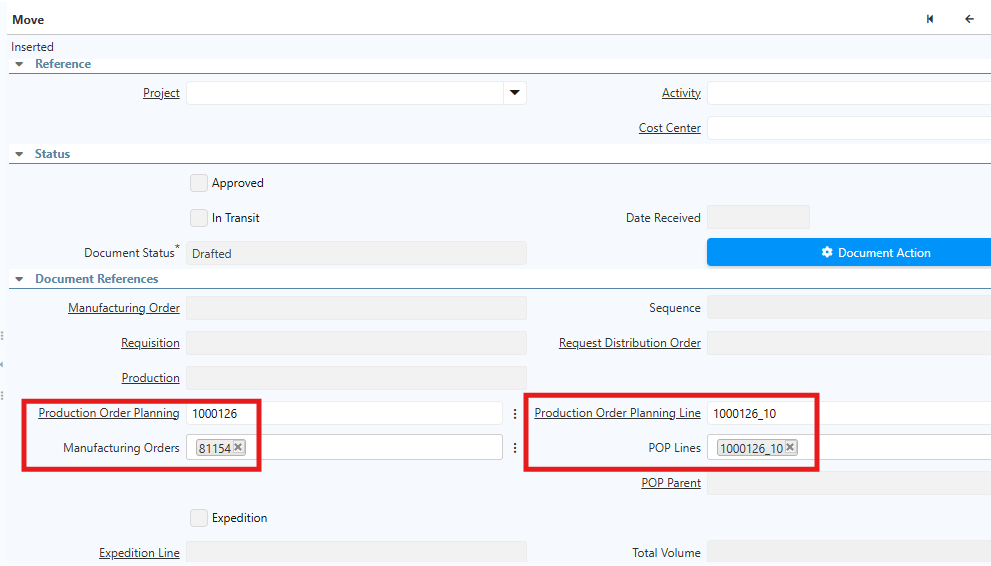
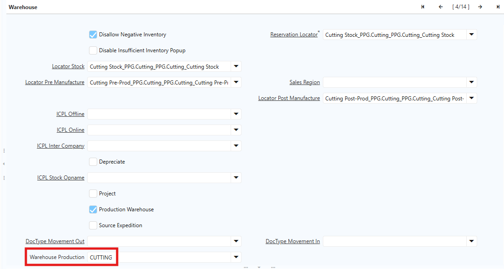
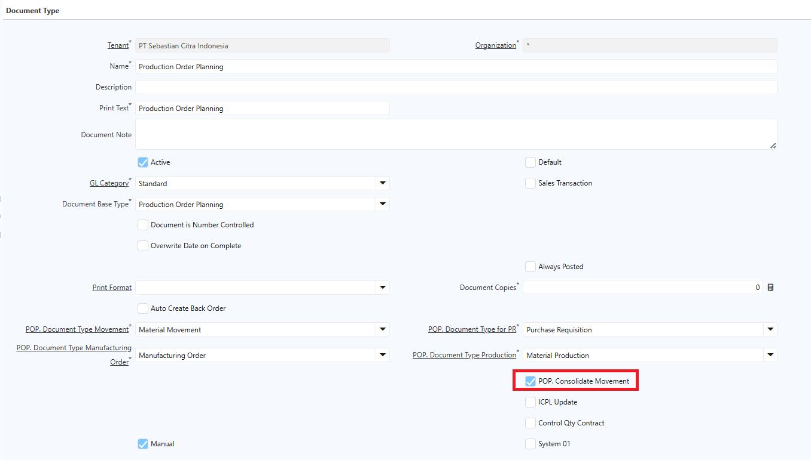
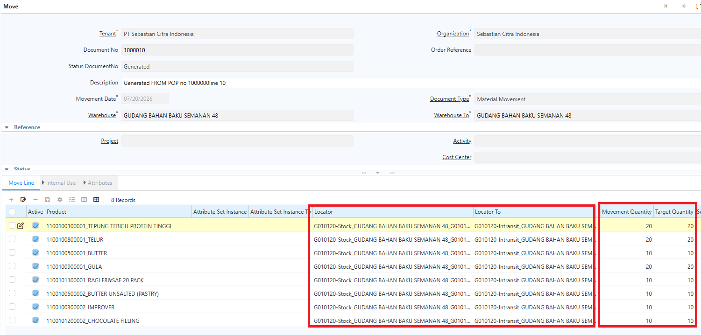

# Inventory Move POP

## Document Type Movement POP

Saat Production Order Planning (POP) melibatkan banyak warehouse, tidak semua user memiliki hak akses ke seluruh warehouse. Umumnya, satu user hanya memiliki akses ke satu warehouse saat produk akan dipindahkan (_movement_). Untuk mengatasi hal ini, sistem menyediakan konfigurasi **Document Type Movement** per warehouse, sehingga setiap user tetap dapat mengakses dokumen movement sesuai aksesnya.

Ikuti langkah berikut untuk mengkonfigurasi Document Type Movement di warehouse:

1. Buka menu **Warehouse and Locator**.
2. Tentukan **Search Key** dan **Name** warehouse tersebut.
3. Pada field **Document Type Movement**, pilih document type sesuai konfigurasi.

 {#Figure207}

4. Klik **Save**.

Document Type yang dikonfigurasi di Document Type POP dapat menggunakan **Document Type Movement General** yang khusus diperuntukkan untuk POP. Jika konfigurasi Document Type Movement tidak dilakukan di warehouse, sistem otomatis menggunakan Document Type Movement yang dikonfigurasi di Document Type POP.

Berikut contoh implementasinya di Production Order Planning (POP):

 {#Figure208}

## Konfigurasi Document Type Transfer dan Terima POP

Pada Production Order Planning, routing melibatkan perpindahan barang dari warehouse ke **intransit**, kemudian dari intransit ke gudang atau pabrik tujuan. Karena kedua proses ini menggunakan document type yang berbeda, lakukan konfigurasi berikut:

- **Document Type Transfer (Out)** — Digunakan untuk perpindahan dari warehouse ke intransit.
- **Document Type Penerimaan (In)** — Digunakan untuk perpindahan dari intransit ke gudang tujuan.

Konfigurasi ini dilakukan di menu **Warehouse and Locator** untuk masing-masing warehouse. Ikuti langkah berikut:

1. Buka menu **Warehouse and Locator**.
2. Tentukan **Search Key** dan **Name** warehouse tersebut.
3. Pada field **DocType Movement Out**, pilih document type sesuai konfigurasi.
4. Pada field **DocType Movement In**, pilih document type sesuai konfigurasi.
5. Klik save.

 {#Figure314}

Berikut contoh implementasi konfigurasi ini di Production Order Planning (POP):

 {#Figure315}

 {#Figure316}

## Implementasi Inventory Move POP

Sistem membuat **Inventory Move** secara otomatis saat user menjalankan **Generate MO**. Pada proses tersebut, sistem akan membuat **Manufacturing Order (MO)**, **Requisition** apabila stok tidak mencukupi, dan Inventory Move.

Sistem membuat Inventory Move berdasarkan konfigurasi **Routing**, sehingga perpindahan barang dari satu locator ke locator lainnya mengikuti alur yang telah ditentukan. Document Type Inventory Move mengikuti konfigurasi pada warehouse dan Document Type Production Order Planning (POP) sesuai pengaturan yang telah dijelaskan sebelumnya.
#### Langkah Memproses Inventory Move dari POP

1. Buka menu **Inventory Move**.
2. Cari Inventory Move berdasarkan nomor **POP** atau **MO (Manufacturing Order)**.
3. Pilih dokumen Inventory Move yang akan diproses.
4. Verifikasi informasi pada header Inventory Move.
5. Pastikan informasi **POP**, **MO**, **Warehouse From**, dan **Warehouse To** sudah sesuai.
6. Masuk ke tab **Move Line**.
7. Verifikasi data pada Move Line. Field **Target Qty** menunjukkan quantity yang telah dihitung oleh sistem berdasarkan kebutuhan produksi.
8. Klik **Save**.
9. Klik **Complete** dokumen.
#### Penerimaan Sebagian

Jika user melakukan penerimaan sebagian dan Document Type dikonfigurasi **Auto Back Order**, sistem akan membuat Inventory Move baru untuk memenuhi sisa quantity yang belum diterima secara otomatis.

Jika konfigurasi **Auto Create Back Order** tidak diaktifkan, user harus membuat Inventory Move untuk sisa quantity secara manual. Namun, Inventory Move yang dibuat secara manual tersebut tidak terhubung dengan POP maupun MO yang sedang diproses.

Pada menu **Inventory Move**, terdapat penambahan field **POP Parent** yang menunjukkan dokumen POP induk dari proses produksi. Field ini digunakan untuk mengakomodasi proses produksi dengan skema **CMT**, di mana sistem membuat POP turunan untuk memproduksi _semi-finished goods_ secara internal, bukan melalui pihak ketiga.

 {#Figure355}

Dengan adanya field **POP Parent**, user dapat mengetahui POP induk yang terkait dengan Inventory Move pada setiap POP turunan, sehingga hubungan antara proses produksi induk dan turunannya dapat ditelusuri dengan lebih mudah.
### Inventory Move POP Manual

Dalam proses Production Order Planning, terdapat kondisi di mana user perlu membuat **Inventory Move secara manual**. Karena Inventory Move ini berkaitan dengan Production Order Planning, dokumen yang dibuat harus terhubung ke **POP** dan **MO** terkait. Oleh karena itu, user wajib menginput nomor dokumen POP dan MO yang akan diproses.

Ikuti langkah berikut untuk membuat Inventory Move POP Manual:

1. Buka menu **Inventory Move**.
2. Tentukan **Document Type** yang akan digunakan.
3. Tentukan **Warehouse** asal dan **Warehouse** tujuan.
4. Pada field **Production Order Planning**, input nomor dokumen **POP**.
5. Pada field **Production Order Planning Line**, tentukan line POP yang diproses.
6. Pada field **Manufacturing Order**, input nomor dokumen **MO**.

 {#Figure356}

7. Klik **Save**.
8. Masuk ke **Move Line**.
9. Tentukan **produk** yang akan diproses.
10. Tentukan **Locator** asal dan **Locator** tujuan.
11. Tentukan **quantity** produk yang akan diproses.
12. Klik **Save**.
13. Klik **Complete** pada dokumen Movement.

Inventory Move yang dibuat secara manual tetap terhubung dengan **Manufacturing Order** dan **Production Order Planning** terkait. Saat dilakukan pengecekan Inventory Move untuk POP tersebut, dokumen yang dibuat manual akan tetap muncul bersama dokumen lainnya.
## Warehouse Production

Dalam proses Production Order Planning, bahan mentah melewati beberapa tahap produksi sebelum menjadi barang jadi. Setiap tahap produksi menggunakan warehouse yang berbeda. Untuk menandai warehouse mana yang digunakan pada tahap produksi tertentu, lakukan konfigurasi pada field **Warehouse Production**.

Contoh: produk bahan mentah yang dibeli akan ditempatkan di **gudang bahan baku**. Untuk menyatakan bahwa gudang tersebut digunakan untuk proses bahan, user mengkonfigurasi field Warehouse Production dengan nilai **Bahan**.

Field Warehouse Production berfungsi sebagai **identitas tahap produksi** suatu warehouse. Terdapat 8 pilihan Warehouse Production yang tersedia:

- Bahan
- Bordir
- Cutting
- Finishing
- QC Serie
- Sablon
- Sewing
- Washing

 {#Figure331}

Jika warehouse dikonfigurasi dengan Warehouse Production **Cutting**, warehouse tersebut digunakan khusus untuk proses _cutting_. Ketentuan yang sama berlaku untuk seluruh tahap produksi lainnya hingga proses _finishing_.

## Konsolidasi Movement

Fitur **Konsolidasi Movement** digunakan untuk menggabungkan beberapa kebutuhan perpindahan barang ke dalam satu dokumen **Inventory Move**, selama memiliki **Warehouse From** dan **Warehouse To** yang sama. Dengan fitur ini, jumlah dokumen movement berkurang sehingga proses pengiriman, penerimaan, dan administrasi gudang menjadi lebih efisien.
### Konfigurasi Konsolidasi

Saat sistem men-generate Material Movement, sistem membandingkan informasi perpindahan setiap artikel. Jika beberapa artikel memiliki kombinasi **Warehouse From** dan **Warehouse To** yang sama, sistem menggabungkannya ke dalam **satu dokumen Inventory Move**.

Ikuti langkah berikut untuk mengkonfigurasi konsolidasi movement:

1. Buka menu **Document Type**.
2. Cari dokumen **Production Order Planning**.
3. Pada field **Consolidate Movement**, lakukan konfigurasi:
- **Y** — Movement akan dikonsolidasi.
- **N** — Movement tidak dikonsolidasi.

 {#Figure154}

4. Klik **Save**.
### Implementasi Konsolidasi Movement

Meskipun beberapa artikel digabung dalam satu dokumen movement, **quantity setiap artikel tetap dihitung secara independen** sesuai konfigurasi di level product. Sistem tidak menjumlahkan quantity antar artikel yang berbeda — setiap artikel tetap menggunakan quantity hasil perhitungan sesuai konfigurasi BoM, Routing, atau kebutuhan produksinya masing-masing.

Contoh:

|Artikel|Warehouse From|Warehouse To|Qty Movement|
|---|---|---|---|
|Tepung Terigu|Gudang Bahan|Gudang Produksi|20 Kg|
|Gula Pasir|Gudang Bahan|Gudang Produksi|20 Kg|
|Ragi|Gudang Bahan|Gudang Produksi|10 Kg|

 {#Figure155}

Karena seluruh artikel memiliki Warehouse From dan Warehouse To yang sama, sistem menghasilkan **satu dokumen Inventory Move** dengan tiga line — masing-masing quantity mengikuti kebutuhan artikel tersebut.

Jika konsolidasi movement tidak dikonfigurasi, setiap artikel akan memiliki dokumen Inventory Move tersendiri as existing saat ini meskipun locator asal dan tujuannya sama.