# Production Order Planning Subcon

Subcon atau CMT adalah ketika salah satu komponen Finished Goods diproduksi di luar perusahaan oleh vendor.

Dalam proses ini:
- Perusahaan mengirim material ke vendor
- Vendor memproduksi barang setengah jadi atau barang jadi
- Perusahaan melakukan proses pembelian hasil produksi vendor melalui:
    * Requisition
    * Purchase Order
    * Material Receipt
## Mekanisme POP Subcon

Jika Finished Goods memiliki komponen subcon, maka Manufacturing Order yang terbentuk hanya satu, yaitu untuk Finished Goods.

Namun, ketika Purchase Order untuk produk subcon selesai diproses, sistem dapat otomatis membuat POP baru untuk Semi Finished Goods yang masih diproduksi secara inhouse.

Setelah produksi Semi Finished Goods selesai dan stok tersedia di warehouse, proses produksi Finished Goods dapat dilanjutkan.

## Langkah POP Subcon di Sistem

1. Buka menu **SIS Production Order Planning**
2. Masuk ke Tab **Line**
3. Input:
  - Produk yang akan diproduksi
  - Quantity produksi
  - BoM yang digunakan
4. Jalankan proses **SIS Generate POP BoM**

	
	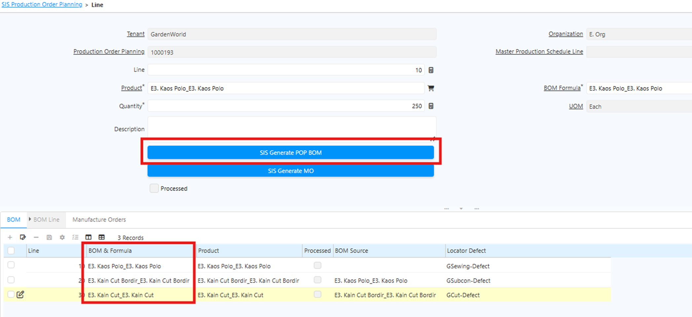 {#Figure22}
	

5. Klik **SIS Generate MO**

	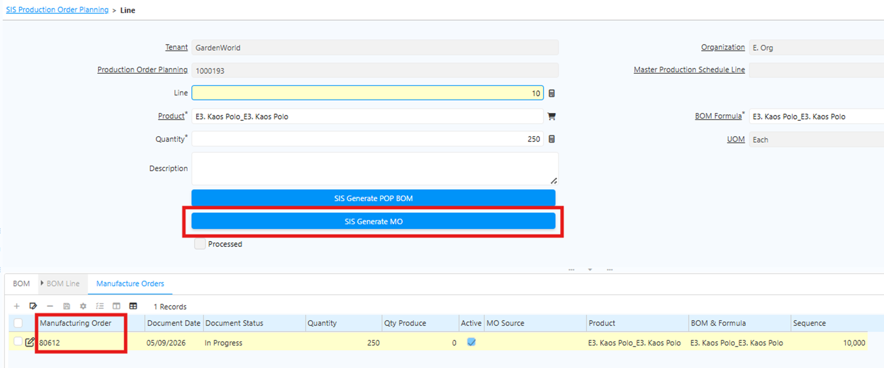 {#Figure23}

	
6. Masuk ke menu **Manufacturing Order**. Setelah proses Generate MO selesai, sistem otomatis membuat dokumen berikut **Back Order, Movement, Requisition, Production, Child** dan **Production Report Quantity**.

7. Lakukan proses **Requisition** untuk material subcon. Alur proses:
  - Requisition Complete
  - Purchase Order Complete
  - Material Receipt

	Sistem akan membuat POP baru untuk Semi Finished Goods yang diproduksi secara inhouse.

	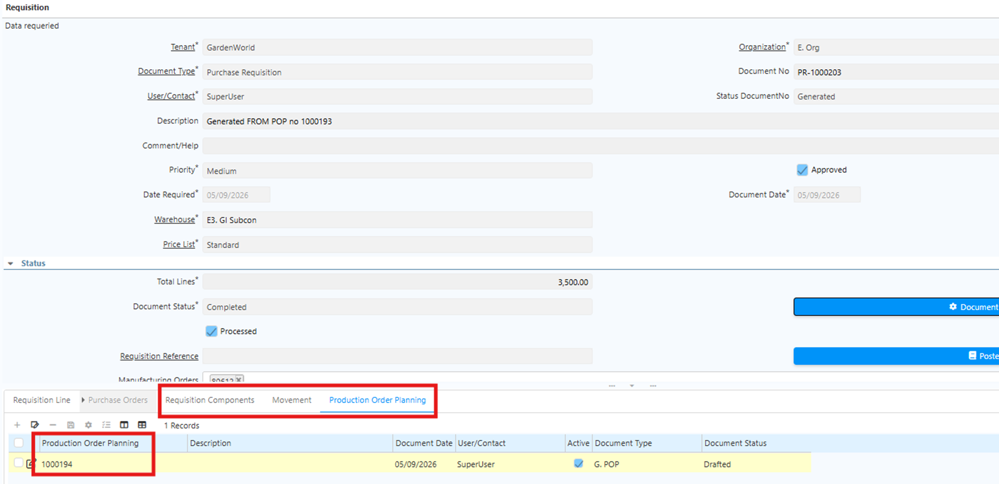 {#Figure24}

8. Jalankan proses produksi Semi Finished Goods hingga selesai
9. Setelah Semi Finished Goods tersedia di Warehouse, lakukan **Movement** sesuai urutan proses
10. Klik tab **Movement** dan lakukan movement sesuai urutan
11. Setelah stok tersedia, jalankan proses produksi pada tab **Production Report Quantity**:
  - Isi quantity produksi
  - Isi quantity defect, **jika ada**
  - Centang field **Defect** untuk produk defect

	Produk defect akan diproses movement manual ke locator sesuai konfigurasi BoM.
    
12. Setelah quantity ditentukan, lakukan **Complete Document MO**. Sistem akan menjalankan proses production secara otomatis dan mengkonsumsi:
  - Raw Material
  - Semi Finished Goods
## Inventory Move Subcon

Pada **Production Order Planning (POP) Subcon** — di mana proses produksi melibatkan pihak luar — saat Purchase Order (PO) untuk Subcon di-complete, sistem otomatis membuat dokumen **Inventory Move** untuk artikel tersebut.

Untuk membedakan movement artikel Subcon dari artikel yang diproduksi secara internal, sistem menyalin informasi **Business Partner** dari PO Subcon ke dokumen Inventory Move terkait secara otomatis. Artikel yang diproduksi oleh perusahaan sendiri tidak memiliki informasi Business Partner pada dokumen Inventory Move.

Berikut contoh implementasi penyalinan Business Partner di Inventory Move artikel Subcon:

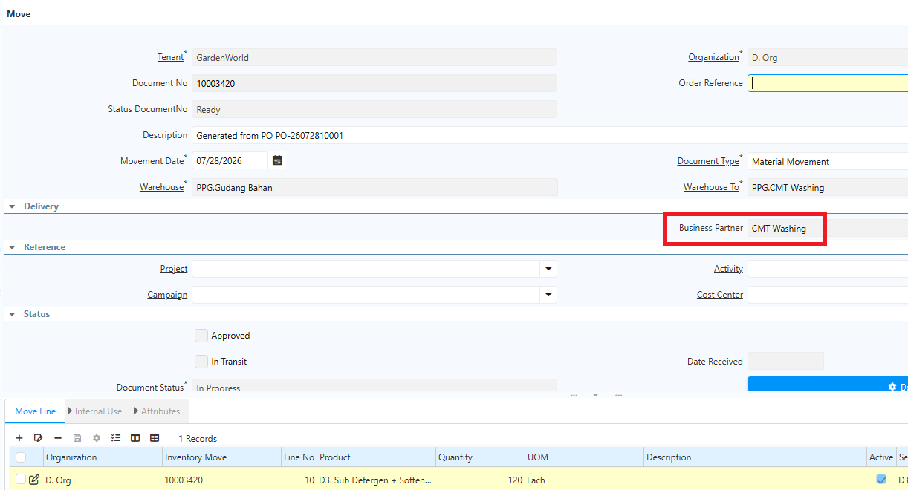 {#Figure185}

## Cost Adjustment Hasil CMT

Product subcon dapat memiliki komponen berupa bahan baku (_raw material_) yang dibeli perusahaan dan dikirim ke vendor subcon. Saat bahan baku dipindahkan ke gudang subcon dan dokumen Movement di-complete, sistem otomatis membentuk **Internal Use** atas bahan baku tersebut.

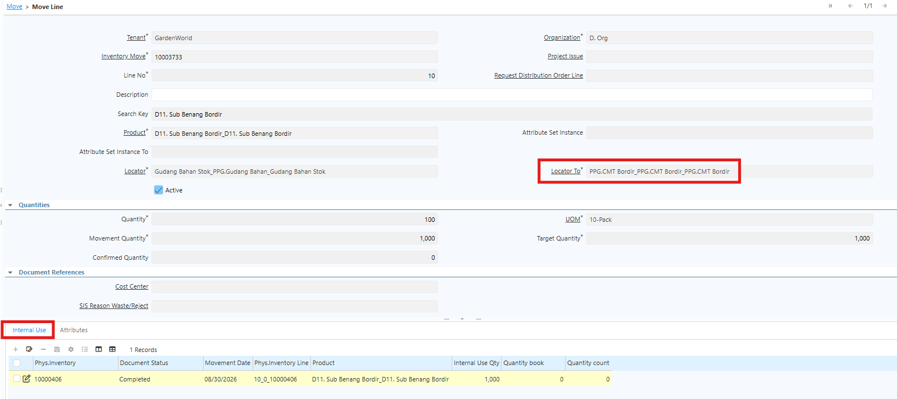 {#Figure277}

Konfigurasi auto Internal Use dilakukan di **master Locator Warehouse Subcon**. Jika konfigurasi ini tidak dilakukan, sistem tidak akan membentuk Internal Use secara otomatis saat produk dipindahkan ke gudang subcon.

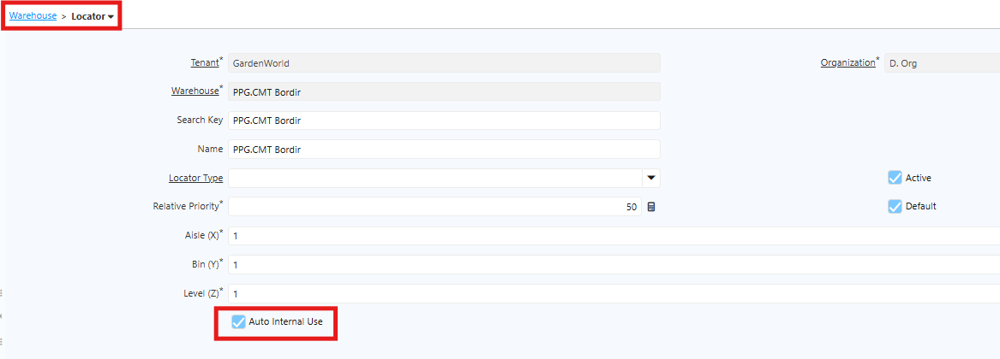 {#Figure278}

Pada **Production Order Planning (POP)** yang menggunakan subcon, hasil produksi subcon diterima melalui **BPB/MR**. Penerimaan dapat dilakukan secara _parsial_. Saat MR di-complete, sistem otomatis menjalankan proses **Cost Adjustment** atas product subcon tersebut.

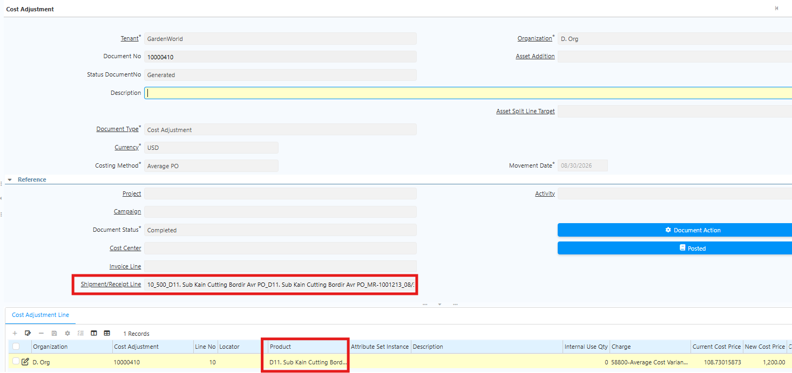 {#Figure279}

### Konfigurasi Cost Adjustment CMT

Konfigurasi Cost Adjustment dilakukan di **Document Type Purchase Order** pada field **Document Type Adjustment SC** — user menentukan document type untuk Cost Adjustment yang akan ter-create saat MR di-complete.

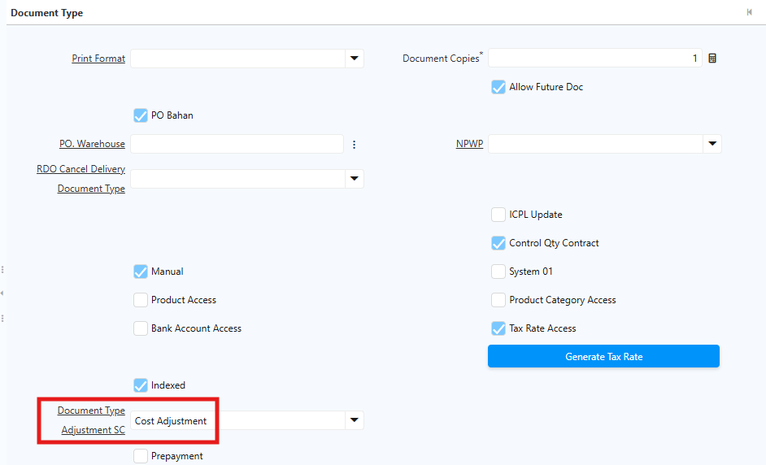 {#Figure350}

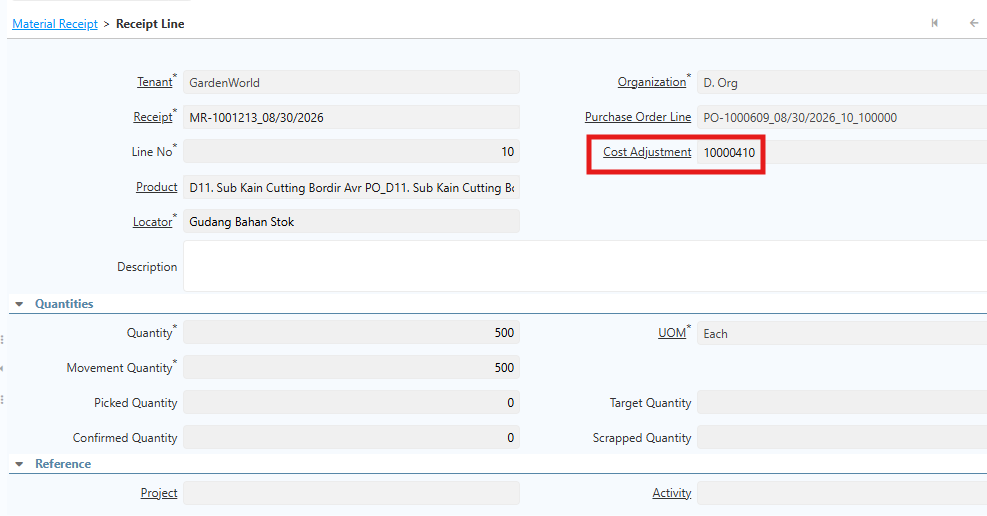 {#Figure351}

Selain itu, lakukan konfigurasi **Scheduler** sebelum memulai transaksi. Sistem membuat Cost Adjustment secara otomatis sesuai jadwal Scheduler. Ikuti langkah berikut untuk mengkonfigurasi Scheduler:

1. Buka menu **Scheduler**.
2. Pada field **Name**, input **SIS Auto Create Adjustment MR SC**.
3. Pada field **Process**, pilih **SIS Auto Create Adjustment MR SC**.
4. Pada field **Schedule**, tentukan jadwal eksekusi (menit, jam, atau hari).
5. Pada field **Supervisor**, pilih user yang bertanggung jawab.
6. Pada field **Days to Keep Log**, tentukan berapa lama log hasil eksekusi akan disimpan oleh sistem.
7. Klik **Save**.
8. Klik **Not Schedule**.
9. Klik **OK**.

Setelah Scheduler berjalan dan Material Receipt/BPB di-complete, sistem otomatis membuat **Cost Adjustment** sesuai jadwal Scheduler. Nomor dokumen Cost Adjustment juga akan muncul di **Receipt Line** sebagai referensi.

## Keterkaitan dengan POP Induk

Pada proses **Production Order Planning (POP)** yang melibatkan Subcon, sistem akan membuat POP turunan saat Purchase Order atas hasil Subcon diproses. POP turunan ini digunakan untuk memproduksi product _semi-finished goods_ secara internal tanpa melibatkan pihak ketiga.

Untuk menghubungkan POP turunan dengan POP induk, sistem menyediakan field **POP Parent** pada header Production Order Planning.

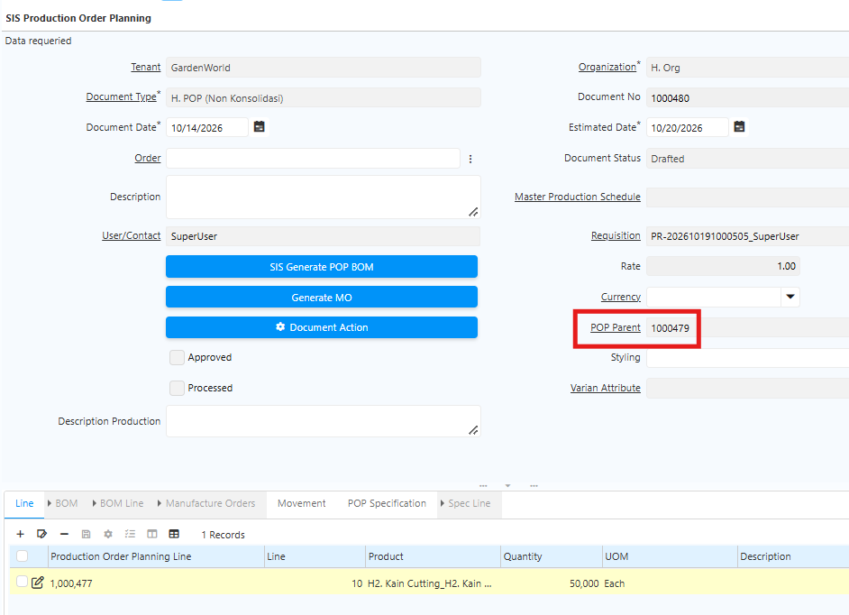 {#Figure356}

Field **POP Parent** menunjukkan dokumen POP induk yang terkait dengan POP turunan, sehingga user dapat mengetahui keterkaitan antara proses produksi induk dan turunannya. Sistem mengisi field **POP Parent** secara otomatis, sehingga user tidak perlu menginputnya secara manual.

Selain itu, dokumen **POP Parent** memuat informasi **listing POP Child (turunan)** atas subcon untuk produksi barang jadi tersebut. Satu POP Parent dapat memiliki lebih dari satu POP Child, karena dalam satu kali produksi terdapat beberapa line atau produk dengan kebutuhan subcon yang berbeda-beda. Dengan listing ini, user dapat mengetahui POP turunan subcon mana saja yang ter-create.

Berikut contoh POP Parent dengan dua POP Child (turunan):

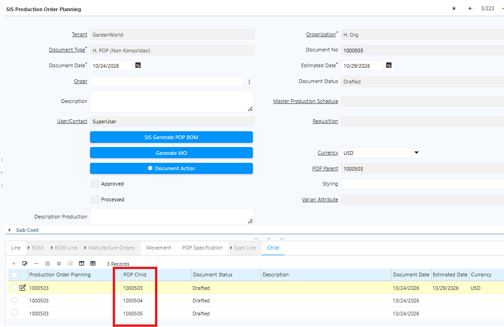 {#Figure372}