# Production Order Planning

Production Order Planning (POP) adalah dasar perencanaan produksi yang digunakan untuk menentukan produk yang akan diproduksi.

Dalam satu POP, user dapat memproduksi beberapa produk atau beberapa line sekaligus. POP mengacu pada master data produk dan routing. Maka dari itu, routing harus dikonfigurasi terlebih dahulu sebelum membuat POP.
## Fungsi Production Order Planning

Dalam satu POP line, sistem dapat menghasilkan beberapa Manufacturing Order tergantung jumlah dan jenis produk.

POP juga berfungsi untuk:
- Menghitung kebutuhan bahan baku
- Menyiapkan inventory movement
- Menjadi dasar penarikan material dari gudang ke area produksi
## Langkah Production Order Planning di Sistem

1. Buka menu **SIS Production Order Planning**
2. Masuk ke Tab **Line**
3. Input:
  - Produk yang akan diproduksi
  - Quantity produksi
  - BoM yang digunakan
4. Jalankan proses **SIS Generate POP BoM**. Sistem akan menampilkan struktur BoM produk tersebut.

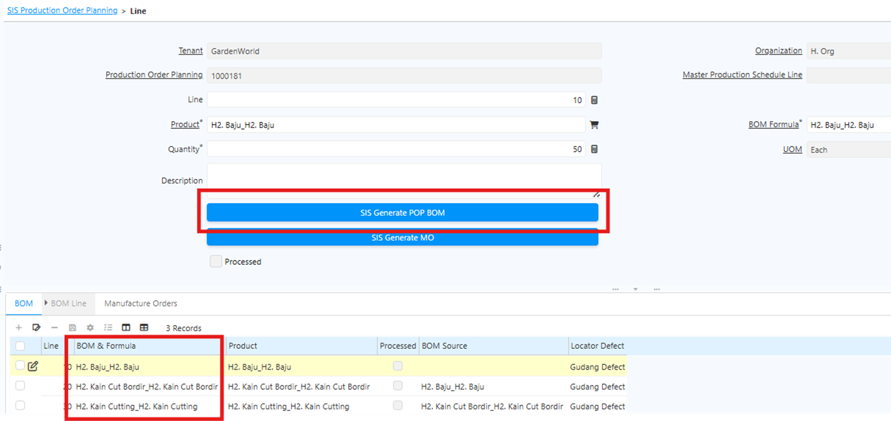 {#Figure17}

	
5. Klik **SIS Generate MO**. Sistem akan membuat Manufacturing Order secara otomatis.

	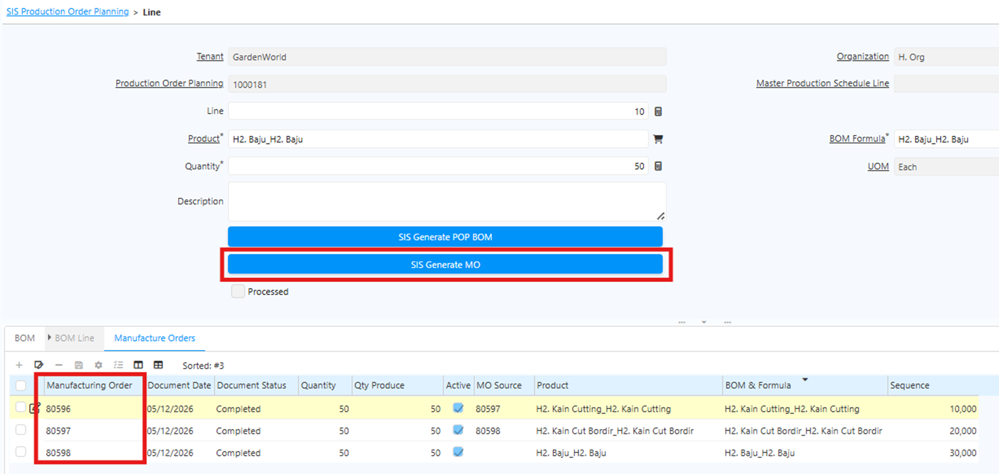 {#Figure18}

6. Masuk ke menu **Manufacturing Order**. Setelah proses Generate MO selesai, sistem otomatis membuat dokumen berikut:
  - Back Order
  - Movement
  - Requisition
  - Production
  - Child
  - Production Report Quantity

Dokumen **Requisition** hanya muncul jika stok material tidak mencukupi.

	
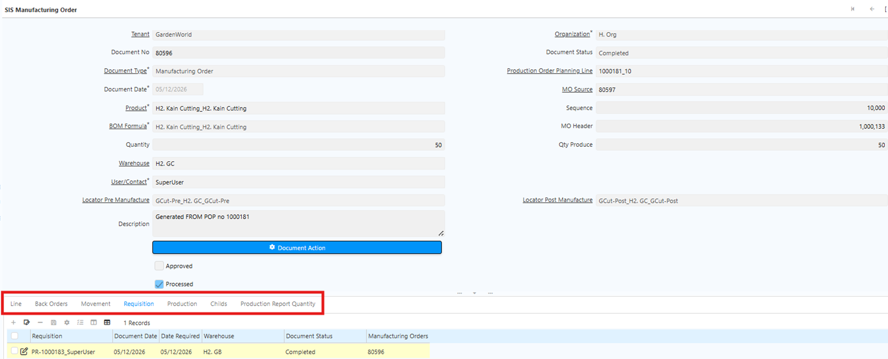 {#Figure19}

7. Lakukan proses requisition untuk komponen raw material yang dibutuhkan. Alur proses:
  - Requisition Complete
  - Purchase Order Complete
  - Material Receipt
8. Klik Tab **Movement** dan lakukan movement sesuai urutan proses
9. Setelah movement selesai dan stok tersedia, jalankan proses produksi pada tab **Production Report Quantity**:
  - Isi quantity produksi
  - Jika terdapat produk defect, isi quantity defect
  - Centang field **Defect** untuk produk defect

Produk defect akan diproses movement manual ke locator sesuai konfigurasi pada BoM.

	
!(80%)[Production](../Prod_Report_Reg.png "Production Report Quantity") {#Figure20}
	

10. Setelah quantity ditentukan, lakukan **Complete Document MO**. Sistem akan menjalankan proses production secara otomatis di belakang layar dan mengkonsumsi **Raw Material** dan **Semi Finished Goods**

	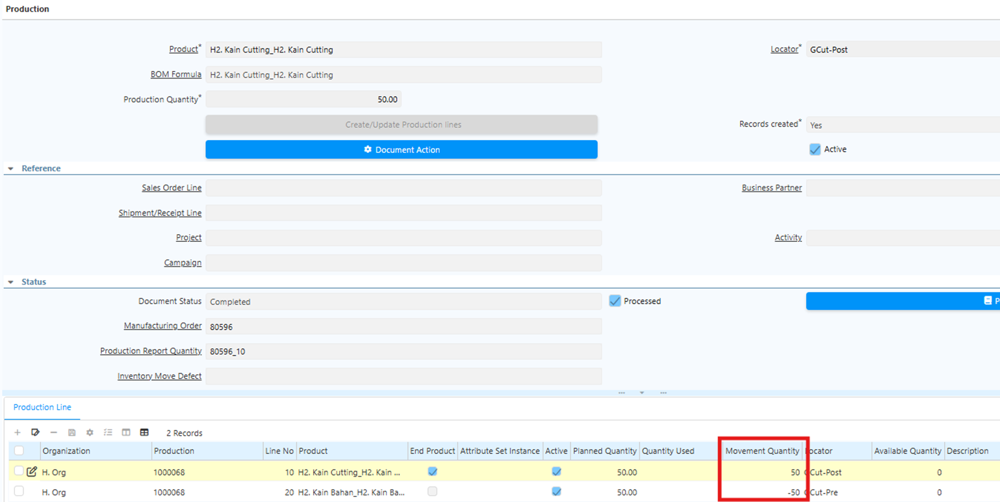 {#Figure21}

11. Setelah produk finished goods selesai diproduksi, klik **Complete** pada dokumen POP.

>**Catatan:** Dokumen POP hanya dapat di-complete jika seluruh dokumen **Requisition**, **Purchase Order**, dan **Manufacturing Order** sudah berstatus _Complete_. Jika masih terdapat dokumen yang outstanding atau belum diproses, sistem akan menampilkan pesan error dan dokumen POP tidak dapat di-complete.

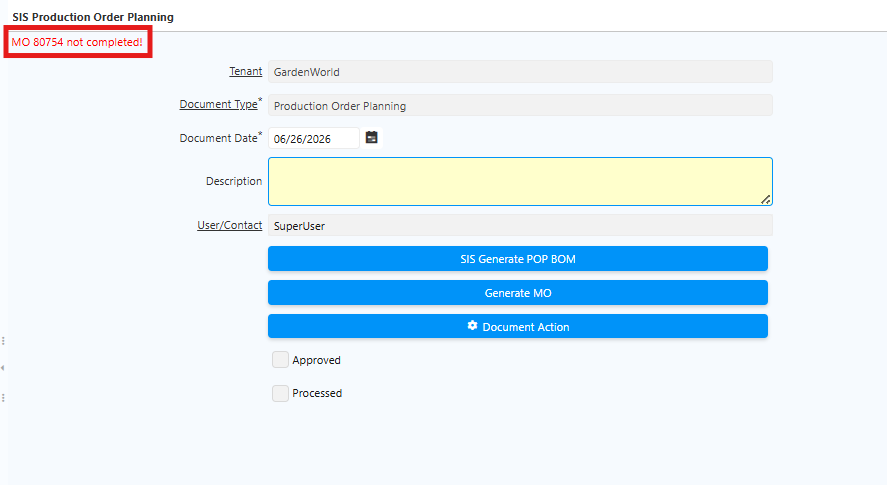 {#Figure126}

Dokumen **Manufacturing Order (MO)**, **Movement**, dan **Requisition** sudah memuat informasi POP yang bersangkutan. Selain itu, user dapat melakukan pencarian Movement berdasarkan nomor POP melalui fitur **Search**, sehingga tim gudang dapat memfilter POP mana yang sudah atau belum diproses dengan mudah.

Berikut contoh tampilan dokumen MO dan Movement yang sudah memuat informasi **POP** dan **POP Line** terkait:

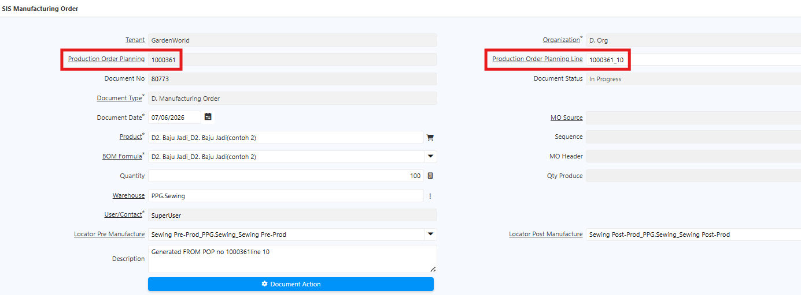 {#Figure125}

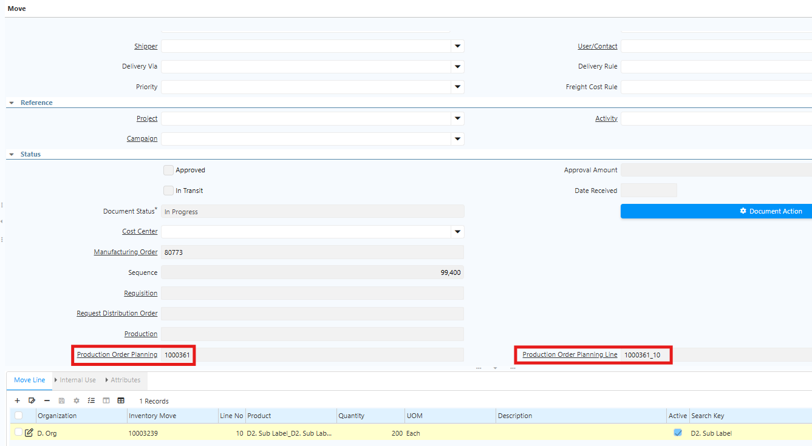 {#Figure126}

Di header Production Order Planning, terdapat tombol **SIS Generate POP BoM** dan **Generate MO**. Kedua tombol ini memungkinkan user men-generate BoM dan MO untuk seluruh line dalam satu POP sekaligus, tanpa perlu melakukan generate satu per satu.
### SIS Generate POP BoM

Ikuti langkah berikut untuk men-generate BoM pada seluruh line POP:

1. Buka menu **Production Order Planning**.
2. Pilih dokumen yang akan diproses.
3. Masuk ke header **Production Order Planning**.
4. Klik tombol **SIS Generate POP BoM**.

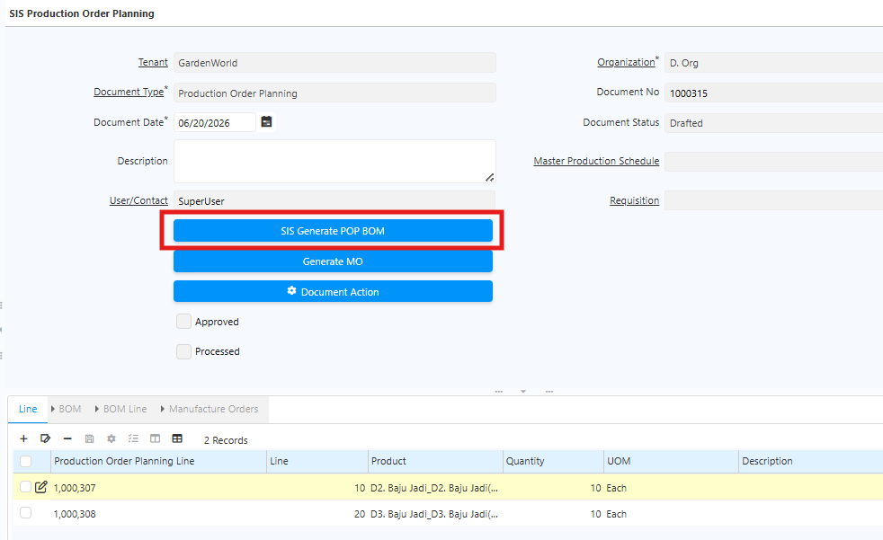 {#Figure115}

5. Klik **ok**.

Sistem otomatis men-generate BoM pada seluruh line POP tersebut.
### Generate MO

Ikuti langkah berikut untuk men-generate Manufacturing Order (MO) pada seluruh line POP:

1. Buka menu **Production Order Planning**.
2. Pilih dokumen yang akan diproses.
3. Masuk ke header **Production Order Planning**.
4. Klik tombol **Generate MO**.

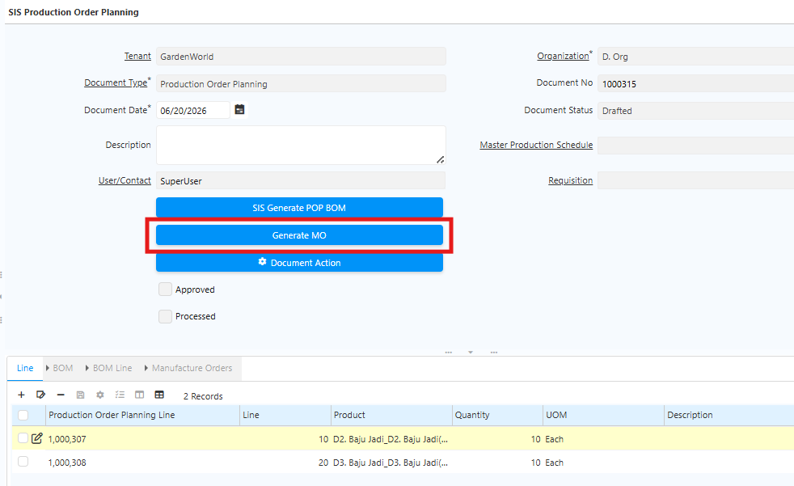 {#Figure116}

5. Klik **OK**.

Sistem otomatis men-generate MO pada seluruh line POP tersebut.
## Generate Listing Document POP

Fitur **Generate Listing Document POP** digunakan untuk mengekspor seluruh dokumen POP — mulai dari Requisition, Purchase Order, Material Receipt, hingga jurnal Rate Variance — dalam format **Excel**. Dokumen yang dihasilkan memuat informasi quantity dan status dokumen di setiap tahapan produksi.

Ikuti langkah berikut untuk mengekspor dokumen POP:

1. Buka menu **SIS Production Order Planning**.
2. Pilih dokumen yang akan diproses.
3. Klik ikon **Setting (⚙)**.
4. Klik **Generate Listing Document POP**.
5. Pilih document yang akan diproses berdasarkan document status.

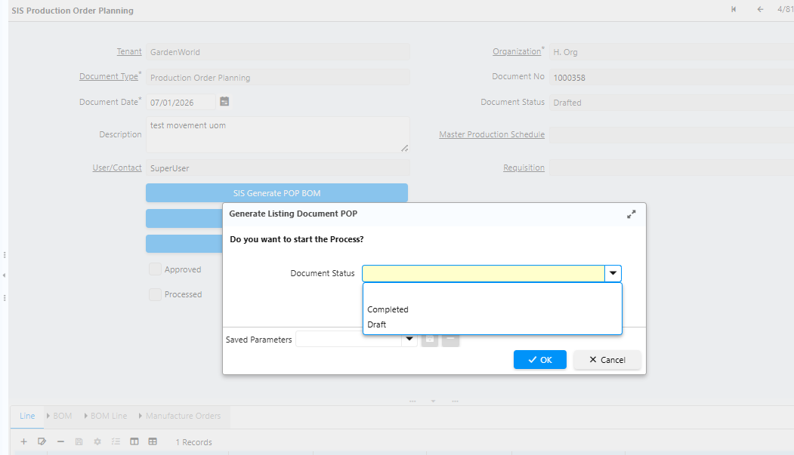 {#Figure117}

5. Klik **OK**
6. Sistem menampilkan dokumen dalam format **Excel**.

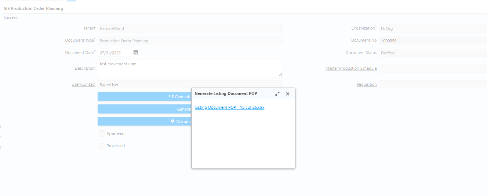 {#Figure118}

7. Klik dokumen tersebut, kemudian klik **Download**.

Dokumen yang dihasilkan terfilter berdasarkan **Document Status** yang dikonfigurasi. Contoh: jika filter Document Status diset _Complete_, maka hasil generate hanya menampilkan dokumen berstatus _Complete_. Ketentuan yang sama berlaku untuk status lainnya seperti _Draft_, _In Progress_, dan _Invalid_.

Jika field Document Status dikosongkan, sistem menampilkan seluruh dokumen tanpa filter, mencakup informasi quantity dan komponen artikel yang digunakan dalam proses produksi beserta jurnal transaksi terkait, meliputi:

- Purchase Order (PO)
- Material Receipt (MR)
- Invoice
- Matched Invoice
- Material Movement
- Production
## Mekanisme Production

Di iDempiere, terdapat dua mekanisme produksi yang dikonfigurasi di level **Document Type Manufacturing Order**:

- **Pendekatan Lama** — User menentukan quantity production reports di level MO dengan mengklik **SIS Generate Production From MO**. Sistem otomatis membentuk dokumen Production berstatus _Complete_ dan MO ikut ter-complete. Jika produksi dilakukan secara parsial, sistem otomatis membuat **back order MO** atas sisa quantity yang belum diproduksi.
- **Pendekatan Baru** — Hanya terdapat satu MO, namun user dapat mengatur production reports berkali-kali sebelum MO di-complete. User menginput quantity produk yang diproses di tab **Production Report Qty** — baik sekaligus maupun secara parsial — kemudian baru mengcomplete dokumen MO. Di pendekatan ini tidak ada auto back order untuk produksi parsial; user harus menentukan quantity production terlebih dahulu sebelum meng-complete MO.

Ikuti langkah berikut untuk mengkonfigurasi mekanisme production:

1. Buka menu **Document Type**.
2. Cari dokumen **Manufacturing Order**.
3. Pada field **Auto Back Order**, lakukan konfigurasi:
- **Y** — Menggunakan mekanisme production versi lama.
- **N** — Menggunakan mekanisme production versi baru.

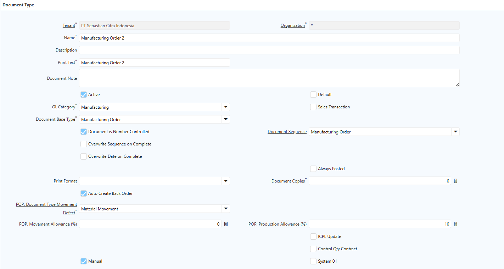{#Figure151}

4. Klik **Save**.

Berikut contoh tampilan window dan proses Manufacturing Order untuk versi lama dan versi baru:

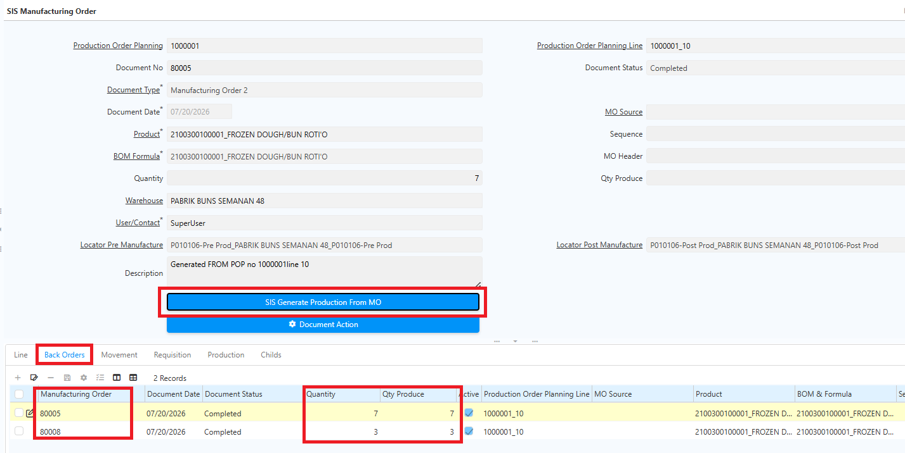 {#Figure152}

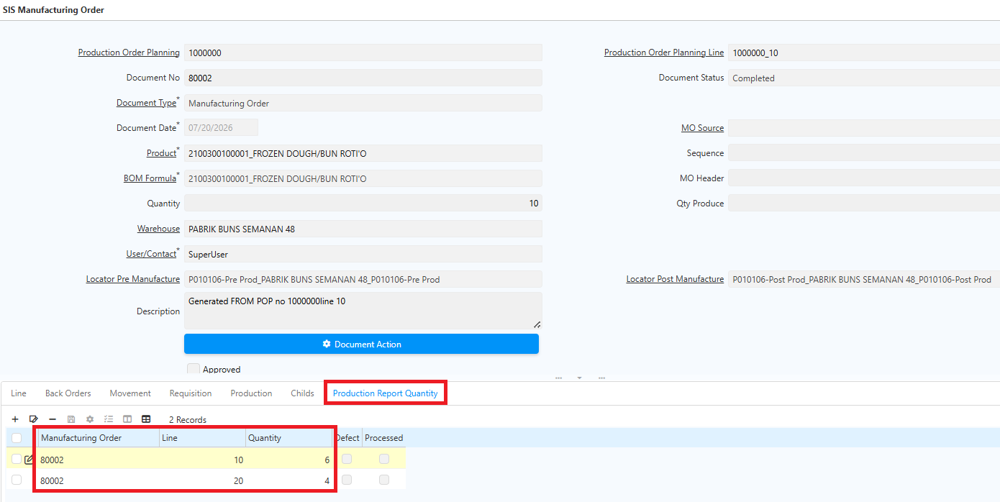 {#Figure153}

## Lead Time

**Lead Time Produksi** adalah estimasi waktu yang dibutuhkan untuk menyelesaikan proses produksi suatu produk — sejak produksi dimulai hingga produk selesai.
### Konfigurasi Lead Time

Konfigurasi Lead Time dilakukan pada **Bill of Material (BoM)** produk melalui field **Lead Time (Days)** — berisi jumlah hari yang dibutuhkan untuk memproduksi produk tersebut. Nilai Lead Time harus lebih besar dari 0 dan tidak boleh diisi dengan 0. Konfigurasi ini wajib dilakukan karena Lead Time berkaitan langsung dengan proses produksi artikel. Jika Lead Time tidak dikonfigurasi, proses produksi tidak dapat dijalankan.

Contoh konfigurasi:

| Produk            | Lead Time (Days) |
| ----------------- | ---------------- |
| Frozen Dough Buns | 1 Hari           |
"Contoh Konfigurasi Lead Time"{#Tabel10}

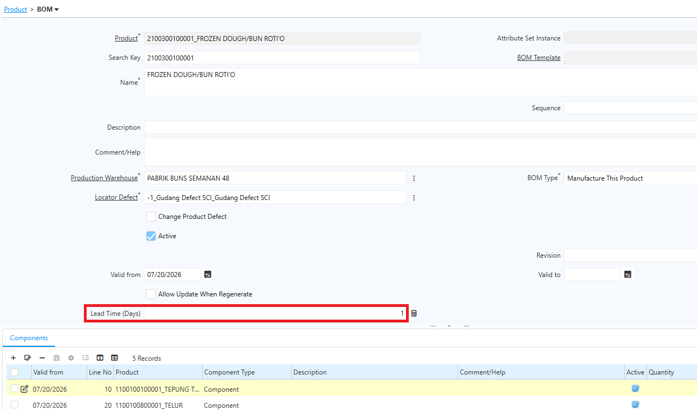 {#Figure156}
### Implementasi Lead Time

Di iDempiere, **Estimated Date** (tanggal output produksi) ditentukan oleh user. Konfigurasi Lead Time pada BoM berfungsi untuk menentukan **Document Date** MO dan Movement, dengan rumus berikut:

> **Document Date = Estimated Date − Lead Time (Days)**

Contoh:

|Estimated Date|Lead Time|Document Date|
|---|---|---|
|21 Juli 2026|1 Hari|20 Juli 2026
"Contoh Implementasi Lead Time"{#Tabel11}
## Production Time

Saat membuat Production Order Planning, user harus menentukan tiga informasi waktu berikut:

- **Estimated Date** — Tanggal estimasi produk selesai diproduksi.
- **Lead Time** — Waktu yang diperlukan (dalam hari) untuk memproduksi suatu artikel.
- **Finished Time** — Tanggal aktual perusahaan menyelesaikan produksi.

Konfigurasi Finished Time diperlukan karena produksi artikel dalam jumlah besar dapat membutuhkan waktu lebih dari satu bulan, sehingga perlu dicatat secara terpisah dari estimasi.

### Mekanisme Finished Time

Finished Time bersifat **read-only** — user tidak dapat menginput atau mengedit nilai ini secara manual. Sistem mengisi Finished Time secara otomatis berdasarkan ketentuan berikut:

- Saat POP dibuat dan MO (_Manufacturing Order_) ter-generate, sistem membuat field Finished Time di menu **Manufacturing Order** dalam kondisi kosong.
- Saat dokumen MO di-complete — baik untuk _semi finished goods_ maupun _finished goods_ — sistem otomatis mengisi **Finished Time** sesuai tanggal dokumen MO di-complete.
- Jika dokumen MO belum di-complete, field Finished Time tetap kosong.

Berikut contoh implementasi Finished Time saat MO baru di-generate dan saat MO sudah di-complete:

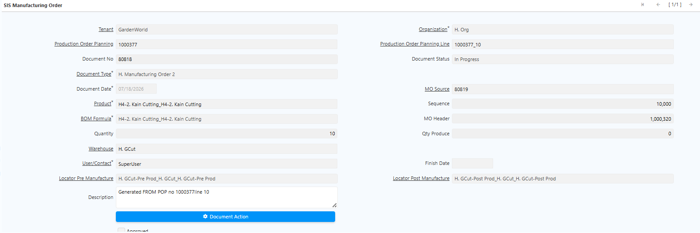 {#Figure181}

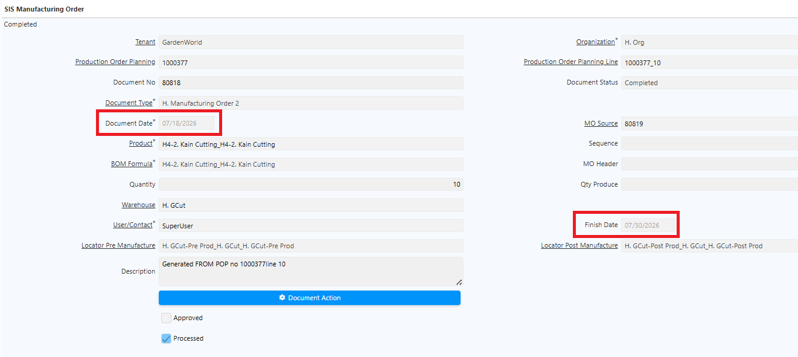 {#Figure183}

## ASI untuk Production

Saat melakukan production, user dapat menentukan apakah produksi menggunakan **batch/lot** — yang di iDempiere dikenal sebagai **ASI (Attribute Set Instance)**. Jika produksi dilakukan per batch, lakukan konfigurasi **Attribute Set** pada artikel _semi finished goods_ (end product). Jika tidak menggunakan ASI, konfigurasi ini tidak diperlukan.

Ikuti langkah berikut untuk mengkonfigurasi Attribute Set di product:

1. Buka menu **Product**.
2. Input **Search Key** dan **Name** product.
3. Tentukan **Product Category**.
4. Tentukan **UoM**.
5. Tentukan **Product Type**.
6. Centang field **Bill of Material**.
7. Centang field **Purchased**.
8. Centang field **Stocked**.
9. Pada field **Attribute Set**, pilih Attribute Set yang sudah dikonfigurasi.

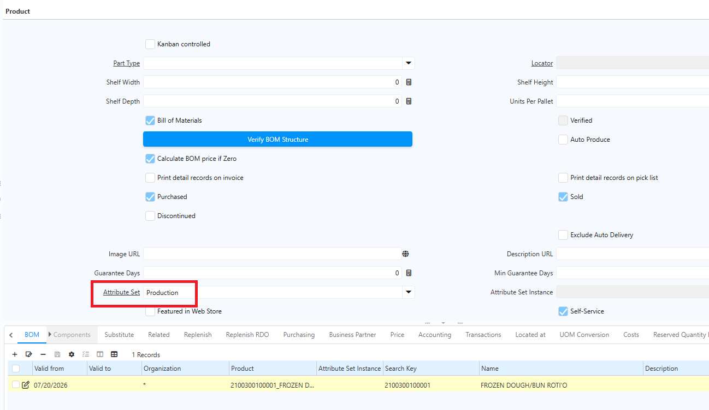 {#Figure206}
 
10. Masuk ke tab **BoM**.
11. Tentukan **Production Warehouse**.
12. Tentukan **Locator Defect**.
13. Tentukan **BoM Type**.
14. Tentukan **Lead Time**.
15. Masuk ke tab **Component**.
16. Input produk-produk yang menjadi komponen pada artikel tersebut.
17. Klik **Save**.
### Mekanisme Production

Produksi dapat dilakukan per batch (dengan ASI) maupun tanpa batch (non ASI). Berikut dua mekanisme yang tersedia:

#### Production dengan ASI

1. Buka menu **Production Order Planning**.
2. Tentukan **Document Date**.
3. Tentukan **Estimated Date**.
4. Masuk ke tab **Line**.
5. Tentukan **artikel** yang akan diproduksi.
6. Tentukan **quantity** yang akan diproduksi.
7. Tentukan **BoM Formula**.
8. Klik **SIS Generate POP BoM**.
9. Klik **SIS Generate MO**.
10. Proses **Manufacturing Order** hingga Movement.
11. Klik **Complete** pada dokumen Manufacturing Order.

Setelah Manufacturing Order di-complete, sistem otomatis membuat dokumen **Production** atas artikel tersebut dengan status _Complete_ dan _Posted_. Dokumen Production yang terbentuk memuat informasi **Attribute Set Instance (ASI)**, yang menandakan bahwa produksi dilakukan berdasarkan batch/lot.

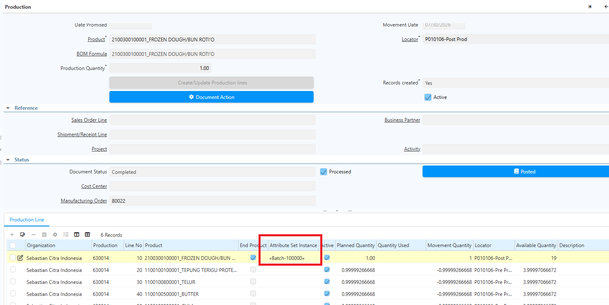 {#Figure207}

#### Production Non ASI

1. Buka menu **Production Order Planning**.
2. Tentukan **Document Date**.
3. Tentukan **Estimated Date**.
4. Masuk ke tab **Line**.
5. Tentukan **artikel** yang akan diproduksi.
6. Tentukan **quantity** yang akan diproduksi.
7. Tentukan **BoM Formula**.
8. Klik **SIS Generate POP BoM**.
9. Klik **SIS Generate MO**.
10. Proses **Manufacturing Order** hingga Movement.
11. Klik **Complete** pada dokumen Manufacturing Order.

Setelah Manufacturing Order di-complete, sistem otomatis membuat dokumen **Production** atas artikel tersebut dengan status _Complete_ dan _Posted_. Produksi dilakukan tanpa pengelompokan berdasarkan batch/lot.

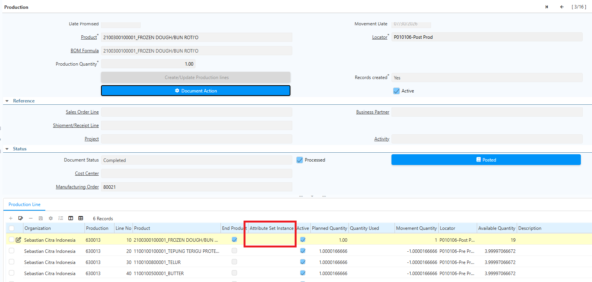 {#Figure208}

## Informasi Kurs di Production Order Planning

Di Production Order Planning, terdapat field **Rate (Kurs)** yang digunakan jika transaksi menggunakan mata uang asing. Sistem menggunakan **Currency Rate** dengan Currency Type sesuai default yang telah dikonfigurasi.

Berikut ketentuan pengisian rate secara otomatis:

- **Jika tanggal transaksi berada dalam rentang Valid From dan Valid To** pada Currency Rate — sistem otomatis mengisi field Rate sesuai Currency Rate yang berlaku.
- **Jika tidak ada Currency Rate yang berlaku** pada tanggal transaksi — sistem otomatis mengisi Rate dengan nilai **1**.

## Validasi POP

Setelah seluruh proses produksi diselesaikan, user dapat meng-complete dokumen **POP**. Terdapat dua mekanisme complete POP yang dapat dikonfigurasi di sistem melalui parameter **SIS_DISABLE_CHECK_INVENTORY_MOVE_WHILE_COMPLETE_POP**:

**Jika SIS_DISABLE_CHECK_INVENTORY_MOVE_WHILE_COMPLETE_POP = Y**

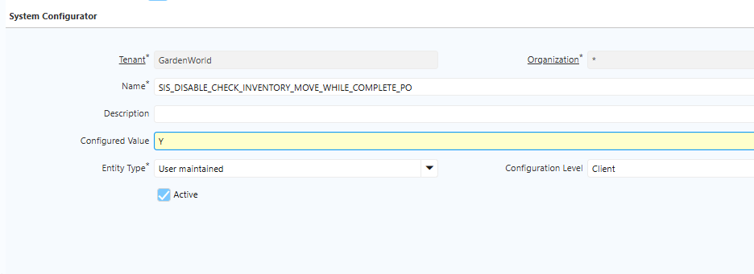 {#Figure367}

POP dapat di-complete meskipun masih terdapat Inventory Move _outstanding_ yang belum di-complete. Namun, Inventory Move yang tidak diproses tersebut harus di-_void_ terlebih dahulu sebelum POP dapat di-complete.

**Jika SIS_DISABLE_CHECK_INVENTORY_MOVE_WHILE_COMPLETE_POP = N**

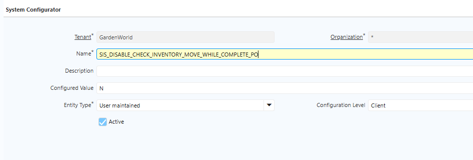 {#Figure368}

POP hanya dapat di-complete jika **seluruh** Inventory Move yang ter-create dari Generate MO sudah berstatus _Complete_ — termasuk perpindahan produk jadi ke gudang induk atau hingga routing berakhir.

Sesuaikan konfigurasi ini dengan kebutuhan operasional perusahaan sebelum memproses POP.

## Penentuan Tanggal Produksi

Dokumen Production akan terbentuk secara otomatis ketika Manufacturing Order (MO) diproses hingga Complete. Pembuatan Production dapat dilakukan melalui dua mekanisme, yaitu dengan mengisi Qty pada tab **Production Report Quantity** atau melalui button **SIS Generate Production From MO**.

Jika Production dibuat melalui tab Production Report Quantity, tanggal produksi akan mengikuti tanggal ketika Manufacturing Order di-Complete. Sementara itu, jika Production dibuat melalui button SIS Generate Production From MO, user dapat menentukan tanggal produksi secara manual sehingga tanggal Production dapat berbeda dengan tanggal Manufacturing Order.

Berikut langkah-langkah untuk menentukan tanggal produksi melalui button SIS Generate Production From MO:

1. Buka menu **Manufacturing Order**.
2. Pilih dokumen Manufacturing Order yang akan diproses. Pastikan transaksi pendukung, mulai dari Requisition hingga Inventory Move, telah selesai diproses.
3. Klik button **SIS Generate Production From MO**.
4. Tentukan **Qty Produce** sesuai jumlah produk yang akan dihasilkan.
5. Tentukan **Total Batch** sesuai jumlah batch produksi.
6. Tentukan **Production Date** sesuai tanggal produksi yang diinginkan.

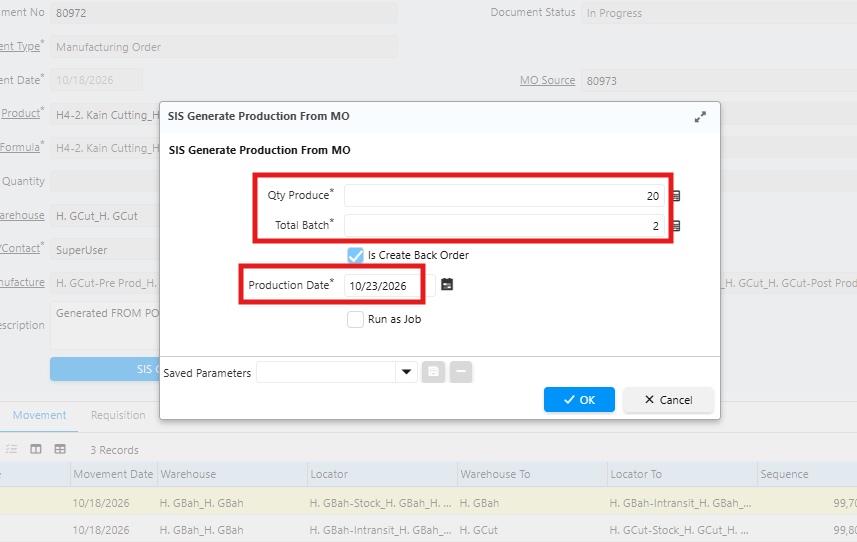 {#Figure371}

7. Klik **OK**.

Sistem akan membuat dokumen Production secara otomatis berdasarkan Qty Produce dan Total Batch yang telah ditentukan. Tanggal Production akan mengikuti tanggal yang diinput pada field Production Date.

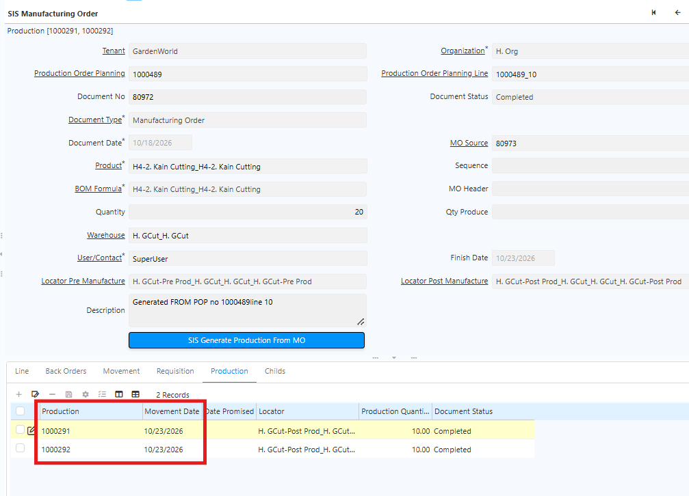 {#Figure372}

## Nilai Hasil Produksi

Dalam proses produksi, Qty hasil produksi dapat berupa bilangan bulat atau desimal. Nilai tersebut dipengaruhi oleh kebutuhan Qty komponen yang ditentukan pada Bill of Material (BoM) masing-masing produk WIP.

Namun, untuk produk jadi yang menggunakan satuan Pcs, Qty hasil produksi umumnya harus berupa bilangan bulat dan tidak diperbolehkan menggunakan desimal. Oleh karena itu, sistem menyediakan konfigurasi pembulatan Qty hasil produksi pada masing-masing produk yang memiliki BoM, baik produk WIP maupun produk jadi.

### Konfigurasi Nilai Hasil Produksi pada Product

Berikut langkah-langkah untuk mengatur jumlah angka desimal pada Qty hasil produksi:

1. Buka menu **Product**.
2. Tentukan produk yang akan dikonfigurasi.
3. Pada field **Decimal On Production Qty**, tentukan jumlah angka di belakang koma yang diperbolehkan untuk Qty hasil produksi. Jika Qty harus berupa bilangan bulat, isi dengan nilai **0**.

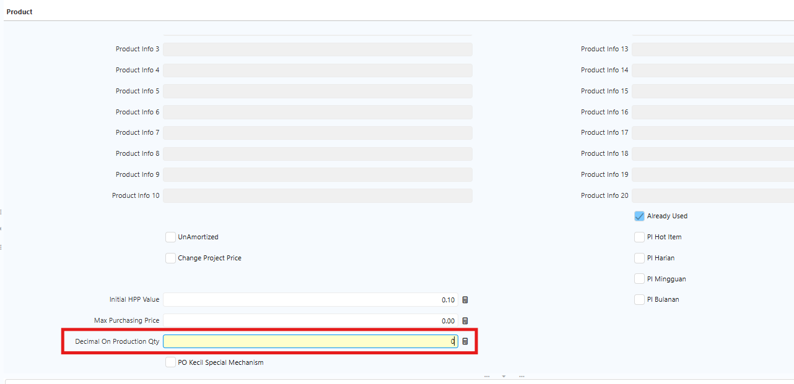 {#Figure376}

4. Klik **Save**.
### Production Order Planning dengan Konfigurasi Qty

Setelah konfigurasi pada Product selesai, lakukan proses Production Order Planning (POP) dan produksi dengan langkah berikut:

1. Buka menu **SIS Production Order Planning**.
2. Masuk ke tab **Line**.
3. Input data berikut:
    
    - **Product**: produk yang akan diproduksi.
    - **Quantity**: jumlah produk yang akan diproduksi.
    - **BoM**: Bill of Material yang digunakan.

4. Jalankan proses **SIS Generate POP BoM** untuk menampilkan struktur BoM produk.
5. Klik **Generate MO** untuk membuat Manufacturing Order.
6. Masuk ke tab **Manufacture Order**.
7. Pilih Manufacturing Order yang akan diproses.
8. Selesaikan proses Requisition dan Inventory Move sesuai kebutuhan produksi.
9. Klik **SIS Generate Production From MO**.
10. Tentukan **Qty Produce** sesuai jumlah produk yang akan dihasilkan.
11. Tentukan **Total Batch** sesuai jumlah batch produksi.
12. Tentukan **Production Date** sesuai tanggal produksi.

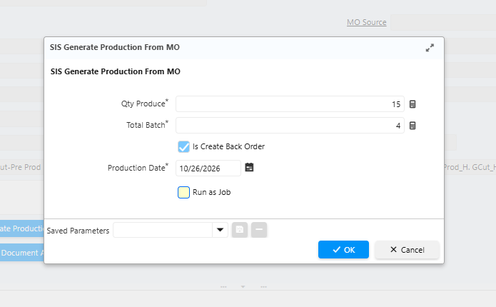 {#Figure377}

13. Klik **OK** untuk menjalankan proses.

Sistem akan membuat dokumen Production berdasarkan Qty Produce dan Total Batch yang ditentukan. Qty hasil produksi pada masing-masing batch akan dibulatkan sesuai konfigurasi **Decimal On Production Qty** pada Product.

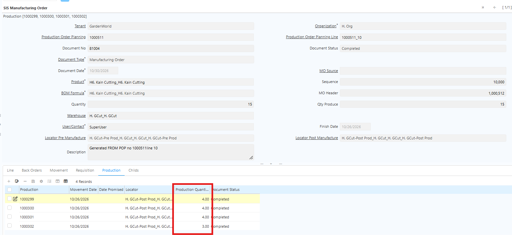 {#Figure378}

## Event Marketing

Saat membuat Production Order Planning (POP), perusahaan menentukan **Event Marketing** yang menjadi target produksi tersebut — misalnya Natal, Imlek, Lebaran, atau Liburan. Dengan demikian, setiap POP dapat dikaitkan dengan event yang dituju, dan POP untuk setiap event akan berbeda-beda.

### Konfigurasi Master Event Marketing

Sebelum membuat POP, buat master Event Marketing terlebih dahulu:

1. Buka menu **SIS Event Marketing**.
2. Tentukan **Name** dan **Search Key** event marketing.

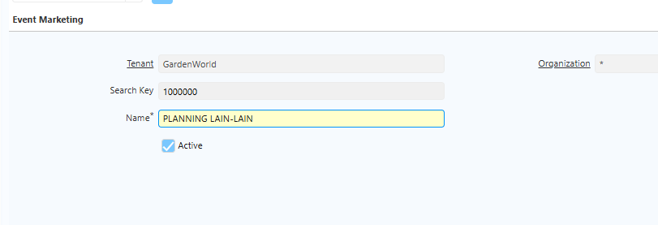 {#Figure380}

3. Klik **Save**.

### Production Order Planning dengan Event Marketing

Setelah master dibuat, hubungkan POP dengan Event Marketing melalui langkah berikut:

1. Buka menu **SIS Production Order Planning**.
2. Tentukan **Document Type**.
3. Tentukan **Document Date** dan **Estimated Date**.
4. Pada field **Event Marketing**, tentukan event yang menjadi tujuan produksi.

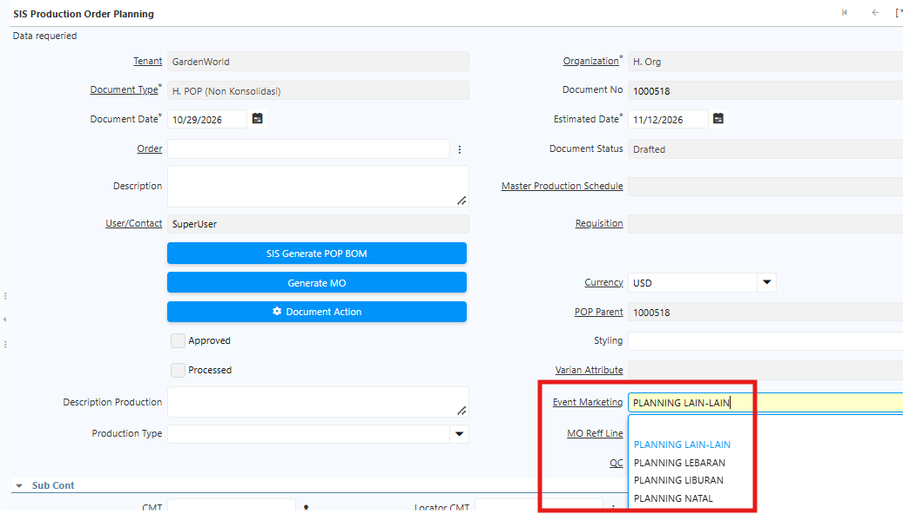 {#Figure381}

5. Tentukan **Production Type**: _Collaboration_ atau _Full_ dikerjakan oleh CMT.
6. Klik **Save**.

Dengan adanya informasi Event Marketing, proses produksi pada POP tersebut dapat diidentifikasi sebagai produksi untuk memenuhi event yang bersangkutan.

## Master QC MO

Master Quality Control (QC) bertujuan untuk menstandarkan spesifikasi ukuran produk garmen yang akan diproduksi serta menjadi acuan dalam pemeriksaan kualitas hasil produksi. Master ini membantu memastikan bahwa produk yang dihasilkan sesuai dengan standar ukuran yang telah ditetapkan untuk masing-masing produk.

Master QC terdiri dari tiga master yang saling berkaitan, yaitu **Size Specification, Size, dan QC**. Size Specification digunakan untuk mendefinisikan bagian atau parameter pengukuran produk, Size digunakan untuk mendefinisikan variasi ukuran produk, sedangkan QC menghubungkan keduanya dan menyimpan detail standar ukuran untuk setiap kombinasi spesifikasi dan ukuran.

### Master Size Specification

Master Size Specification berfungsi untuk menyimpan spesifikasi pengukuran produk garmen. Master ini mendefinisikan bagian-bagian produk yang perlu diukur dalam proses QC, seperti panjang baju, lebar dada, lebar bahu, dan lingkar pinggang.

Spesifikasi pengukuran yang telah dibuat dapat digunakan kembali pada berbagai model produk yang memiliki standar pengukuran serupa.

Berikut langkah-langkah untuk membuat Master Size Specification:

1. Buka menu **SIS Size Spec**.
2. Tentukan **Search Key** dan **Name**.

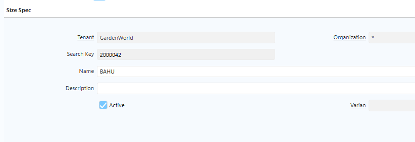 {#Figure381}

3. Klik **Save**.

### Master Size

Master Size berfungsi untuk mendefinisikan variasi ukuran produk yang digunakan dalam proses produksi, misalnya XS, S, M, L, XL, atau ukuran numerik sesuai standar perusahaan.

Master ini menjadi acuan dalam menentukan variasi ukuran produk pada Production Order Planning. Dengan memisahkan master Size dari spesifikasi pengukuran, ukuran yang sama dapat digunakan kembali pada berbagai model atau jenis produk.

Berikut langkah-langkah untuk membuat Master Size:

1. Buka menu **SIS Size**.
2. Tentukan **Search Key** dan **Name**.

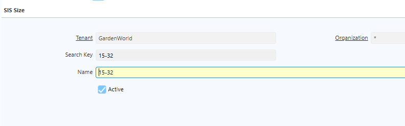 {#Figure382}

3. Klik **Save**.

### Master QC

Master QC berfungsi untuk menghubungkan Master Size Specification dengan Master Size serta menyimpan standar nilai ukuran untuk setiap kombinasi spesifikasi dan ukuran. Data ini menjadi acuan bagi tim produksi dan QC dalam memeriksa kesesuaian hasil produksi terhadap standar ukuran yang telah ditentukan.

Berikut langkah-langkah untuk membuat Master QC:

1. Buka menu **SIS QC**.
2. Tentukan **Search Key** dan **Name**.

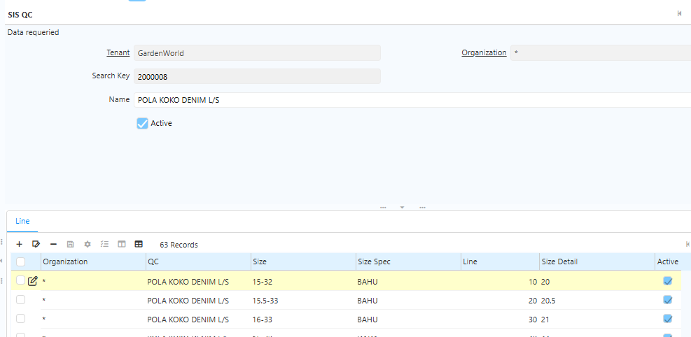 {#Figure383}

3. Klik **Save** untuk menyimpan data.
4. Masuk ke tab **Line**.
5. Tentukan **Size Spec** sesuai spesifikasi pengukuran yang digunakan.
6. Tentukan **Size** sesuai variasi ukuran produk.
7. Input **Size Detail** sesuai standar nilai ukuran untuk kombinasi Size Spec dan Size tersebut.

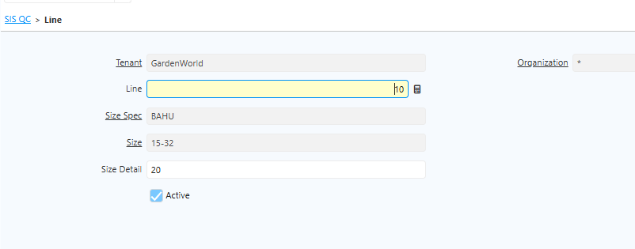 {#Figure384}

8. Klik **Save**.

### Implementasi Master QC pada Production Order Planning

Setelah Master QC dibuat, user dapat menggunakannya pada dokumen Production Order Planning (POP) dengan langkah-langkah berikut:

1. Buka menu **SIS Production Order Planning**.
2. Tentukan **Document Type**.
3. Tentukan **Document Date** dan **Estimated Date**.
4. Pada field **QC**, pilih Master QC yang akan digunakan untuk proses produksi.

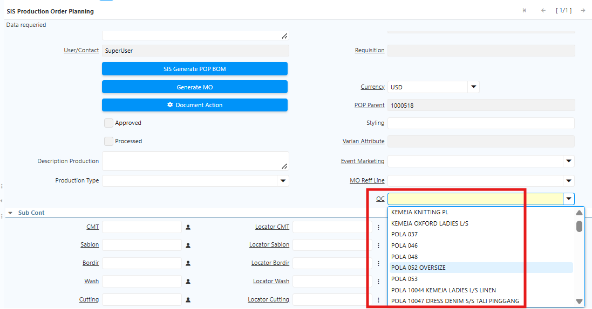 {#Figure385}

5. Klik **Save**.
6. Lanjutkan proses Production Order Planning seperti biasa, mulai dari proses generate BoM hingga Manufacturing Order dan Production.

Master QC yang dipilih pada Production Order Planning menjadi acuan spesifikasi ukuran produk yang akan diproduksi dan diperiksa kualitasnya.

## Master MO

Master MO merupakan master kode produksi yang digunakan untuk mengidentifikasi proses produksi suatu produk berdasarkan Sub Brand. Setiap Sub Brand memiliki kode produksi masing-masing sehingga proses produksi dapat dibedakan sesuai Sub Brand yang digunakan.

Kode produksi untuk setiap Sub Brand selanjutnya dibedakan berdasarkan kategori produksi, yaitu Reguler, Online, Vermak, dan PRL. Oleh karena itu, setiap Sub Brand memiliki Master MO tersendiri yang berisi kategori kode produksi sesuai kebutuhan.

### Membuat Master MO Reff

Berikut langkah-langkah untuk membuat Master MO:

1. Buka menu **SIS MO Reff**.
2. Tentukan **Document Type** yang akan digunakan untuk Master MO tersebut.
3. Tentukan **Sub Brand** yang terkait dengan kode produksi.

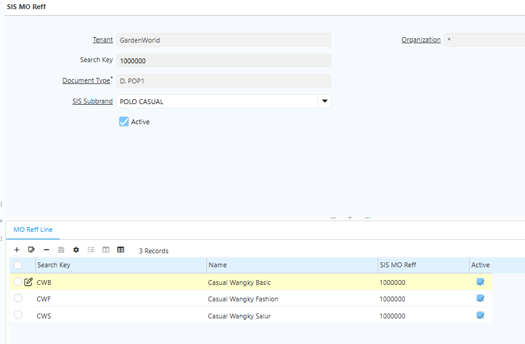 {#Figure385}

4. Masuk ke tab **MO Reff Line**.
5. Tentukan **Search Key** dan **Name** untuk masing-masing kategori kode produksi, seperti Reguler, Online, Vermak, dan PRL.

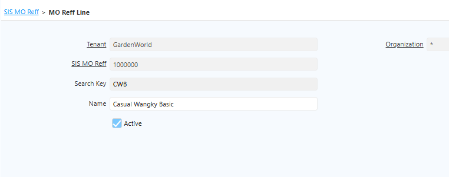 {#Figure386}

6. Klik **Save**.

### Implementasi Master MO pada Production Order Planning

Setelah Master MO dibuat, user dapat menggunakannya pada dokumen Production Order Planning (POP) dengan langkah-langkah berikut:

1. Buka menu **SIS Production Order Planning**.
2. Tentukan **Document Type**.
3. Tentukan **Document Date** dan **Estimated Date**.
4. Tentukan **Event Marketing** sesuai kebutuhan.
5. Pada field **MO Reff Line**, pilih kode produksi yang akan digunakan untuk POP tersebut.

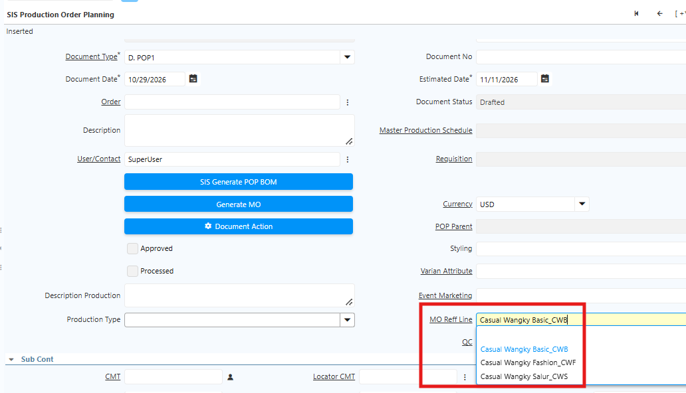 {#Figure387}

6. Klik **Save**.

>**Catatan:** Field MO Reff Line akan menampilkan pilihan kode produksi apabila Document Type pada Production Order Planning sama dengan Document Type yang dikonfigurasi pada Master MO. Selain itu, produk yang dapat diproses pada POP harus sesuai dengan Sub Brand yang telah ditentukan pada Master MO. Dengan demikian, kode produksi yang digunakan akan mengikuti Sub Brand dan kategori produksi yang dipilih.