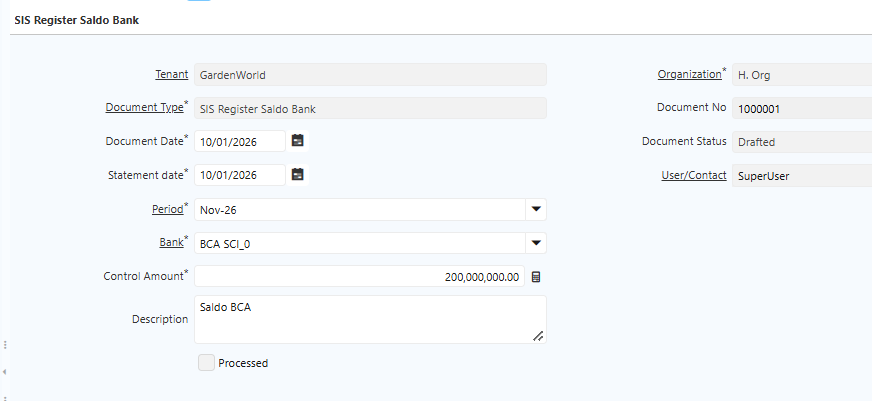
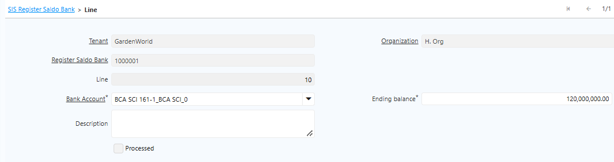

# Register Saldo Bank

Menu **Register Saldo Bank** digunakan untuk mencatat dan memelihara saldo rekening bank berdasarkan informasi saldo pada rekening koran (_bank statement_). Proses ini memastikan saldo rekening koran sesuai dengan saldo bank yang tercatat di iDempiere.

Data saldo yang telah diregistrasi menjadi dasar pengecekan dan rekonsiliasi saldo. Data tersebut digunakan pada menu **Report Cross Check Selisih Rekening Koran** untuk membandingkan saldo rekening koran dengan saldo di sistem. Hasil perbandingan membantu user mengidentifikasi perbedaan saldo sehingga dapat melakukan pemeriksaan dan tindak lanjut atas selisih yang ditemukan.

## Konfigurasi Document Type

1. Buka menu **Document Type**.
2. Klik **New**.
3. Input **Name** document type sesuai kebijakan perusahaan.
4. Pada field **GL Category**, pilih **Manual**.
5. Pada field **Document Base Type**, pilih **SIS Register Saldo Bank**.
6. Centang field **Document Is Number Controlled**.
7. Klik **Save**.

## Langkah Registrasi Saldo Bank

1. Buka menu **Register Saldo Bank**.
2. Tentukan **Document Type**.
3. Tentukan **Document Date**.
4. Tentukan **Statement Date**.
5. Tentukan **Period**.
6. Tentukan **Bank** yang akan dikonfigurasi.
7. Tentukan **Control Amount**.
8. Klik **Save**.

 {#Figure418}

9. Masuk ke tab **Line**.
10. Tentukan **Bank Account**.
11. Tentukan **Ending Balance**.

 {#Figure419}

12. Klik **Save**.
13. Klik **Complete** pada dokumen.

Setelah dokumen di-complete, saldo yang diregistrasi digunakan oleh **Report Cross Check Selisih Rekening Koran** untuk membandingkan saldo rekening koran dengan saldo di sistem iDempiere.