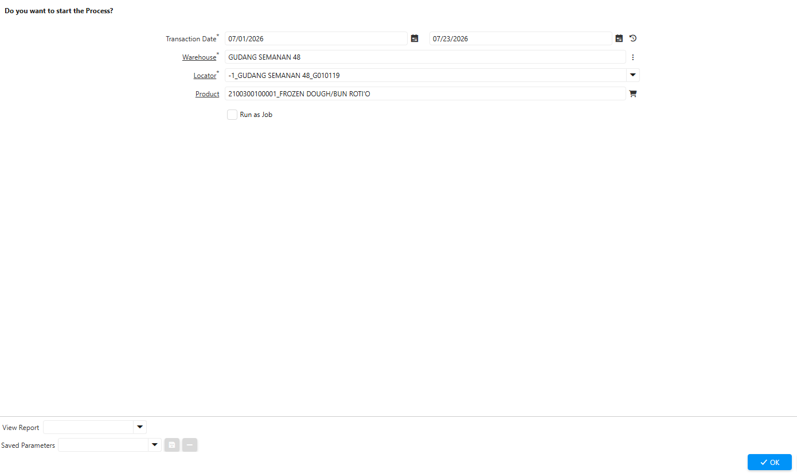
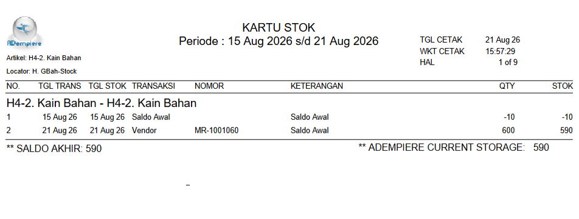
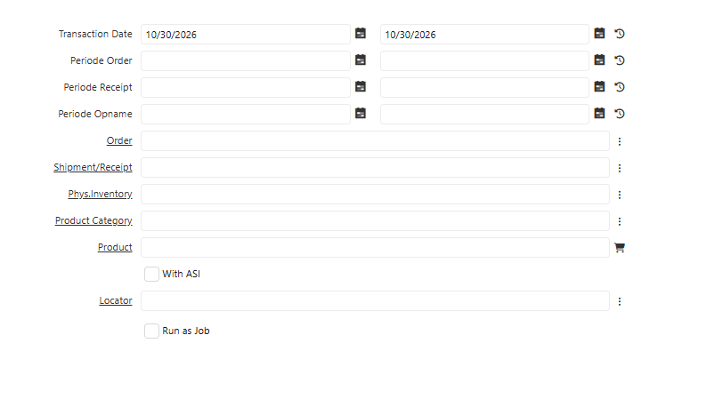
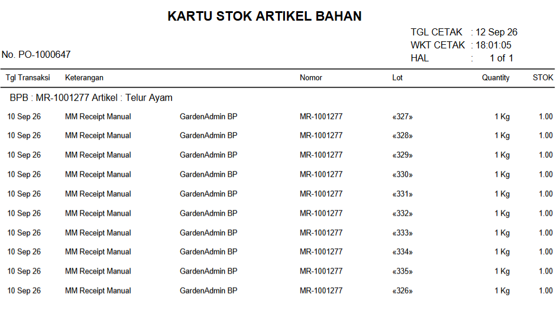

# Report Kartu Stock

Laporan Kartu Stok berfungsi untuk menyajikan riwayat seluruh transaksi yang memengaruhi persediaan suatu produk pada periode tertentu. Setiap transaksi akan memperlihatkan jumlah stok sebelum transaksi, kuantitas yang masuk atau keluar, serta saldo stok setelah transaksi diproses.

### Fungsi Laporan Kartu Stock

- Memantau pergerakan stok
- Mengetahui saldo stok setiap transaksi
- Melakukan penelusuran (traceability)
- Membantu proses rekonsiliasi stok
### Langkah Proses Report Kartu Stock FG

1. Buka menu **SIS Report Kartu Stock FG**
2. Input parameter berikut:
- Transaction date — Tanggal transaksi.
- Warehouse — Gudang penyimpanan produk.
- Locator — Lokasi penyimpanan produk.
- **Product** — Pilih produk yang akan ditampilkan pada laporan. Parameter ini dapat dikosongkan jika ingin menampilkan lebih dari satu produk.
- **Artikel Value** — Isi nilai artikel untuk memfilter produk berdasarkan kode artikel tertentu. Parameter ini dapat menggunakan karakter wildcard (%) untuk menampilkan beberapa produk dengan pola kode artikel yang sama. **Contoh:** Jika Artikel Value diisi `1011%`, sistem akan menampilkan seluruh produk dengan kode artikel yang diawali `1011`.

 {#Figure163}

3. Klik Start.

 {#Figure164}

> **Catatan:** Report Kartu Stock hanya menampilkan transaksi yang telah diproses (Completed) sehingga saldo yang ditampilkan mencerminkan kondisi persediaan yang telah tercatat secara resmi di sistem. Transaksi dengan status Drafted, In Progress, atau Voided tidak memengaruhi saldo stok pada laporan ini.

## Report Kartu Stock Bahan

Langkah Akses Report Kartu Stock Bahan:

1. Buka menu **SIS Report Kartu Stock Bahan**.
2. Tentukan **Transaction Date** apabila filter laporan menggunakan Product atau Product Category.
3. Tentukan jenis filter stock yang akan digunakan, yaitu:

- **Purchase Order** — Menampilkan informasi stock berdasarkan transaksi Purchase Order.
- **Material Receipt** — Menampilkan informasi stock berdasarkan transaksi penerimaan barang.
- **Physical Inventory** — Menampilkan informasi stock berdasarkan transaksi stock opname.
- **Product Category** — Menampilkan informasi stock berdasarkan kategori produk.
- **Product** — Menampilkan informasi stock berdasarkan produk tertentu.

 {#Figure388}

4. Jika menggunakan filter Purchase Order, Material Receipt, atau Physical Inventory, periode laporan akan mengikuti tanggal transaksi yang dipilih.
5. Jika produk menggunakan Attribute Set Instance (ASI), centang field **With ASI** untuk menampilkan informasi stock berdasarkan ASI.
6. Tentukan **Locator** jika ingin membatasi laporan berdasarkan lokasi penyimpanan tertentu (opsional).
7. Klik **ok**.

Berikut contoh report kartu stock bahan:

 {#Figure304}